# CHƯƠNG 2. PHÂN TÍCH VÀ THIẾT KẾ HỆ THỐNG

<!--
Ghi chú biên soạn (xoá khi chuyển sang Word):
- Nguồn: docs/architecture/*.md, apps/api/prisma/schema.prisma, apps/api/src/modules/*/*.controller.ts,
  packages/types/src/events/ws-events.ts tại commit cc8585f7.
- Hình nằm trong thư mục hinh/ (mã nguồn .mmd và ảnh .png).
-->

Chương này trình bày quá trình phân tích yêu cầu và thiết kế hệ thống Chatofy. Phần phân tích xác định
các tác nhân, yêu cầu chức năng và phi chức năng, biểu đồ use case và kịch bản của các chức năng chính.
Phần thiết kế mô tả kiến trúc tổng thể, luồng dữ liệu, biểu đồ tuần tự, cơ sở dữ liệu, giao diện lập
trình và các cơ chế bảo mật.

## 2.1 Phân tích yêu cầu

### 2.1.1 Mô tả bài toán

Chatofy giúp hai hoặc nhiều người không cùng ngôn ngữ trò chuyện trực tiếp với nhau. Mỗi người nói bằng
ngôn ngữ của mình và nghe hoặc đọc bản dịch sang ngôn ngữ của mình với độ trễ dưới 2 giây. Hệ thống hỗ trợ
tiếng Việt, tiếng Anh và tiếng Trung giản thể, dịch được giữa mọi cặp trong ba ngôn ngữ.

Hệ thống phục vụ ba tình huống sử dụng:

1. **Hội thoại trực tiếp** trên trang web `/translate`: hai người dùng chung một thiết bị, nói lần lượt.
2. **Họp video** trên trang `/conference`: mỗi người tham gia từ thiết bị riêng, chọn ngôn ngữ mình nói,
   và nhận phụ đề cùng giọng đọc bản dịch theo ngôn ngữ của mình.
3. **Cuộc gọi trên nền tảng khác** (Google Meet, Zoom bản web, Facebook) qua tiện ích mở rộng Chrome.

### 2.1.2 Xác định các tác nhân

**Bảng 2.1. Các tác nhân của hệ thống**

| Tác nhân                 | Mô tả                                                                                               |
| ------------------------ | --------------------------------------------------------------------------------------------------- |
| Khách                    | Người chưa đăng nhập. Xem trang giới thiệu, bảng giá, đăng ký và đăng nhập.                         |
| Người dùng               | Người đã đăng nhập. Dùng chức năng dịch, xem lịch sử, quản lý ngữ cảnh dịch và bảng thuật ngữ.      |
| Chủ phòng họp            | Người dùng tạo phòng họp. Có thêm quyền kết thúc và xoá phòng.                                      |
| Người tham gia họp       | Người dùng có đường dẫn phòng họp và đã vào phòng.                                                  |
| Chủ nhóm / Quản trị nhóm | Người dùng sở hữu hoặc quản trị một nhóm. Mời thành viên, đổi vai trò, quản lý thư viện dùng chung. |
| Thành viên nhóm          | Người dùng thuộc một nhóm. Dùng ngữ cảnh dịch và bảng thuật ngữ của nhóm trong phiên của mình.      |
| Dịch vụ AI               | Tác nhân hệ thống: nhận dạng tiếng nói, dịch máy, tổng hợp tiếng nói, tóm tắt biên bản.             |
| Cổng thanh toán          | Tác nhân hệ thống: Polar và SePay, gửi thông báo thanh toán qua webhook.                            |

### 2.1.3 Yêu cầu chức năng

**Bảng 2.2. Yêu cầu chức năng**

| Mã  | Chức năng                                                                          | Tác nhân                          |
| --- | ---------------------------------------------------------------------------------- | --------------------------------- |
| F01 | Đăng ký bằng email, xác thực email, đăng nhập bằng email/mật khẩu hoặc Google      | Khách                             |
| F02 | Quên mật khẩu, đặt lại mật khẩu, đổi mật khẩu, đăng xuất khỏi mọi thiết bị         | Người dùng                        |
| F03 | Cập nhật hồ sơ, ảnh đại diện, ngôn ngữ giao diện và tuỳ chọn                       | Người dùng                        |
| F04 | Dịch hội thoại một chiều (chọn ngôn ngữ nguồn hoặc tự nhận diện)                   | Người dùng                        |
| F05 | Dịch hội thoại hai chiều Việt–Anh, tự gán ngôn ngữ và người nói cho từng lượt      | Người dùng                        |
| F06 | Hiển thị văn bản nguồn và bản dịch trong lúc nói; đọc bản dịch bằng giọng tổng hợp | Người dùng                        |
| F07 | Lưu hội thoại, xem, tìm kiếm, đổi tên, xoá, nghe lại bản ghi âm                    | Người dùng                        |
| F08 | Sinh biên bản (tóm tắt, ý chính, quyết định, việc cần làm) từ hội thoại            | Người dùng                        |
| F09 | Quản lý ngữ cảnh dịch (AI Context): chủ đề, từ khoá, văn phong, bảng thuật ngữ     | Người dùng                        |
| F10 | Quản lý bảng thuật ngữ (glossary) và các mục thuật ngữ                             | Người dùng                        |
| F11 | Tạo phòng họp, chia sẻ đường dẫn hoặc mã QR                                        | Chủ phòng họp                     |
| F12 | Tham gia phòng họp, bật/tắt micro và camera, chọn ngôn ngữ nói                     | Người tham gia họp                |
| F13 | Nhận phụ đề và giọng đọc bản dịch theo ngôn ngữ của mình trong họp                 | Người tham gia họp                |
| F14 | Chat trong họp, tin nhắn được dịch cho từng người nhận                             | Người tham gia họp                |
| F15 | Kết thúc họp, xem biên bản cuộc họp                                                | Chủ phòng họp, Người tham gia họp |
| F16 | Tạo nhóm, mời thành viên qua email, đổi vai trò, xoá thành viên                    | Chủ nhóm / Quản trị nhóm          |
| F17 | Dùng ngữ cảnh dịch và bảng thuật ngữ của nhóm                                      | Thành viên nhóm                   |
| F18 | Xem số dư credit, lịch sử sử dụng, mua gói hoặc nạp thêm                           | Người dùng, Cổng thanh toán       |
| F19 | Dịch cuộc gọi trên Google Meet, Zoom web, Facebook qua tiện ích Chrome             | Người dùng                        |

### 2.1.4 Yêu cầu phi chức năng

**Bảng 2.3. Yêu cầu phi chức năng**

| Nhóm                 | Yêu cầu                                                                                                      |
| -------------------- | ------------------------------------------------------------------------------------------------------------ |
| Hiệu năng            | Độ trễ từ lúc dừng nói đến âm thanh dịch đầu tiên dưới 2 giây; văn bản tạm cập nhật mỗi 300 ms               |
| Ổn định              | Hội thoại 10 phút không bị rớt; mất kết nối ngắn không làm kết thúc hội thoại                                |
| Chất lượng dịch      | Ít nhất 70% bản dịch đúng trên hội thoại thường ngày                                                         |
| Chi phí              | Nhận dạng và tổng hợp tiếng nói chạy cục bộ trên CPU, không cần khoá API                                     |
| Bảo mật              | Mật khẩu băm, token truy cập ngắn hạn, refresh token xoay vòng; WebSocket xác thực ngay khi bắt tay          |
| Khả năng mở rộng     | Thêm ngôn ngữ chỉ cần thêm một mục vào registry và mô hình tiếng nói tương ứng                               |
| Khả dụng             | Giao diện tiếng Việt và tiếng Anh; dùng được ở chiều rộng 375, 768 và 1440 px; đạt ngưỡng tương phản         |
| Kiểm soát chi phí AI | Mỗi tài khoản có 120 credit miễn phí mỗi tháng (1 credit = 1 phút phụ đề); hết credit thì không mở phiên mới |

## 2.2 Biểu đồ use case

### 2.2.1 Biểu đồ use case tổng quát

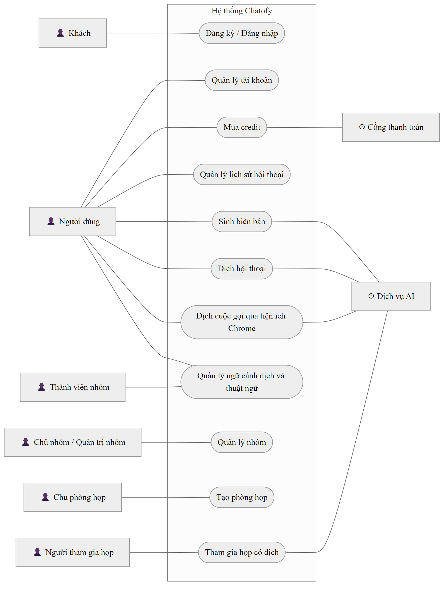

Hình 2.1 thể hiện các nhóm chức năng chính và tác nhân tương ứng. Khách chỉ dùng được các chức năng đăng
ký và đăng nhập; mọi chức năng còn lại yêu cầu đăng nhập.

### 2.2.2 Use case dịch hội thoại

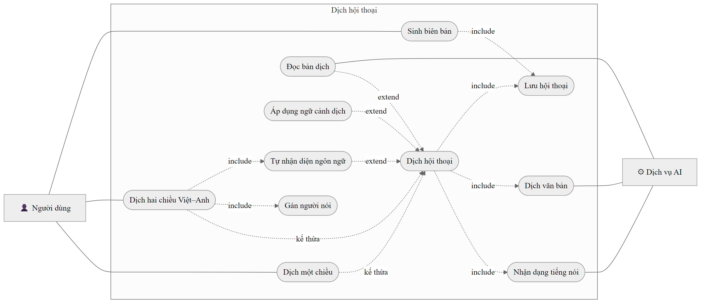

Use case "Dịch hội thoại" bao gồm (_include_) "Nhận dạng tiếng nói" và "Dịch văn bản", và được mở rộng
(_extend_) bởi "Đọc bản dịch", "Áp dụng ngữ cảnh dịch" và "Tự nhận diện ngôn ngữ". Khi kết thúc, hội thoại
được lưu tự động; từ hội thoại đã lưu, người dùng có thể sinh biên bản.

### 2.2.3 Use case họp video

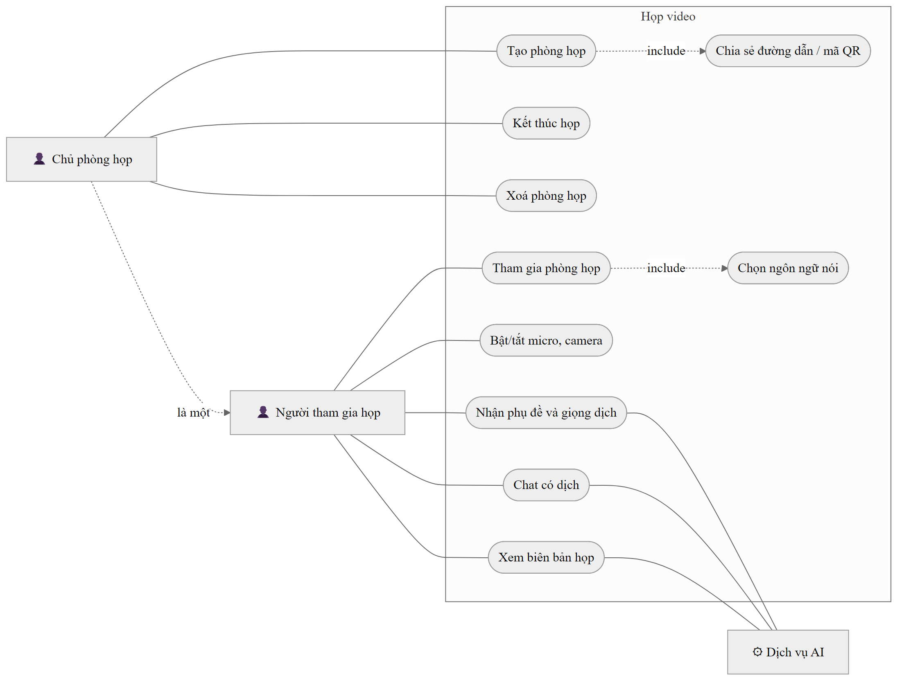

### 2.2.4 Use case quản lý nhóm

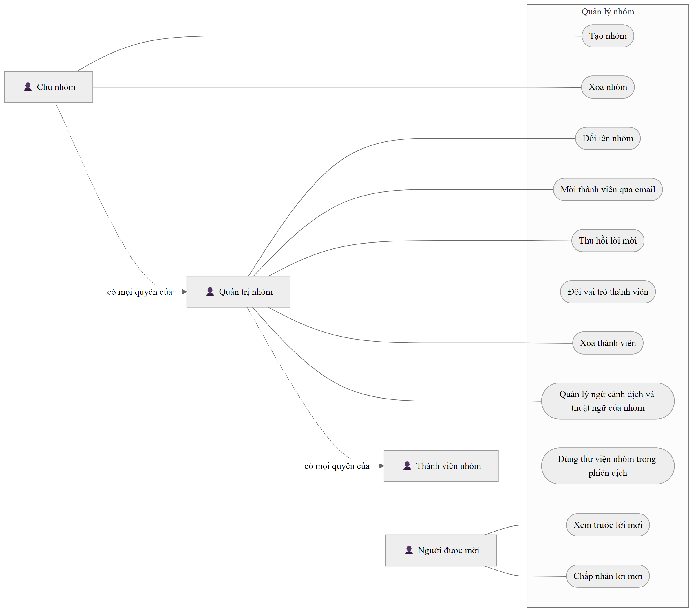

Nhóm có ba vai trò: chủ nhóm (_owner_), quản trị (_admin_) và thành viên (_member_). Chủ nhóm và quản trị
được mời thành viên và quản lý thư viện dùng chung; chỉ chủ nhóm được xoá nhóm. Lịch sử, phòng họp và credit
luôn là của cá nhân, không chia sẻ trong nhóm.

## 2.3 Kịch bản các chức năng chính

**Bảng 2.4. Kịch bản use case "Dịch hội thoại hai chiều"**

| Thành phần        | Nội dung                                                                                                                                                                                                                                                                                                                                                                                                                                                                                                                                                                                                                                                                                                                                                                                                                                                     |
| ----------------- | ------------------------------------------------------------------------------------------------------------------------------------------------------------------------------------------------------------------------------------------------------------------------------------------------------------------------------------------------------------------------------------------------------------------------------------------------------------------------------------------------------------------------------------------------------------------------------------------------------------------------------------------------------------------------------------------------------------------------------------------------------------------------------------------------------------------------------------------------------------ |
| Tác nhân          | Người dùng                                                                                                                                                                                                                                                                                                                                                                                                                                                                                                                                                                                                                                                                                                                                                                                                                                                   |
| Tiền điều kiện    | Đã đăng nhập; trình duyệt được cấp quyền micro; tài khoản còn ít nhất 1 credit                                                                                                                                                                                                                                                                                                                                                                                                                                                                                                                                                                                                                                                                                                                                                                               |
| Hậu điều kiện     | Hội thoại và các lượt nói được lưu vào lịch sử; credit bị trừ theo thời lượng                                                                                                                                                                                                                                                                                                                                                                                                                                                                                                                                                                                                                                                                                                                                                                                |
| Kịch bản chính    | 1. Người dùng mở trang dịch hai chiều, chọn cặp ngôn ngữ Việt–Anh. 2. Người dùng bấm bắt đầu. Trình duyệt mở kết nối WebSocket `/ws/translate` và gửi `client.session.start` với `twoWay: true`. 3. Hệ thống trả `server.session.ready` với chế độ `two-way`. 4. Người thứ nhất nói tiếng Việt. Trình duyệt gửi các khung âm thanh `client.audio.frame`. 5. Hệ thống trả văn bản tạm (`server.transcript.partial`) mỗi 300 ms, nhãn ngôn ngữ của lượt, và bản dịch tạm (`server.translation.partial`). 6. Người thứ nhất dừng nói. Hệ thống chốt lượt (`server.transcript.final`), gửi bản dịch tiếng Anh và âm thanh đọc (`server.audio.frame`). 7. Người thứ hai trả lời bằng tiếng Anh; hệ thống nhận diện tiếng Anh, gán người nói thứ hai và dịch sang tiếng Việt. 8. Người dùng bấm kết thúc. Hệ thống lưu hội thoại vào lịch sử. |
| Kịch bản ngoại lệ | 3a. Sidecar không nhận diện được ngôn ngữ hoặc đã đủ số phiên nhận diện: phiên chạy một chiều, giao diện báo lý do. 3b. Hết credit: hệ thống từ chối mở phiên và hiển thị liên kết mua thêm. 6a. Lượt nói ngắn dưới 1,5 giây: dùng ngôn ngữ dự phòng của cặp. 6b. Dịch vụ dịch máy bị giới hạn hạn mức: hệ thống chuyển sang mô hình dự phòng; nếu tất cả đều bị chặn thì báo lỗi lượt đó, phiên vẫn tiếp tục. *. Mất kết nối: trình duyệt kết nối lại và tiếp tục cùng hội thoại.                                                                                                                                                                                                                                                                                                                                                               |

**Bảng 2.5. Kịch bản use case "Tham gia phòng họp"**

| Thành phần        | Nội dung                                                                                                                                                                                                                                                                                                                                                                                                                                                                                                                                                                                                                                              |
| ----------------- | ----------------------------------------------------------------------------------------------------------------------------------------------------------------------------------------------------------------------------------------------------------------------------------------------------------------------------------------------------------------------------------------------------------------------------------------------------------------------------------------------------------------------------------------------------------------------------------------------------------------------------------------------------- |
| Tác nhân          | Người tham gia họp                                                                                                                                                                                                                                                                                                                                                                                                                                                                                                                                                                                                                                    |
| Tiền điều kiện    | Đã đăng nhập; có đường dẫn phòng họp; phòng chưa kết thúc                                                                                                                                                                                                                                                                                                                                                                                                                                                                                                                                                                                             |
| Hậu điều kiện     | Người dùng được ghi nhận là người tham gia; nhận được video, âm thanh và phụ đề của người khác                                                                                                                                                                                                                                                                                                                                                                                                                                                                                                                                                        |
| Kịch bản chính    | 1. Người dùng mở đường dẫn phòng (hoặc quét mã QR). 2. Hệ thống hiển thị sảnh chờ: xem trước camera, chọn micro, chọn ngôn ngữ nói. 3. Người dùng bấm tham gia. Trình duyệt kết nối `/ws/conference` và gửi `conference.join`. 4. Hệ thống ghi nhận người tham gia, tạo phiên phát lên SFU (`conference.media.publish`) và phiên nhận (`conference.media.subscribe`). 5. Người dùng thấy video của những người khác. Khi có người nói, người dùng nhận phụ đề và giọng đọc bằng ngôn ngữ của mình. 6. Người dùng gửi tin nhắn chat; mỗi người nhận đọc tin nhắn bằng ngôn ngữ của họ. 7. Người dùng rời phòng (`conference.leave`). |
| Kịch bản ngoại lệ | 1a. Chưa đăng nhập: chuyển tới trang đăng nhập, quay lại phòng sau khi đăng nhập. 1b. Phòng đã kết thúc: hiển thị màn hình kết thúc kèm biên bản. 2a. Trình duyệt từ chối quyền camera/micro: vẫn vào phòng được, chỉ xem và nghe. 4a. Quá tải dịch: lượt dịch của nhánh họp bị bỏ qua, phụ đề nguồn vẫn hiển thị.                                                                                                                                                                                                                                                                                                                           |

**Bảng 2.6. Kịch bản use case "Mời thành viên vào nhóm"**

| Thành phần        | Nội dung                                                                                                                                                                                                                                                                                                                                                                   |
| ----------------- | -------------------------------------------------------------------------------------------------------------------------------------------------------------------------------------------------------------------------------------------------------------------------------------------------------------------------------------------------------------------------- |
| Tác nhân          | Chủ nhóm hoặc Quản trị nhóm; người được mời                                                                                                                                                                                                                                                                                                                                |
| Tiền điều kiện    | Người mời có vai trò owner hoặc admin trong nhóm                                                                                                                                                                                                                                                                                                                           |
| Hậu điều kiện     | Người được mời trở thành thành viên với vai trò đã chọn                                                                                                                                                                                                                                                                                                                    |
| Kịch bản chính    | 1. Người mời nhập email và chọn vai trò. 2. Hệ thống tạo lời mời, lưu giá trị băm của mã mời, gửi email chứa liên kết. 3. Người được mời mở liên kết. Hệ thống hiển thị trang xem trước (tên nhóm, người mời, vai trò). 4. Người được mời đăng nhập bằng đúng email được mời và bấm chấp nhận. 5. Hệ thống tạo bản ghi thành viên và đánh dấu lời mời đã dùng. |
| Kịch bản ngoại lệ | 3a. Lời mời hết hạn hoặc đã bị thu hồi: báo lỗi, không cho chấp nhận. 4a. Đăng nhập bằng email khác email được mời: từ chối chấp nhận. 4b. Người được mời đã là thành viên: hệ thống báo thành công, không thêm bản ghi trùng và giữ nguyên lời mời.                                                                                                                 |

**Bảng 2.7. Kịch bản use case "Đăng nhập"**

| Thành phần        | Nội dung                                                                                                                                                                                                                                                                |
| ----------------- | ----------------------------------------------------------------------------------------------------------------------------------------------------------------------------------------------------------------------------------------------------------------------- |
| Tác nhân          | Khách                                                                                                                                                                                                                                                                   |
| Tiền điều kiện    | Đã có tài khoản (tài khoản email chỉ được tạo khi người dùng bấm liên kết xác thực), hoặc dùng tài khoản Google                                                                                                                                                         |
| Hậu điều kiện     | Có phiên đăng nhập: token truy cập 15 phút và refresh token                                                                                                                                                                                                             |
| Kịch bản chính    | 1. Khách nhập email và mật khẩu. 2. Web gửi `POST /auth/login`. 3. API kiểm tra mật khẩu băm, cấp token truy cập (JWT, HS256) và refresh token; lưu giá trị băm SHA-256 của refresh token trong Redis. 4. Web lưu phiên trong cookie và chuyển tới trang dịch. |
| Kịch bản ngoại lệ | 3a. Sai email hoặc mật khẩu: trả một lỗi 401 chung, không tiết lộ email có tồn tại hay không. 1a. Đăng nhập bằng Google: web gửi mã định danh Google tới `POST /auth/google`; API xác minh và liên kết với tài khoản cùng email.                                     |

## 2.4 Thiết kế kiến trúc

### 2.4.1 Kiến trúc tổng thể

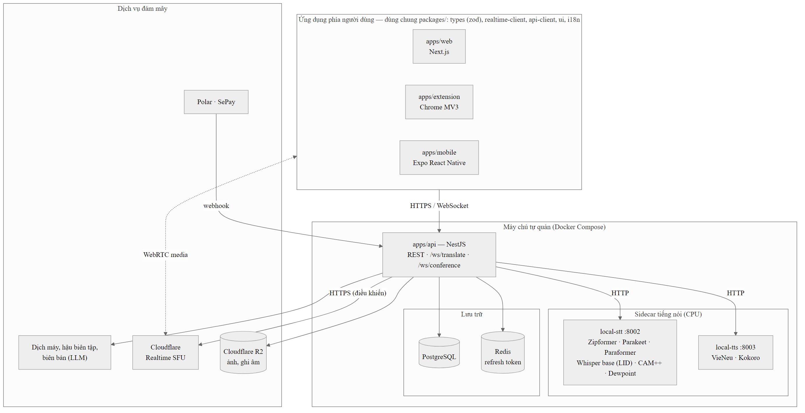

Hệ thống tổ chức dạng monorepo (Turborepo + pnpm) với ba nhóm thư mục:

- **`apps/`** gồm bốn ứng dụng: `api` (NestJS, REST và WebSocket), `web` (Next.js), `extension` (tiện ích
  Chrome Manifest V3) và `mobile` (React Native với Expo).
- **`packages/`** gồm các thư viện dùng chung: `types` (hợp đồng zod), `api-client`, `ai-providers` (giao
  diện nhà cung cấp AI), `realtime-client` (thu âm, chính sách phân lượt, phát âm thanh theo thứ tự, client
  WebSocket), `i18n` (chuỗi giao diện tiếng Việt và tiếng Anh), `ui` (design token và bộ component) và
  `config`.
- **`services/`** gồm hai sidecar Python: `local-stt` (nhận dạng, nhận diện ngôn ngữ, speaker embedding,
  khôi phục dấu câu) và `local-tts` (tổng hợp tiếng nói).

Dữ liệu lưu trong PostgreSQL (qua Prisma ORM). Redis lưu refresh token. Ảnh đại diện và bản ghi âm hội thoại
lưu trên Cloudflare R2. Media cuộc họp đi qua Cloudflare Realtime SFU. Dịch máy và tóm tắt gọi dịch vụ đám
mây; thanh toán qua Polar và SePay.

### 2.4.2 Nguyên tắc thiết kế

1. **Thiết kế theo giao diện.** Mọi phụ thuộc bên ngoài nằm sau một giao diện: `SttProvider`,
   `TranslationProvider`, `TtsProvider`, `SpeakerEmbeddingProvider`, `DisplayRestorer`,
   `SummarizationProvider`, `AuthAdapter`. Đổi nhà cung cấp chỉ cần thêm một lớp cài đặt và đăng ký.
2. **Hợp đồng kiểu dữ liệu duy nhất.** Mỗi endpoint và mỗi sự kiện WebSocket có một schema zod trong
   `@chatofy/types`. Kiểu TypeScript được suy ra từ schema; API kiểm tra đầu vào bằng schema, client kiểm tra
   đầu ra bằng cùng schema. Một thay đổi hợp đồng làm lỗi biên dịch ở mọi nơi dùng nó.
3. **Phong bì phản hồi thống nhất.** Mọi phản hồi HTTP có dạng `{ success, data | error, meta: { requestId,
timestamp } }`, dùng mã trạng thái HTTP thật (không trả 200 kèm `success: false`).
4. **Registry ngôn ngữ.** Danh sách ngôn ngữ nằm ở một chỗ (`packages/types/src/domain/languages.ts`); mọi
   cặp ngôn ngữ được suy ra từ danh sách này.
5. **Dùng chung mã qua package**, không sao chép giữa web, extension và mobile.

### 2.4.3 Tổ chức module của API

**Bảng 2.8. Các module của API NestJS**

| Module                               | Trách nhiệm                                                                               |
| ------------------------------------ | ----------------------------------------------------------------------------------------- |
| `auth`, `users`, `mail`              | Đăng ký, xác thực email, đăng nhập, Google, token, ảnh đại diện, gửi email                |
| `translate`                          | `POST /translate`, cổng WebSocket `/ws/translate`, phiên dịch, phân lượt, nhà cung cấp AI |
| `conversations`                      | Lưu, liệt kê, tìm kiếm, xoá hội thoại và bản ghi âm                                       |
| `minutes`, `summarization`           | Sinh biên bản bằng mô hình ngôn ngữ lớn                                                   |
| `translation-contexts`, `glossaries` | Ngữ cảnh dịch và bảng thuật ngữ (cá nhân và nhóm)                                         |
| `conference`                         | Phòng họp, cổng `/ws/conference`, điều khiển SFU, chat, biên bản họp                      |
| `teams`                              | Nhóm, thành viên, vai trò, lời mời                                                        |
| `credits`, `usage`                   | Sổ cái credit, đo lượng sử dụng, thanh toán, webhook                                      |
| `preferences`                        | Tuỳ chọn tài khoản dùng chung mọi client                                                  |
| `storage`, `redis`, `health`, `meta` | Hạ tầng: R2, Redis, kiểm tra sức khoẻ                                                     |

### 2.4.4 Luồng dữ liệu một lượt dịch

Một lượt dịch qua `/ws/translate` gồm các bước:

1. **Mở phiên.** `client.session.start` mang cặp ngôn ngữ, chế độ và giọng đọc. API kiểm tra credit, quyết
   định chế độ thực tế (`declared`, `two-way` hoặc `detect`) và trả `server.session.ready`.
2. **Truyền âm thanh.** Trình duyệt chỉ gửi khung PCM16 khi có tiếng nói (cổng giọng nói phía client). API
   đọc lại tối đa 9 giây âm thanh gần nhất mỗi 300 ms để sinh văn bản tạm, và dịch phần văn bản đã ổn định
   sau mỗi 15 ký tự mới.
3. **Dịch suy đoán.** Khi im lặng ngắn, client gửi `client.turn.speculate`; API bắt đầu nhận dạng và dịch phần
   đã có.
4. **Chốt lượt.** `client.session.end` (hoặc kết thúc lượt) làm API chạy nhận dạng cuối, nhận diện ngôn ngữ,
   gán người nói, dùng lại bản dịch suy đoán nếu không có âm thanh mới, rồi gửi văn bản cuối, bản dịch và âm
   thanh dạng stream.
5. **Hậu biên tập.** Bản dịch được gửi cho bước hậu biên tập chạy nền, kèm ngữ cảnh các lượt trước; nếu bản
   sửa khác bản nháp, API gửi `server.translation.polished`.

Bản dịch tạm giữa câu chỉ hiển thị chữ, không bao giờ được đọc thành tiếng, vì một phỏng đoán trên màn hình
có thể thay thế lặng lẽ còn một phỏng đoán đã đọc ra thì không rút lại được.

### 2.4.5 Luồng media và dịch trong họp video

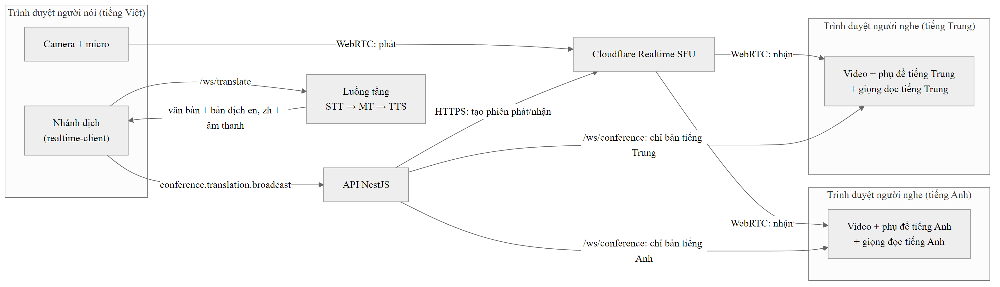

API giữ khoá bí mật của Cloudflare và điều khiển SFU qua HTTPS: mỗi người tham gia có hai phiên SFU, một để
phát và một để nhận. Trình duyệt chỉ nói chuyện với API qua `/ws/conference` và với SFU qua WebRTC. Việc dịch
không đi qua SFU: trình duyệt của người nói mở thêm một "nhánh dịch" dùng chính luồng `/ws/translate`, rồi
gửi kết quả qua `conference.translation.broadcast`; API chuyển tới từng người nghe đúng ngôn ngữ của họ.

## 2.5 Biểu đồ tuần tự

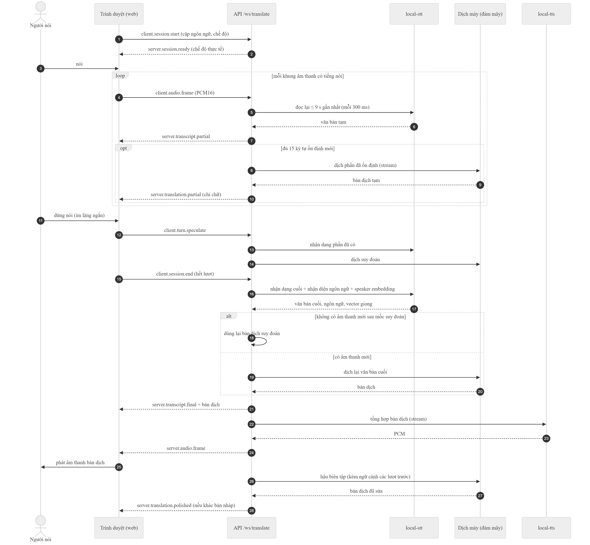

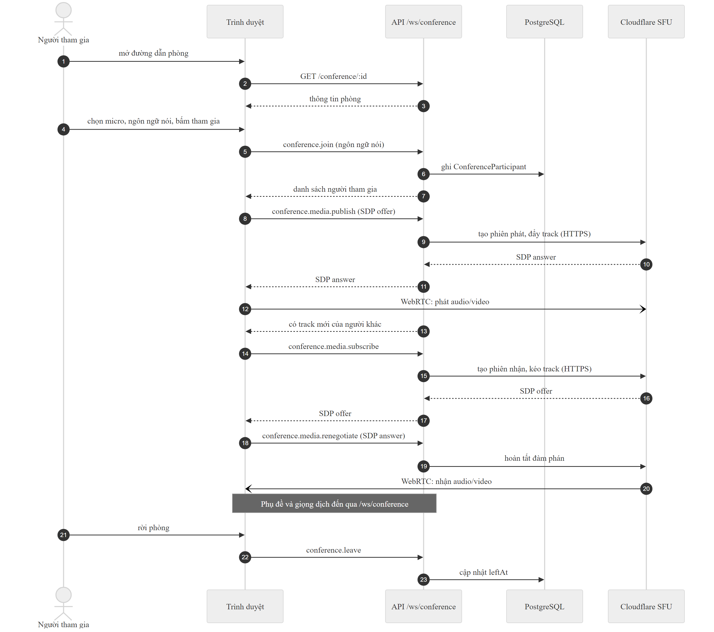

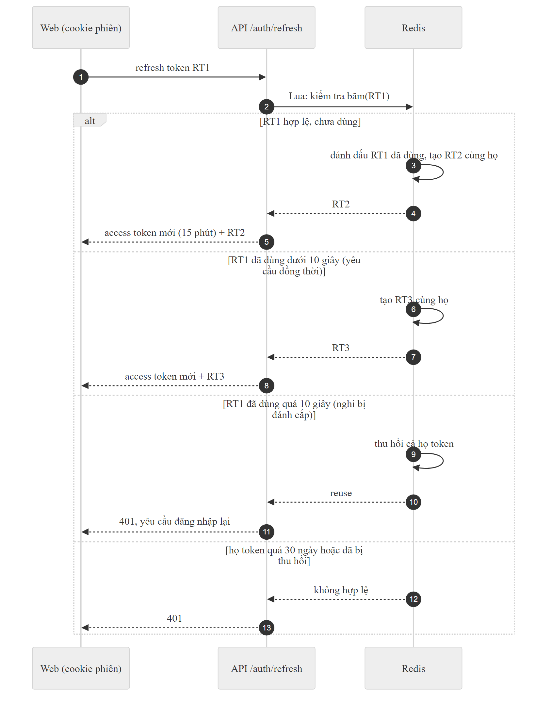

Hình 2.9 mô tả cơ chế refresh token xoay vòng: mỗi refresh token chỉ dùng được một lần. Khi một token đã dùng
bị gửi lại (dấu hiệu bị đánh cắp), toàn bộ họ token bị thu hồi và người dùng phải đăng nhập lại.

## 2.6 Thiết kế cơ sở dữ liệu

Cơ sở dữ liệu PostgreSQL gồm 27 bảng, chia thành năm nhóm. Hình 2.10 và Hình 2.11 thể hiện các bảng
nghiệp vụ chính; các bảng thanh toán được mô tả ngắn trong Bảng 2.13.

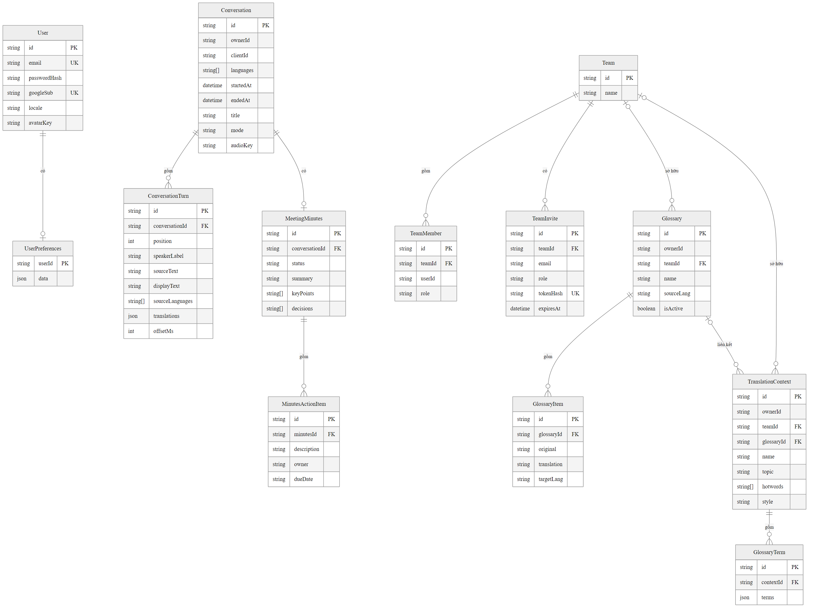

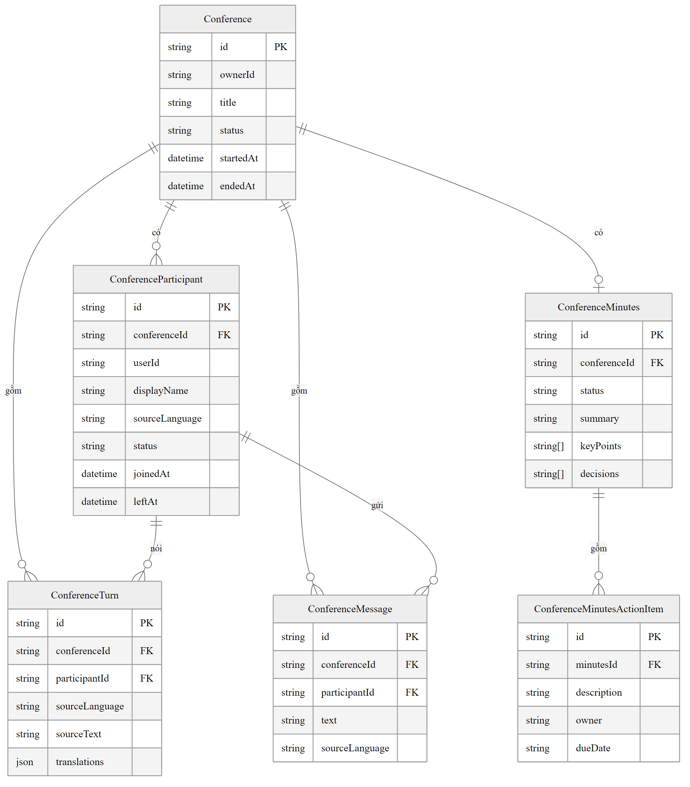

**Bảng 2.9. Bảng `User` (người dùng)**

| Trường               | Kiểu              | Mô tả                                               |
| -------------------- | ----------------- | --------------------------------------------------- |
| id                   | String (cuid)     | Khoá chính                                          |
| email                | String, duy nhất  | Email đăng nhập                                     |
| name                 | String?           | Tên hiển thị                                        |
| passwordHash         | String?           | Mật khẩu đã băm; rỗng với tài khoản chỉ dùng Google |
| googleSub            | String?, duy nhất | Định danh tài khoản Google đã liên kết              |
| passwordChangedAt    | DateTime?         | Thời điểm đổi mật khẩu, dùng để vô hiệu token cũ    |
| locale               | String            | Ngôn ngữ giao diện (mặc định `en`)                  |
| avatarKey            | String?           | Khoá ảnh đại diện trên R2                           |
| createdAt, updatedAt | DateTime          | Thời điểm tạo, cập nhật                             |

**Bảng 2.10. Bảng `Conversation` (hội thoại)**

| Trường                                   | Kiểu     | Mô tả                                                   |
| ---------------------------------------- | -------- | ------------------------------------------------------- |
| id                                       | String   | Khoá chính                                              |
| ownerId                                  | String   | Người dùng sở hữu                                       |
| clientId                                 | String   | Mã do client sinh, giúp lưu lặp lại không tạo bản trùng |
| languages                                | String[] | Các ngôn ngữ có trong hội thoại                         |
| startedAt, endedAt                       | DateTime | Thời điểm bắt đầu, kết thúc                             |
| pausedMs                                 | Int      | Tổng thời gian tạm dừng                                 |
| title, searchTitle                       | String?  | Tiêu đề và tiêu đề đã chuẩn hoá để tìm kiếm             |
| mode                                     | String?  | Chế độ: một chiều, hai chiều, tự nhận diện              |
| audioKey, audioOffsetMs, audioDurationMs |          | Bản ghi âm trên R2 và vị trí căn chỉnh                  |

**Bảng 2.11. Bảng `ConversationTurn` (lượt nói)**

| Trường                    | Kiểu     | Mô tả                                              |
| ------------------------- | -------- | -------------------------------------------------- |
| id                        | String   | Khoá chính                                         |
| conversationId            | String   | Khoá ngoại tới `Conversation` (xoá theo)           |
| position                  | Int      | Thứ tự lượt                                        |
| speakerRole, speakerLabel | String   | Vai trò và nhãn người nói                          |
| sourceText                | String   | Văn bản nhận dạng gốc                              |
| displayText               | String?  | Văn bản hiển thị (đã thêm dấu câu, chữ số)         |
| sourceLanguages           | String[] | Ngôn ngữ của lượt                                  |
| translations              | Json     | Bản dịch theo từng ngôn ngữ đích                   |
| searchText                | String?  | Văn bản đã chuẩn hoá để tìm kiếm (chỉ mục trigram) |
| offsetMs                  | Int?     | Vị trí của lượt trong bản ghi âm                   |

**Bảng 2.12. Bảng `Conference` và `ConferenceParticipant`**

| Bảng                  | Trường chính                                                                    | Mô tả                                                    |
| --------------------- | ------------------------------------------------------------------------------- | -------------------------------------------------------- |
| Conference            | id, ownerId, title, status, startedAt, endedAt                                  | Phòng họp và trạng thái (mặc định `waiting` khi mới tạo) |
| ConferenceParticipant | id, conferenceId, userId, displayName, sourceLanguage, status, joinedAt, leftAt | Người tham gia và ngôn ngữ nói                           |
| ConferenceTurn        | id, conferenceId, participantId, sourceLanguage, sourceText, translations       | Lượt nói trong họp và bản dịch                           |
| ConferenceMessage     | id, conferenceId, participantId, text, sourceLanguage                           | Tin nhắn chat                                            |
| ConferenceMinutes     | id, conferenceId, status, summary, keyPoints, decisions                         | Biên bản họp                                             |

**Bảng 2.13. Các bảng còn lại**

| Nhóm               | Bảng                                                                                  | Mô tả                                                                                                              |
| ------------------ | ------------------------------------------------------------------------------------- | ------------------------------------------------------------------------------------------------------------------ |
| Biên bản           | MeetingMinutes, MinutesActionItem, ConferenceMinutesActionItem                        | Biên bản và việc cần làm                                                                                           |
| Ngữ cảnh dịch      | TranslationContext, GlossaryTerm, Glossary, GlossaryItem                              | Ngữ cảnh dịch, bảng thuật ngữ (cá nhân hoặc của nhóm qua `teamId`)                                                 |
| Nhóm               | Team, TeamMember, TeamInvite                                                          | Nhóm, thành viên với vai trò, lời mời (lưu băm của mã mời)                                                         |
| Tuỳ chọn           | UserPreferences                                                                       | Một tài liệu JSON tuỳ chọn cho mỗi tài khoản                                                                       |
| Credit, thanh toán | Plan, CreditGrant, CreditLease, CreditEntry, Subscription, PaymentOrder, WebhookEvent | Gói, khoản cấp credit, giữ chỗ khi phiên đang chạy, sổ cái bút toán, thuê bao, đơn hàng, chống xử lý trùng webhook |
| Giám sát chi phí   | LlmCallRecord                                                                         | Mỗi lần gọi mô hình ngôn ngữ lớn: mô hình, độ trễ, số token                                                        |

Thiết kế credit dùng mô hình sổ cái: mỗi thay đổi số dư là một bút toán `CreditEntry` có khoá chống trùng
(`idempotencyKey`). Khi một phiên dịch bắt đầu, hệ thống giữ chỗ một lượng credit (`CreditLease`), trừ dần theo
giây được chấp nhận, và trả lại phần chưa dùng khi phiên kết thúc.

## 2.7 Thiết kế giao diện lập trình

### 2.7.1 REST API

**Bảng 2.14. Các nhóm endpoint REST chính**

| Nhóm                | Endpoint                                                                                                                                      | Mô tả                                                               |
| ------------------- | --------------------------------------------------------------------------------------------------------------------------------------------- | ------------------------------------------------------------------- |
| Xác thực            | `POST /auth/register`, `/verify-email`, `/login`, `/google`, `/refresh`, `/revoke`, `/forgot-password`, `/reset-password`, `/change-password` | Vòng đời tài khoản và phiên                                         |
| Hồ sơ               | `GET/PATCH /auth/me`, `PUT/DELETE /auth/me/avatar`, `GET/PATCH/DELETE /me/preferences`                                                        | Hồ sơ, ảnh đại diện, tuỳ chọn                                       |
| Dịch                | `POST /translate`, `GET /translate/voices`                                                                                                    | Dịch một lượt qua REST (dùng làm đối chứng đo đạc); danh sách giọng |
| Hội thoại           | `GET /conversations`, `GET/PUT/PATCH/DELETE /conversations/:id`, `PUT/GET /conversations/:id/audio`                                           | Lịch sử, tìm kiếm, bản ghi âm                                       |
| Biên bản            | `POST/GET /conversations/:id/minutes`, `POST/GET /conference/:id/minutes`                                                                     | Sinh và đọc biên bản                                                |
| Ngữ cảnh, thuật ngữ | `/translation-contexts`, `/glossaries`, `/teams/:teamId/translation-contexts`, `/teams/:teamId/glossaries`                                    | Thư viện cá nhân và của nhóm                                        |
| Họp                 | `POST/GET /conference`, `GET/DELETE /conference/:id`                                                                                          | Tạo, xem, xoá phòng họp                                             |
| Nhóm                | `/teams`, `/teams/:teamId/members`, `/teams/:teamId/invites`, `POST /team-invites/preview`, `/accept`                                         | Nhóm, thành viên, lời mời                                           |
| Credit              | `GET /billing/plans`, `/me`, `/usage`, `POST /billing/checkout`, `POST /billing/webhooks/polar`, `/sepay`                                     | Số dư, mua gói, webhook                                             |

Khi không chạy ở môi trường production, API tự sinh tài liệu OpenAPI tại `/docs` từ các schema zod.

### 2.7.2 Sự kiện WebSocket

**Bảng 2.15. Sự kiện WebSocket chính**

| Kênh             | Chiều           | Sự kiện                                                    | Ý nghĩa                                                |
| ---------------- | --------------- | ---------------------------------------------------------- | ------------------------------------------------------ |
| `/ws/translate`  | Client → Server | `client.session.start`                                     | Mở phiên với cặp ngôn ngữ và chế độ                    |
|                  |                 | `client.audio.frame`                                       | Khung âm thanh PCM16 có số thứ tự                      |
|                  |                 | `client.turn.speculate`                                    | Báo im lặng ngắn, bắt đầu dịch suy đoán                |
|                  |                 | `client.session.end`                                       | Kết thúc lượt / phiên                                  |
|                  | Server → Client | `server.session.ready`                                     | Phiên sẵn sàng, chế độ thực tế                         |
|                  |                 | `server.transcript.partial` / `.final` / `.display`        | Văn bản tạm, văn bản cuối, văn bản hiển thị            |
|                  |                 | `server.translation.delta` / `.partial` / `.polished`      | Bản dịch từng phần, bản dịch tạm, bản sau hậu biên tập |
|                  |                 | `server.audio.frame`                                       | Âm thanh bản dịch                                      |
|                  |                 | `server.error`                                             | Lỗi có mã ổn định                                      |
| `/ws/conference` | Client → Server | `conference.join` / `.leave`                               | Vào, rời phòng                                         |
|                  |                 | `conference.media.publish` / `.subscribe` / `.renegotiate` | Đàm phán WebRTC qua API                                |
|                  |                 | `conference.participant.mute` / `.video`                   | Bật, tắt micro và camera                               |
|                  |                 | `conference.chat`                                          | Gửi tin nhắn                                           |
|                  |                 | `conference.translation.broadcast`                         | Gửi phụ đề và bản dịch của nhánh dịch tới phòng        |

## 2.8 Thiết kế bảo mật

- **Mật khẩu** được băm bằng Argon2. `POST /auth/register` không tạo tài khoản ngay: mật khẩu đã băm, email và
  tên được đóng gói vào một token ký có hạn 24 giờ và gửi qua email; tài khoản chỉ được tạo khi người dùng bấm
  liên kết. Endpoint đăng ký trả cùng một phản hồi 202 cho mọi email, nên không thể dò xem email nào đã đăng ký.
- **Lời mời nhóm** gắn với địa chỉ email được mời, chỉ dùng một lần, và chỉ lưu giá trị băm của mã mời.
- **Token truy cập** là JWT ký HS256, hiệu lực 15 phút.
- **Refresh token** là chuỗi ngẫu nhiên 256 bit, chỉ lưu giá trị băm SHA-256 trong Redis. Mỗi token dùng một
  lần; việc kiểm tra, vô hiệu và cấp mới chạy trong một script Lua nguyên tử. Một token đã dùng chưa quá 10 giây
  vẫn được chấp nhận để xử lý các yêu cầu làm mới đồng thời từ cùng một màn hình. Họ token có hạn tuyệt đối 30
  ngày.
- **WebSocket** được xác thực trong lúc bắt tay HTTP (`verifyClient`): yêu cầu không hợp lệ bị từ chối với mã 401
  trước khi socket được tạo, nên không có khung nào được xử lý trước khi xác thực xong.
- **Lời nhắc dịch** đặt lời nói của người dùng trong một khối dữ liệu riêng để chống tấn công chèn lệnh (mục
  3.8.4).
- **Khoá dịch vụ** (Cloudflare, dịch máy) chỉ nằm ở API; trình duyệt không bao giờ nhận khoá.
- **Webhook thanh toán** được kiểm chữ ký trên dữ liệu thô (so sánh an toàn về thời gian, cửa sổ ±300 giây) và
  chống xử lý trùng qua bảng `WebhookEvent`.

## 2.9 Kết luận

Chương 2 đã xác định 8 tác nhân, 19 yêu cầu chức năng và các yêu cầu phi chức năng, trong đó quan trọng nhất là
độ trễ dưới 2 giây và việc chạy tiếng nói trên CPU. Kiến trúc được thiết kế theo giao diện, với hợp đồng zod dùng
chung cho mọi ứng dụng, hai sidecar tiếng nói chạy cục bộ và SFU của Cloudflare cho họp video. Cơ sở dữ liệu gồm
27 bảng, tách bạch dữ liệu cá nhân, dữ liệu nhóm và sổ cái credit. Chương 3 trình bày chi tiết các kỹ thuật
xử lý tiếng nói và dịch, cùng các thực nghiệm dùng để chọn và tinh chỉnh chúng.
