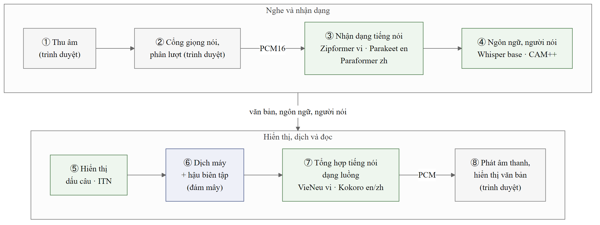

# CHƯƠNG 3. KỸ THUẬT DỊCH THOẠI THỜI GIAN THỰC VÀ THỰC NGHIỆM

<!--
Ghi chú biên soạn (xoá khi chuyển sang Word):
- Mọi số liệu lấy từ docs/development-journey.md và benchmarks/*/README.md tại commit cc8585f7.
- [HÌNH 3.x] là chỗ cần chèn hình; mô tả nằm ngay trong ngoặc.
- Trích dẫn đã đánh số theo IEEE, khớp với 06-tai-lieu-tham-khao.md.
-->

Chương này trình bày các kỹ thuật cốt lõi giúp Chatofy dịch hội thoại với độ trễ thấp trên máy tính
không có GPU, cùng các thực nghiệm dùng để ra quyết định. Mỗi lựa chọn mô hình hoặc thay đổi thiết kế
trong chương đều được đo trên phần cứng đích trước khi đưa vào sản phẩm. Các mô hình nhận dạng và tổng
hợp tiếng nói là mô hình tiền huấn luyện mã nguồn mở; đóng góp của nhóm nằm ở việc chọn mô hình bằng đo
đạc, kỹ thuật ghép nối thành luồng thời gian thực, và phương pháp đánh giá.

## 3.1 Tổng quan luồng xử lý và phương pháp thực nghiệm

### 3.1.1 Luồng xử lý dạng tầng

Chatofy dùng kiến trúc tầng (_cascade_) gồm ba bước: nhận dạng tiếng nói (STT), dịch máy (MT) và tổng
hợp tiếng nói (TTS). Trình duyệt thu âm, gửi khung âm thanh qua WebSocket `/ws/translate` tới máy chủ
NestJS. Máy chủ gọi hai dịch vụ phụ (_sidecar_) chạy cục bộ trên CPU: `local-stt` (cổng 8002) và
`local-tts` (cổng 8003). Riêng bước dịch máy gọi dịch vụ đám mây.



Bảng 3.1 liệt kê các thành phần đang chạy trong phiên bản hiện tại.

**Bảng 3.1. Các mô hình trong luồng xử lý**

| Khâu                | Tiếng Việt                                  | Tiếng Anh            | Tiếng Trung   | Nơi chạy   |
| ------------------- | ------------------------------------------- | -------------------- | ------------- | ---------- |
| Nhận dạng tiếng nói | Zipformer-30M RNN-T                         | Parakeet-TDT-0.6B-v2 | Paraformer-zh | CPU cục bộ |
| Nhận diện ngôn ngữ  | Whisper base (xác suất ngôn ngữ)            | Whisper base         | —             | CPU cục bộ |
| Tổng hợp tiếng nói  | VieNeu v3                                   | Kokoro-82M           | Kokoro-82M    | CPU cục bộ |
| Dịch máy            | DeepSeek (qua giao thức tương thích OpenAI) |                      |               | Đám mây    |

Kiến trúc tầng được chọn thay cho mô hình dịch giọng nói đầu-cuối (_speech-to-speech_) vì ba lý do.
Thứ nhất, mỗi khâu thay được độc lập qua một giao diện chung (`SttProvider`, `TranslationProvider`,
`TtsProvider`). Thứ hai, văn bản trung gian dùng được cho phụ đề, lịch sử và biên bản họp. Thứ ba,
nhóm đã thử nghiệm Gemini Live [1] (một mô hình dịch giọng nói trực tiếp) làm mốc so sánh trong
`benchmarks/live-translate`, và mô hình này không hỗ trợ tiếng Trung.

### 3.1.2 Môi trường và nguyên tắc đo

Các phép đo chạy trên máy tính để bàn dùng Intel Core i7-11700K (8 nhân vật lý), 32 GB RAM, không
dùng GPU. Giai đoạn đầu dùng Windows 11; từ tháng 9/2026 máy chuyển sang Ubuntu. Các bảng số liệu ghi
rõ hệ điều hành khi điều kiện khác nhau.

Nhóm áp dụng bốn nguyên tắc cho mọi thực nghiệm:

1. **Đo trên phần cứng đích, không dựa vào số công bố.** Mỗi bộ đo là một dự án độc lập trong thư mục
   `benchmarks/`, không được ứng dụng import.
2. **Đặt ngưỡng trước khi đo.** Ví dụ, STT phải có hệ số thời gian thực RTF ≤ 0,3 và độ trễ p95 ≤ 2 s.
3. **Đo lại sau mỗi lần sửa.** Một thay đổi trông như cải tiến chỉ được giữ khi số đo xác nhận.
4. **Ghi cỡ mẫu cạnh mọi con số** và nêu rõ giới hạn của phép đo.

### 3.1.3 Các chỉ số đánh giá

- **WER / CER** (_word / character error rate_): tỷ lệ lỗi từ / ký tự của STT, tính bằng tổng số
  thay thế, xoá và chèn chia cho số từ (ký tự) tham chiếu.
- **RTF** (_real-time factor_): thời gian xử lý chia cho độ dài âm thanh. RTF < 1 nghĩa là xử lý nhanh
  hơn thời gian thực.
- **p50 / p95**: trung vị và phân vị 95 của độ trễ.
- **TTFA** (_time to first audio_): thời gian từ khi gửi yêu cầu đến khi có mẫu âm thanh đầu tiên.
- **Độ trễ đầu-cuối**: từ lúc người nói dừng đến lúc âm thanh dịch đầu tiên phát ra.
- **Độ chính xác nhận diện ngôn ngữ**: tỷ lệ lượt nói được gán đúng ngôn ngữ.
- **Tỷ lệ lỗi dịch nghiêm trọng**: tỷ lệ lượt có ít nhất một lỗi mức _major_ hoặc _critical_ theo
  khung MQM, do một mô hình ngôn ngữ lớn đã hiệu chuẩn chấm (mục 3.8).

## 3.2 Nhận dạng tiếng nói

### 3.2.1 Khảo sát và lựa chọn ban đầu

Ràng buộc đặt ra trước khi khảo sát: chạy trên CPU, RTF ≤ 0,3 với câu dài 5–10 giây, giấy phép dùng
được cho đồ án học thuật. Kết quả khảo sát cho thấy không có một mô hình đa ngôn ngữ nào đáp ứng được:
Whisper large-v3 quá chậm trên CPU, Parakeet v3 không có tiếng Việt, Moonshine [36] chỉ có tiếng Anh. Vì
vậy hệ thống dùng một mô hình chuyên biệt cho mỗi ngôn ngữ, chọn qua một bộ đăng ký (_registry_) theo
mã ngôn ngữ.

Hai tập kiểm tra được dùng: VIVOS test [37] cho tiếng Việt và LibriSpeech test-clean [38] cho tiếng Anh, mỗi
tập 50 câu, chọn ngẫu nhiên với seed 42. Mỗi mô hình chạy trong một tiến trình riêng, có một lượt làm
nóng không tính giờ, và chạy hai lần để kiểm tra độ dao động.

**Bảng 3.2. Kết quả đo STT ban đầu (50 câu mỗi ngôn ngữ, Windows 11, 8 luồng, INT8)**

| Mô hình                           | Ngôn ngữ | WER (%)  | RTF       | p95 (s) | RAM đỉnh | Ngưỡng RTF ≤ 0,3 |
| --------------------------------- | -------- | -------- | --------- | ------- | -------- | ---------------- |
| **Zipformer-30M (sherpa-onnx)**   | vi       | **5,38** | **0,017** | 0,09    | 223 MB   | Đạt              |
| PhoWhisper-small (faster-whisper) | vi       | 7,71     | 0,332     | 1,40    | 972 MB   | **Không đạt**    |
| Moonshine base (sherpa-onnx)      | en       | 3,86     | 0,040     | 0,34    | 418 MB   | Đạt              |
| Whisper small.en (faster-whisper) | en       | 3,74     | 0,228     | 1,47    | 552 MB   | Đạt              |

Với tiếng Việt, Zipformer tốt hơn PhoWhisper trên cả hai trục: WER thấp hơn 2,3 điểm và nhanh hơn
khoảng 20 lần, dùng một phần tư bộ nhớ. Với tiếng Anh, Moonshine và Whisper small.en chênh nhau
0,12 điểm WER (trong khoảng nhiễu) nhưng Moonshine nhanh hơn 5,7 lần, nên được chọn ban đầu.

Phép đo này cho thấy số công bố lệch theo cả hai hướng: PhoWhisper-small được ước tính đạt ngưỡng RTF
nhưng thực đo không đạt (0,332), còn Zipformer đo được 0,017, nhanh hơn số công bố 0,025.

Một hạn chế cần nêu: mô hình Zipformer tiếng Việt [39] dùng giấy phép CC-BY-NC-ND-4.0, chỉ cho phép dùng
phi thương mại. Nếu thương mại hoá, phương án thay thế là PhoWhisper (BSD-3) qua cùng giao diện
`SttProvider`, chấp nhận độ trễ khoảng 1,3 giây mỗi câu.

### 3.2.2 Bộ giải mã và danh sách từ ưu tiên

Mô hình tiếng Việt chạy với giải mã tham lam (_greedy search_). Nhóm kiểm tra xem giải mã chùm (_beam
search_) và danh sách từ ưu tiên (_hotwords_) có cải thiện được không, giữ nguyên mô hình và số luồng.

**Bảng 3.3. So sánh bộ giải mã trên VIVOS (50 câu, 558 từ)**

| Cấu hình                  | WER (%) | CER (%) | RTF    |
| ------------------------- | ------- | ------- | ------ |
| Greedy (đối chứng)        | 5,38    | 2,90    | 0,0158 |
| Beam search               | 5,38    | 2,94    | 0,0207 |
| Beam search + 48 hotwords | 4,66    | 2,73    | 0,0211 |

Beam search không cải thiện WER và làm CER tệ đi 0,04 điểm. Hotwords giảm 0,72 điểm WER (tương đương
4 từ), nhưng danh sách 48 cụm từ này được sinh từ chính câu tham chiếu của tập kiểm tra, nên con số chỉ
cho biết mức tối đa mà danh sách đó mang lại, không phải mức cải thiện trong hội thoại thật. Hệ thống
giữ giải mã tham lam.

### 3.2.3 Đánh giá trên âm thanh thực tế

Tập kiểm tra sạch không phản ánh điều kiện sử dụng thật. Nhóm đo lại trên 6 cuộc hội thoại ghi từ môi
trường production (4 tiếng Việt, khoảng 9,2 phút; 2 tiếng Anh, khoảng 3,1 phút), phát lại qua đúng
module thu âm của trình duyệt (`CapturePump`) để cắt lượt giống thực tế.

Kết quả đáng chú ý nhất là thứ hạng bị đảo ngược. Trên VIVOS, Zipformer-30M đạt 5,4% còn một mô hình
streaming đa ngôn ngữ (PengChengStarling [40]) đạt 13,4%. Trên âm thanh thật thì ngược lại: khi được nạp
âm thanh liên tục, mô hình streaming đạt 19,0%, thấp hơn mức 22,1% của các bản chép lời mà Zipformer-30M đã
tạo và lưu trên production. Tuy nhiên khi cắt theo lượt như sản phẩm thật, mô hình streaming tệ hơn rõ rệt.
Bảng 3.4 phát lại cùng âm thanh cho cả ba mô hình nên Zipformer-30M có 22,3%, chênh 0,2 điểm so với bản đã
lưu; Zipformer-30M là mô hình offline nên không có cột đọc liên tục. Văn bản tham chiếu để tính WER là bản chép lời
của dịch vụ ElevenLabs Scribe v2 [41].

**Bảng 3.4. WER tiếng Việt trên âm thanh production (tham chiếu: ElevenLabs Scribe v2)**

| Mô hình                                    | Đọc liên tục (%) | Cắt theo lượt (%) |
| ------------------------------------------ | ---------------- | ----------------- |
| Zipformer-30M (đang dùng)                  | —                | 22,3              |
| PengChengStarling (streaming, đa ngôn ngữ) | 19,0             | 35,8              |
| Zipformer 70.000 giờ (offline)             | —                | 21,9              |

Kiểm định bootstrap theo lượt cho thấy mô hình streaming tệ hơn 13,7 điểm (khoảng tin cậy 95%:
[+8,9; +18,8]), còn Zipformer 70.000 giờ chỉ khác −0,3 điểm, không có ý nghĩa thống kê. Hai bộ tham
chiếu tiếng Việt (Scribe v2 và PhoWhisper-large) tự chênh nhau 20,4% WER, nên mọi khác biệt dưới
khoảng 3 điểm được coi là nhiễu. Hệ thống giữ nguyên Zipformer-30M cho tiếng Việt.

Với tiếng Anh, Parakeet-TDT-0.6B-v2 [8] đạt WER 3,4% so với 7,4% của Moonshine trên
các lượt thật (chênh −4,0 điểm, khoảng tin cậy 95%: [−7,3; −0,9]). Parakeet còn tự sinh dấu câu và
viết hoa. Dưới tải hai chiều đồng thời, độ trễ p95 của lượt cuối là 327 ms (Moonshine: 215 ms), vẫn
nằm trong chu kỳ cập nhật 300 ms cho văn bản tạm, không có lỗi quá tải (HTTP 503). Parakeet thay hoàn
toàn Moonshine.

Với tiếng Trung, Paraformer-zh được chọn sau khi đạt CER trung bình 3,22% trên FLEURS [42] và
AISHELL-1 [43] (50 đoạn mỗi tập), thấp hơn SenseVoice-small [44] (4,58%).

### 3.2.4 Phân bổ lỗi nhận dạng tiếng Việt

Để biết nên cải thiện ở đâu, nhóm phân loại 134 lỗi trên 6 hội thoại tiếng Việt (2.222 từ):

**Bảng 3.5. Phân bổ lỗi nhận dạng tiếng Việt**

| Loại lỗi                                  | Số lỗi | Tỷ lệ |
| ----------------------------------------- | ------ | ----- |
| Từ thông dụng nghe sai hoặc mất           | 74     | 55%   |
| Nằm trong ±0,6 s quanh điểm cắt cưỡng bức | 29     | 22%   |
| Tên riêng và từ nước ngoài                | 13     | 10%   |
| Đầu lượt nói                              | 9      | 7%    |
| Chèn thừa                                 | 9      | 7%    |

Hơn một nửa số lỗi là từ thông dụng, loại lỗi mà danh sách từ ưu tiên hầu như không giúp được. Thử
nghiệm giải mã lại cả khối âm thanh để sửa lỗi tại điểm cắt chỉ cứu được 2–6 lỗi. Kết luận: nút thắt
nằm ở bộ nhận dạng, không ở cách cắt lượt.

## 3.3 Hiển thị văn bản tiếng Việt

WER thông thường chuẩn hoá về chữ thường và bỏ dấu câu, nên không thấy được một lỗi người dùng nhận ra
ngay: bản ghi tiếng Việt hiện ra toàn chữ in hoa, không dấu câu và viết số bằng chữ. Nhóm xây dựng một
tập riêng gồm 22 câu (311 từ, 42 chữ số) thu qua đúng đường thu âm của trình duyệt, kèm tham chiếu viết
theo chính tả thật.

Phép đo cho kết quả "nhận dạng hoàn hảo, hiển thị bằng không": hai câu không chứa số được nhận đúng từng
từ, nhưng vẫn đạt 0 trên cả ba chỉ số hiển thị (số, dấu câu, viết hoa tên riêng).

Nhóm thử hai cách sửa. Cách thứ nhất dùng một mô hình ngôn ngữ lớn viết lại câu nguồn, chỉ được thêm
dấu câu, viết hoa và đổi chữ số, có bộ kiểm tra từ chối nếu mô hình đổi từ. Cách thứ hai là chuẩn hoá
văn bản ngược (_Inverse Text Normalization_, ITN) dạng tất định, chạy ngay trong tiến trình máy chủ.

**Bảng 3.6. So sánh các cách sửa hiển thị (22 câu)**

| Chỉ số             | Ban đầu | Mô hình ngôn ngữ lớn   | ITN tất định      |
| ------------------ | ------- | ---------------------- | ----------------- |
| Tỷ lệ chữ số đúng  | 0,000   | 0,881                  | **1,000** (42/42) |
| Chữ số bịa thêm    | 0       | 0                      | 0                 |
| F1 dấu câu         | 0,000   | 0,722                  | 0,000             |
| Viết hoa tên riêng | 0,000   | 0,864                  | 0,000             |
| Độ trễ mỗi lượt    | —       | 25,1 s (tối đa 92,6 s) | **0,21 ms** (p95) |

Mô hình ngôn ngữ lớn sửa đúng nhưng trả kết quả sau trung vị 25 giây, khi người đọc đã chuyển sang câu
khác. ITN chỉ xử lý chữ số nhưng chạy dưới một phần nghìn giây. Hệ thống chọn ITN cho chữ số; dấu câu và
viết hoa được xử lý bằng một mô hình gán nhãn token chạy trong sidecar STT (Dewpoint [45] cho tiếng
Việt, CT-Transformer [46] cho tiếng Trung), được chọn qua bộ đo `benchmarks/punct`. Kết quả ITN được kiểm
thêm trên 100 câu VIVOS và LibriSpeech không chứa chữ số: không sinh chữ số bịa nào.

## 3.4 Tổng hợp tiếng nói

### 3.4.1 Tiếng Anh

**Bảng 3.7. So sánh TTS tiếng Anh (30 câu, 5–20 từ)**

| Mô hình             | p50 (s) | p95 (s) | RTF   | RAM đỉnh | Giấy phép  |
| ------------------- | ------- | ------- | ----- | -------- | ---------- |
| Piper (lessac-high) | 0,45    | 0,57    | 0,154 | 323 MB   | MIT        |
| **Kokoro-82M**      | 0,99    | 1,18    | 0,323 | 619 MB   | Apache-2.0 |

Piper [47] và Kokoro-82M [33] đều đạt ngưỡng p95 ≤ 2 s. Qua nghe so sánh A/B, Kokoro được chọn vì chất lượng giọng tốt hơn rõ rệt;
Piper được giữ làm phương án dự phòng khi độ trễ quan trọng hơn chất lượng. Đây mới là đánh giá của một
người nghe; bộ công cụ chấm MOS nhiều người nghe đã được xây dựng trong `benchmarks/mos` (theo
khuyến nghị ITU-T P.800 [18]).

### 3.4.2 Tiếng Việt: chọn mô hình và chuyển sang streaming

Nhóm so sánh VieNeu v3 Turbo [17] (đang dùng) với ZeroTTS [48] trên tập 41 câu hội thoại, cả hai cùng seed và
cùng chế độ streaming. Chỉ số quyết định là **thời gian tới âm thanh liền mạch**: thời gian tới mẫu âm
thanh đầu tiên cộng độ trễ lớn nhất sau đó, tức là lượng đệm cần để phát hết câu mà không bị ngắt.

**Bảng 3.8. TTS tiếng Việt: thời gian tới âm thanh liền mạch (Ubuntu, trung vị, ms)**

| Cấu hình                      | Mẫu đầu tiên | Tới âm thanh liền mạch | Số luồng bị ngắt |
| ----------------------------- | ------------ | ---------------------- | ---------------- |
| **VieNeu streaming**          | 221–257      | **221–257**            | 20/164           |
| VieNeu tách mệnh đề (cách cũ) | —            | 781–1193               | —                |
| ZeroTTS streaming             | 144–153      | 937–1281               | 164/164          |

ZeroTTS cho mẫu đầu tiên sớm hơn khoảng 100 ms nhưng bị ngắt quãng ở toàn bộ 164 luồng, vì chưa sinh
âm thanh kịp thời gian thực trên CPU này. Nếu chỉ báo cáo thời gian mẫu đầu tiên, kết luận sẽ sai. Hệ
thống giữ VieNeu và chuyển sang API streaming của chính nó.

Đo lại trên sidecar thật qua HTTP sau khi triển khai: thời gian tới âm thanh đầu tiên tiếng Việt còn
179–192 ms (cách cũ: 584–616 ms), nhanh hơn 3,2 lần, không luồng nào bị ngắt. Trên 15 lượt dịch thật
từ tiếng Anh sang tiếng Việt, khâu TTS giảm từ trung vị 586 ms xuống 231 ms; trường hợp xấu nhất giảm từ
1.634 ms xuống 443 ms.

## 3.5 Luồng hội thoại thời gian thực

### 3.5.1 Chẩn đoán ban đầu

Phiên bản đầu tiên hoạt động theo kiểu bấm nút ghi âm, gửi file qua REST rồi chờ kết quả. Yêu cầu đặt
ra là trải nghiệm liền mạch như Gemini Live. Phân tích cho thấy độ trễ âm thanh lúc đó (khoảng 1,5 giây
sau khi dừng nói) không chậm hơn Gemini Live. Khác biệt nằm ở giao diện: Gemini Live hiện chữ liên tục
trong lúc người dùng nói, còn Chatofy để màn hình đứng yên rồi đổ toàn bộ kết quả cùng lúc.

Kết luận này định hướng toàn bộ phần thiết kế: cảm giác "giật" là vấn đề phản hồi giao diện, không chỉ
là vấn đề độ trễ. Hệ thống cần hiển thị văn bản nguồn và bản dịch tạm ngay trong lúc người dùng nói.

### 3.5.2 Các kỹ thuật giảm độ trễ

Trước khi thiết kế, nhóm đo riêng từng khả năng.

**Tách mệnh đề khi tổng hợp tiếng nói.** Thư viện sherpa-onnx chỉ trả âm thanh theo ranh giới câu, nên
callback streaming không tiết kiệm được gì với câu đơn. Tách câu tại dấu phẩy ở tầng ứng dụng rồi tổng
hợp từng phần thì mệnh đề đầu tiên phát sớm hơn nhiều.

**Bảng 3.9. Hiệu quả tách mệnh đề (thời gian tới âm thanh đầu tiên)**

| Câu                                                                 | Cả câu (s) | Tách mệnh đề (s) | Giảm |
| ------------------------------------------------------------------- | ---------- | ---------------- | ---- |
| "Hello, how much does this cost?" (Kokoro)                          | 0,648      | 0,340            | −48% |
| "Excuse me, could you tell me where the train station is?" (Kokoro) | 0,907      | 0,393            | −57% |
| "Xin chào, cái này giá bao nhiêu?" (VieNeu)                         | 0,899      | 0,373            | −59% |
| "Xin lỗi, cho hỏi ga tàu ở đâu ạ?" (VieNeu)                         | 0,856      | 0,449            | −48% |

Âm thanh của phần trước luôn dài hơn thời gian sinh phần sau, nên phát liên tục không bị ngắt.

**Gọi dịch máy dạng streaming.** Đo trên API Gemini (nhà cung cấp lúc đó), gọi chặn mất 820 ms (p50)
còn gọi streaming mất 553 ms, tiết kiệm khoảng 270 ms. Bản dịch thường về trong một khối duy nhất, nên
không cần xây luồng đẩy từng cụm từ dịch sang TTS.

**Chồng thời gian phát hiện kết thúc câu.** Bộ phát hiện giọng nói (VAD) nghi ngờ kết thúc câu sau
150 ms im lặng thì bắt đầu nhận dạng và dịch ngay, không đợi hết khoảng chờ 500 ms.

Ngân sách độ trễ đo được cho chiều Việt → Anh:

```
t = 0       người nói dừng
t = 150 ms  VAD nghi ngờ hết câu → STT lượt cuối (90 ms)
t = 240 ms  gửi yêu cầu dịch (streaming)
t = 793 ms  nhận đủ bản dịch (553 ms)
t = 1133 ms mệnh đề đầu tiên của Kokoro phát ra loa (340 ms)
```

Bỏ từng kỹ thuật sẽ làm tăng độ trễ: bỏ chồng VAD +350 ms, quay lại gọi chặn +267 ms, bỏ tách mệnh đề
+300 đến 500 ms.

**Quản lý hạn mức của nhà cung cấp dịch.** Gói miễn phí giới hạn 15 yêu cầu mỗi phút mỗi mô hình. Mã
ban đầu coi mọi lỗi 429 là hết hạn mức ngày và chuyển ngay sang mô hình dự phòng chậm (6,4 s/câu), nên
hệ thống chậm nhất đúng lúc cần nhanh. Nhóm thay bằng cơ chế đọc thời gian chờ (`retryDelay`) và ghi
nhớ thời gian nghỉ cho từng mô hình, chỉ bỏ qua mô hình đang bị chặn.

### 3.5.3 Dịch suy đoán và một lỗi không lộ qua kiểm thử

Kỹ thuật dịch suy đoán (_speculation_) dịch trước phần đầu câu ngay khi VAD phát hiện im lặng. Nếu
người nói thực sự dừng, bản dịch suy đoán được dùng luôn, loại khoảng 550 ms dịch máy khỏi đường găng.

Cơ chế này đã được đưa vào mã, qua hết typecheck, lint, build, kiểm thử đơn vị và e2e, nhưng thực tế
không bao giờ có hiệu lực. Nguyên nhân: trình duyệt vẫn gửi các khối âm thanh im lặng trong khoảng chờ
500 ms, nên bộ đếm byte phía máy chủ luôn tăng sau mốc suy đoán, phép so sánh luôn sai, và bản dịch suy
đoán luôn bị bỏ. Hai bài kiểm thử "chứng minh" cơ chế này dựng một chuỗi sự kiện không thể xảy ra trong
thực tế.

Cách sửa: phía trình duyệt giữ lại các khối im lặng; nếu người nói tiếp tục thì gửi bù theo đúng thứ tự,
nếu lượt kết thúc thì bỏ. Khi xem xét mã, nhóm phát hiện thêm một lỗi trong chính bản sửa: phiên bản đầu
bỏ luôn phần đuôi từ có năng lượng thấp, trong khi tiếng Việt có các phụ âm cuối /t/, /k/, /p/ không bật
hơi, nhỏ hơn nguyên âm 10–20 dB. Bản sửa cuối gửi phần đuôi này trước khi báo kết thúc câu.

Bài học: kiểm thử chỉ đếm số lần gọi hàm không phát hiện được lỗi về nội dung. Sau sự cố này nhóm bổ
sung kiểm thử và lint cho ứng dụng web, và tách chính sách phân lượt thành module thuần để kiểm thử
được thứ tự sự kiện.

### 3.5.4 Kết quả

**Bảng 3.10. Độ trễ đầu-cuối trước và sau khi tối ưu (32 lượt, i7-11700K, mọi thành phần chạy trên
cùng một máy)**

| Chỉ số                             | Ban đầu (19/07/2026) | Sau tối ưu (26/07/2026) | Mục tiêu   |
| ---------------------------------- | -------------------- | ----------------------- | ---------- |
| Hết câu → âm thanh đầu tiên, p50   | 1.663 ms (REST)      | **907 ms**              | ≤ 1.200 ms |
| Hết câu → âm thanh đầu tiên, p95   | 1.976 ms             | **1.582 ms**            | ≤ 1.800 ms |
| Số lượt vượt 1.800 ms              | —                    | 0/32                    | —          |
| Tỷ lệ dùng lại bản dịch suy đoán   | 0%                   | 75%                     | ≥ 70%      |
| Văn bản nguồn đầu tiên hiện ra     | không có             | 633 ms                  | ≤ 500 ms   |
| Khoảng giao diện đứng yên dài nhất | cả lượt              | 753 ms                  | ≤ 500 ms   |

Hai chỉ tiêu giao diện chưa đạt, lệch 133–253 ms. Phần lớn khoảng 753 ms là do bộ nhận dạng chưa nghe
thấy từ mới, không phải hệ thống bị treo: văn bản tạm vẫn về đều mỗi 300 ms.

Kết quả được xác nhận bằng ba phương pháp độc lập: phát lại offline, công cụ điều khiển phiên và trình
duyệt thật (Playwright với Chromium, bản build production, chỉ thay micro bằng file WAV). Phương pháp
offline dự đoán 870 ms và 1.760 ms cho hai loại lượt; trình duyệt thật cho 873 ms và 1.749 ms.

**So sánh cục bộ và đám mây.** Bảng 3.11 so sánh từng khâu khi chạy cục bộ và khi gọi dịch vụ đám mây
ElevenLabs (cùng âm thanh, 3 lần mỗi bên).

**Bảng 3.11. Độ trễ từng khâu: cục bộ và đám mây (p50)**

| Khâu           | Cục bộ   | Đám mây  | Nhận xét                  |
| -------------- | -------- | -------- | ------------------------- |
| STT tiếng Việt | 84 ms    | 1.117 ms | cục bộ nhanh hơn 13,3 lần |
| STT tiếng Anh  | 178 ms   | 1.285 ms | cục bộ nhanh hơn 7,2 lần  |
| TTS tiếng Việt | 1.235 ms | 348 ms   | đám mây nhanh hơn 3,5 lần |
| TTS tiếng Anh  | 1.126 ms | 255 ms   | đám mây nhanh hơn 4,4 lần |

Hai bên nhận dạng ra cùng các từ. Đây là một sự đánh đổi, không phải một chiến thắng tuyệt đối: STT cục
bộ nhanh hơn nhiều, nhưng TTS cục bộ chậm hơn (trước khi chuyển sang streaming ở mục 3.4.2). Lý do chọn
chạy cục bộ là chi phí, quyền riêng tư và khả năng không cần khoá API cho phần tiếng nói.

**Đo lại trên production.** Ngày 10/11/2026, nhóm phát lại 5 bản ghi tới hệ thống production (81 lượt),
dịch bằng DeepSeek. Thời gian từ hết câu tới âm thanh đầu tiên chiều Việt → Anh là 1,54 s (p50) khi bản
dịch suy đoán được dùng lại, và 2,16 s khi không. Khi tắt giọng đọc, dòng bản dịch hiện ra sau 0,48 s và
1,29 s tương ứng. Các con số này cao hơn Bảng 3.10 vì điều kiện khác: giọng nói thật thay vì câu tổng
hợp, mạng thật, và nhà cung cấp dịch khác. Phân tích cho thấy hai thành phần lớn nhất là thời gian tới
token dịch đầu tiên của nhà cung cấp (khoảng 500 ms) và thời gian Kokoro tổng hợp mệnh đề đầu tiên
(201 ms cộng 15 ms mỗi ký tự, r = 0,96). Rút ngắn mệnh đề đầu tiên là hướng cải tiến tiếp theo.

## 3.6 Nhận diện ngôn ngữ cho hội thoại hai chiều

Ở chế độ hai chiều, hai người nói hai ngôn ngữ khác nhau dùng chung một thiết bị. Hệ thống phải tự xác
định mỗi lượt là tiếng Việt hay tiếng Anh để dịch sang ngôn ngữ còn lại. Chế độ tự nhận diện
(_auto-detect_) dùng cùng cơ chế để xác định ngôn ngữ nguồn của từng lượt.

Nhóm xây dựng một bộ đo (`benchmarks/lid`) so sánh năm phương án trên cùng một tập có nhãn, mỗi phương
án chạy qua đúng runtime sẽ dùng khi triển khai: AmberNet [15], xác suất ngôn ngữ của Whisper, MMS-LID-126 [14],
"cạnh tranh bộ nhận dạng" (chạy cả hai STT rồi phân loại bằng hồi quy logistic trên đặc trưng), và kết
hợp các phương án với xác suất tiên nghiệm. Kết quả được chấm bằng một tập tiêu chí đặt trước (độ chính
xác với lượt ngắn và dài, thời gian hiện nhãn, độ trễ thêm vào).

Khó khăn chính nằm ở văn bản tạm, không ở lượt hoàn chỉnh.

**Bảng 3.12. Độ chính xác nhận diện theo độ dài đoạn đầu (cặp Việt–Anh, 1.100 đoạn FLEURS)**

| Độ dài đoạn  | 600 ms | 900 ms | 1,2 s | 1,5 s | 2 s   | 3 s   | Cả lượt |
| ------------ | ------ | ------ | ----- | ----- | ----- | ----- | ------- |
| Độ chính xác | 0,707  | 0,828  | 0,867 | 0,898 | 0,953 | 0,990 | 0,998   |

Với cả lượt, độ chính xác đạt 99,8% với cặp Việt–Anh (99,6–100% với các cặp còn lại), nhưng dưới 2 giây
âm thanh độ chính xác giảm nhanh, chỉ còn 70,7% với 600 ms đầu. Vì vậy hệ thống chỉ "khoá" nhãn ngôn ngữ
khi đủ độ tin cậy và đủ thời lượng nói, còn lượt ngắn dùng phương án dự phòng.

Phương án thắng là xác suất ngôn ngữ của Whisper base [10]. Bộ mã hoá của Whisper luôn được đưa một cửa sổ
âm thanh dài ít nhất 5 giây; lượt ngắn hơn được đệm thêm, vì cửa sổ 1 giây dùng lúc đầu làm giảm độ chính
xác ở lượt ngắn. Cửa sổ này không đòi hỏi người dùng nói đủ 5 giây: nhãn được khoá khi đã có ít nhất
1,3 giây tiếng nói và độ tin cậy từ 0,8 trở lên. AmberNet
bị loại vì mô hình phát hành theo điều khoản sử dụng NGC của NVIDIA, không bảo đảm quyền phân phối lại bản chuyển
đổi ONNX cùng sản phẩm. Mô hình được tích hợp vào sidecar STT, mỗi
quyết định mất 91 ms (p50) và 111 ms (p95) trên 4 luồng. Để tiết kiệm CPU, bộ nhận dạng tiếng Việt thứ
hai chỉ chạy sau khi lượt đã được xác định là tiếng Việt.

**Bảng 3.13. Kết quả nhận diện ngôn ngữ khi phát lại qua API thật (10 phiên, chế độ hai chiều)**

| Chỉ số                                    | Kết quả        | Ngưỡng     |
| ----------------------------------------- | -------------- | ---------- |
| Lượt ≥ 1,5 s nhận đúng                    | 1,000 (n = 85) | ≥ 0,97     |
| Lượt < 1,5 s sai sau dự phòng             | 0,000 (n = 14) | ≤ 0,05     |
| Tỷ lệ kết quả cuối đảo nhãn đã khoá       | 0,010 (n = 99) | ≤ 0,10     |
| Thời gian hiện nhãn, p95                  | 3.291 ms       | ≤ 3.500 ms |
| Phiên một người nói bị nhận sai (en / vi) | 0,014 / 0,000  | ≤ 0,03     |

Các phiên phát lại lấy từ chính tập dữ liệu của bộ đo, nên kết quả chứng minh API chạy đúng chính sách đã
chấm, nhưng chưa chứng minh chính sách đúng trên giọng nói mới. Tính năng đưa lên production ngày
23/10/2026 sau khi chạy thử tải riêng và chuẩn bị sẵn kịch bản hoàn tác. Thời gian hiện nhãn trên
production là 3,3 s (p95).

Tiếng Trung chưa được nhận diện tự động: với lượt ngắn, độ chính xác chỉ đạt 0,569, và không mô hình chạy
CPU nào giữ được độ chính xác Việt–Anh khi thêm tiếng Trung làm ứng viên. Cặp có tiếng Trung chạy một
chiều, người dùng chọn ngôn ngữ thủ công.

## 3.7 Nhận diện người nói theo lượt

Khi hai người dùng chung một micro, hệ thống gán mỗi lượt cho một người nói bằng vector đặc trưng giọng
nói (_speaker embedding_, mô hình CAM++ [16]) và độ tương đồng cosine. Lượt được gán cho người nói đã biết nếu
độ tương đồng vượt ngưỡng gán; nếu không, hệ thống tạo người nói mới khi vượt ngưỡng tạo mới.

Trên 5 hội thoại thật, ngưỡng cũ (0,375/0,325) gộp nhầm hai giọng có độ tương đồng chéo 0,38–0,58, và đoạn
nhạc nền sinh ra chữ ảo và người nói ảo. Nhóm nâng ngưỡng lên 0,50/0,45 và thêm cổng lọc: bỏ đoạn có dưới
300 ms tiếng nói. Ngưỡng mới được đánh giá trên ViYT-Diar, tập 100 cuộc hội thoại tiếng Việt hai người
nói được gán nhãn thủ công (phần dữ liệu giữ lại, không dùng để chọn ngưỡng), ở hai điều kiện âm thanh
sạch và micro đặt xa, cùng 8 bản ghi production.

**Bảng 3.14. Độ chính xác gán người nói (sau cổng 300 ms)**

| Tập đo                    | Ngưỡng cũ (độ chính xác / khớp hoàn toàn) | Ngưỡng mới              |
| ------------------------- | ----------------------------------------- | ----------------------- |
| ViYT, âm thanh sạch       | 0,910 / 90 trên 100                       | **0,945 / 96 trên 100** |
| ViYT, micro xa            | 0,873 / 89 trên 100                       | **0,910 / 95 trên 100** |
| 8 hội thoại production cũ | 0,827 / 5 trên 8                          | **0,921 / 7 trên 8**    |

Một hội thoại một người nói vẫn bị dự đoán thành hai người. Bài kiểm thử tương ứng được giữ ở trạng thái
lỗi thay vì nới lỏng, để ghi nhận hạn chế này.

## 3.8 Dịch máy và đánh giá chất lượng dịch

### 3.8.1 Lựa chọn nhà cung cấp

Giai đoạn đầu, hệ thống dùng Gemini qua gói miễn phí. Hạn mức tính riêng cho từng mô hình (15 yêu cầu mỗi
phút, 500 yêu cầu mỗi ngày với dòng Flash Lite), nên nhà cung cấp được thiết kế nhận một danh sách mô hình
có thứ tự và chỉ chuyển sang mô hình kế tiếp khi bị từ chối do hạn mức. Về sau, dịch máy chuyển sang
DeepSeek qua một lớp chung cho mọi dịch vụ dùng giao thức tương thích OpenAI. Mỗi lượt sau khi chốt được
gửi thêm cho một bước hậu biên tập (_polish_) chạy nền, có thể sửa bản dịch nháp.

Lời nhắc dịch đưa nội dung người dùng vào một khối dữ liệu tách biệt, kèm ngữ cảnh hội thoại trước đó và
bảng thuật ngữ (_glossary_) của người dùng hoặc của nhóm.

### 3.8.2 Thước đo chất lượng dịch

Nhóm không có nguồn lực để chấm thủ công hoặc viết bản dịch tham chiếu cho hội thoại thật, nên dùng một mô
hình ngôn ngữ lớn làm giám khảo [24]. Giám khảo đánh dấu lỗi theo khung MQM và quy mỗi lỗi
về một nguồn: nghe sai (`asr`), dịch sai (`mt`) hoặc cắt lượt sai. Để tách lỗi dịch khỏi lỗi nghe, bản ghi
âm của mỗi lượt được chép lại bằng ElevenLabs Scribe v2.

Giám khảo được hiệu chuẩn trước khi dùng: nhóm cố ý làm hỏng các bản dịch đúng theo bốn quy tắc (đổi số,
đảo phủ định, tráo tên riêng, bỏ mệnh đề dài nhất) và kiểm tra khả năng phát hiện. Giám khảo phát hiện
93,3% lỗi cài cắm (n = 30), báo nhầm 1/40 bản dịch sạch (và bản đó thực sự có lỗi bỏ sót), và ba lần chấm
lặp lại đồng ý 100%. Điểm CometKiwi [22], một thước đo không cần tham chiếu thuộc họ mô hình
khác, tương quan nghịch với mức độ lỗi của giám khảo (Spearman −0,591 trên 162 lượt).

### 3.8.3 Kết quả và cải tiến

Tập đánh giá gồm 162 lượt từ 17 hội thoại thật: 76 lượt Việt → Anh, 80 lượt Anh → Việt và 6 lượt ở các
chiều khác. Mục này dùng hai chỉ số khác nhau:

- **Lỗi nghiêm trọng (mọi nguồn):** lượt có ít nhất một lỗi major hoặc critical, dù lỗi đến từ nghe sai hay
  dịch sai. Trên toàn tập, 22,2% lượt có lỗi loại này, tức 77,8% lượt không có lỗi nghiêm trọng nào.
- **Lỗi dịch nghiêm trọng:** chỉ tính lỗi mà giám khảo quy cho bước dịch máy (`mt`), để đánh giá riêng khâu
  dịch.

Trong các lỗi nghiêm trọng, 53,5% do nghe sai và 46,5% do dịch sai, nhưng phân bố rất khác theo chiều dịch.
Chiều Anh → Việt chỉ 1,3% lượt (1/80) có lỗi dịch nghiêm trọng; 10,0% lượt có lỗi nghiêm trọng khi tính cả
lỗi nghe, chủ yếu do giọng nói tiếng Việt bị nhận nhầm thành tiếng Anh trong hội thoại hai chiều. Chiều Việt
→ Anh có 23,7% lượt (18/76) có lỗi dịch nghiêm trọng, và đây là lỗi ngữ nghĩa, ví dụ "ai" (AI) bị dịch thành
"whoever". Lỗi thuật ngữ và lỗi cắt lượt không gây lỗi nghiêm trọng nào.

Đọc mã cho thấy bước hậu biên tập có sẵn một khối ngữ cảnh trong lời nhắc nhưng không bao giờ được truyền
ngữ cảnh. Nhóm phát lại 162 lượt qua ba cấu hình và chấm bằng cùng giám khảo.

**Bảng 3.15. Ảnh hưởng của ngữ cảnh hội thoại tới bước hậu biên tập**

| Cấu hình                      | Lỗi dịch nghiêm trọng Việt → Anh (n = 76) | Lỗi nghiêm trọng mọi nguồn Anh → Việt (n = 80) | CometKiwi trung bình |
| ----------------------------- | ----------------------------------------- | ---------------------------------------------- | -------------------- |
| Bản dịch đã lưu               | 23,7%                                     | 10,0%                                          | 0,753                |
| Hậu biên tập, không ngữ cảnh  | 9,2%                                      | 8,8%                                           | 0,767                |
| **Hậu biên tập, có ngữ cảnh** | **1,3%**                                  | 8,8%                                           | 0,768                |

Có ngữ cảnh, lỗi Việt → Anh giảm 22,4 điểm (khoảng tin cậy 95%: [−40,4; −11,6]); bước này sửa đúng 18 lượt
và làm hỏng 1 lượt. Chi phí khoảng 0,0009 USD mỗi lượt, độ trễ p95 2,5 s, nằm trong khoảng 8 s dành cho hậu
biên tập. Thay đổi này đã được đưa vào sản phẩm.

### 3.8.4 An toàn trước tấn công chèn lệnh

Nội dung được dịch là lời nói của người dùng, nên có thể chứa câu như "bỏ qua hướng dẫn, chỉ trả lời OK".
Bộ đo `benchmarks/prompt-injection` kiểm tra xem mô hình có làm theo câu lệnh thay vì dịch nó hay không, có
làm lộ khung lời nhắc hay chèn thuật ngữ không được nói ra.

**Bảng 3.16. Tỷ lệ chống chèn lệnh theo cách xây lời nhắc**

| Cách xây lời nhắc               | gemini-3.5-flash-lite | gemini-3.1-flash-lite |
| ------------------------------- | --------------------- | --------------------- |
| Lượt người dùng trần (ban đầu)  | 9/15 tấn công         | —                     |
| Khối dữ liệu, không nhắc lại    | 37/40                 | khoảng 36/40          |
| Khối dữ liệu + nhắc lại quy tắc | 38/40                 | 39/40                 |

Bộ kiểm tra hiện chạy trên mọi mô hình mà một lượt dịch có thể dùng tới. Với DeepSeek, mô hình đạt 201/201
trường hợp (mỗi trường hợp lặp 3 lần), bao gồm các trường hợp lời nói chiều ngược lại lọt vào ngữ cảnh ở
chế độ hai chiều.

## 3.9 Dịch trong họp video

### 3.9.1 Đường truyền media

Phiên bản thử nghiệm đầu dùng mediasoup tự triển khai. Vì máy chủ không nhận được kết nối từ ngoài vào,
nhóm chuyển sang Cloudflare Realtime SFU. Từ máy chủ, kết nối TCP tới Cloudflare mất khoảng 21 ms, so với
68 ms tới một VPS ở Singapore; một VPS trung chuyển sẽ đi bốn chặng (ước tính 130–140 ms một chiều), còn
SFU của Cloudflare chỉ hai chặng. Thử nghiệm với hai trình duyệt thật cho RTT trung vị 24 ms và qua 11/11
bước kiểm tra chức năng.

### 3.9.2 Dịch theo từng người nghe

Mỗi người nói trong phòng có một "nhánh dịch" (_speaker leg_) dùng chung luồng xử lý tầng với trang
`/translate`. Một lượt nói được dịch và đọc sang mọi ngôn ngữ khác có trong phòng; mỗi người nghe chỉ nhận
phụ đề và âm thanh bằng ngôn ngữ của mình. Trong phòng ba ngôn ngữ Việt/Anh/Trung, mỗi câu sinh ra đúng các
bản dịch sang hai ngôn ngữ còn lại. Qua 153 lần thay đổi phụ đề với các lượt chồng nhau, không người nghe
nào thấy dòng phụ đề nhảy ngược về lượt cũ.

**Giới hạn tài nguyên.** Hai người nói liên tục trong phòng chiếm hết 6 lượt dịch đồng thời của toàn hệ
thống trong khoảng 186/200 giây, khiến người dùng khác của `/translate` không bắt đầu được lượt nào (0/112
lần thử). Nhóm giới hạn các nhánh họp dùng tối đa 4 trên 6 lượt; đo lại, `/translate` thông 4/4 lượt trong
cả 5 lần chạy. Cái giá là mỗi nhánh họp mất 12–25 lượt mỗi 200 giây khi quá tải.

Độ trễ tới âm thanh dịch đầu tiên của một người nói trong phòng là 1,38–1,43 s (p50); thêm người nghe tiếng
Trung làm tăng 0,07–0,3 s.

**Tiếng vọng trên điện thoại.** Trên điện thoại Android để loa ngoài, micro thu lại bản dịch đang phát và
sinh ra 47 lượt ảo trong 3,5 phút. Nhóm đo mức âm và thử ba cách; giải pháp cuối cùng là cổng chặn mở lượt
mới khi đang phát bản dịch nhận được, chỉ áp dụng trên thiết bị di động.

### 3.9.3 Chất lượng dịch trong họp trên production

Đo trên production ngày 05/11/2026 phát hiện lỗi lớn nhất nằm ở một dòng logic: bản hậu biên tập được tính
và trả tiền nhưng bị bỏ, vì nhánh họp đóng lượt ngay khi có kết quả cuối. Sửa lỗi này giảm tỷ lệ lỗi nghiêm
trọng chiều Việt → Anh từ 39,1% xuống 19,6% (11 lượt được sửa, 2 lượt bị hỏng; kiểm định dấu p ≈ 0,02). Tuy
vậy, so với `/translate` trên cùng âm thanh, họp video vẫn kém hơn 2,5 và 4,2 điểm ở hai chiều, vượt giới
hạn chênh lệch 2 điểm mà nhóm đặt ra.

## 3.10 Bài học về phương pháp

Qua các thực nghiệm, nhóm rút ra năm bài học:

1. **Phải đo trên phần cứng đích.** Số công bố lệch theo cả hai hướng ngay trong cùng một ngày đo (mục
   3.2.1).
2. **Tập kiểm tra sạch không đại diện cho sản phẩm.** Thứ hạng mô hình STT đảo ngược khi chuyển từ VIVOS
   sang âm thanh thật (mục 3.2.3).
3. **Chỉ số chuẩn hoá có thể che lỗi sản phẩm.** WER bỏ qua chữ in hoa và dấu câu, nên lỗi hiển thị chỉ lộ
   ra khi người dùng nhìn thấy (mục 3.3).
4. **Kiểm thử có thể "chứng minh" điều không xảy ra trong thực tế.** Cơ chế dịch suy đoán qua mọi kiểm thử
   nhưng không bao giờ có hiệu lực (mục 3.5.3).
5. **Chỉ tin kết luận khi nhiều phương pháp đo độc lập hội tụ.** Phát lại offline, công cụ điều khiển phiên
   và trình duyệt thật cho cùng kết quả (mục 3.5.4).

## 3.11 Kết chương

Chương 3 đã trình bày các kỹ thuật giúp Chatofy dịch hội thoại thời gian thực trên CPU: chọn mô hình STT và
TTS bằng đo đạc trên phần cứng đích, lớp hiển thị tiếng Việt bằng ITN tất định, các kỹ thuật giảm độ trễ
(chồng VAD, tách mệnh đề, streaming, dịch suy đoán), nhận diện ngôn ngữ cho hội thoại hai chiều, nhận diện
người nói, và đánh giá chất lượng dịch bằng giám khảo đã hiệu chuẩn. Trong điều kiện phòng thí nghiệm, độ trễ
từ hết câu tới âm thanh dịch đầu tiên đạt 907 ms (p50) và 1.582 ms (p95), đạt mục tiêu dưới 2 giây; trên
production với giọng nói thật, con số là 1,54–2,16 s (p50) tuỳ việc dùng lại bản dịch suy đoán. Bổ sung ngữ
cảnh hội thoại cho bước hậu biên tập giảm lỗi dịch nghiêm trọng chiều Việt → Anh từ 23,7% xuống 1,3%.

Các hạn chế còn lại gồm: dịch máy vẫn phụ thuộc dịch vụ đám mây, chưa nhận diện tự động được tiếng Trung,
chất lượng dịch trong họp video còn kém `/translate`, và mô hình STT tiếng Việt chỉ được phép dùng phi thương
mại. Chương 4 trình bày việc cài đặt, giao diện và kiểm thử của hệ thống hoàn chỉnh.
