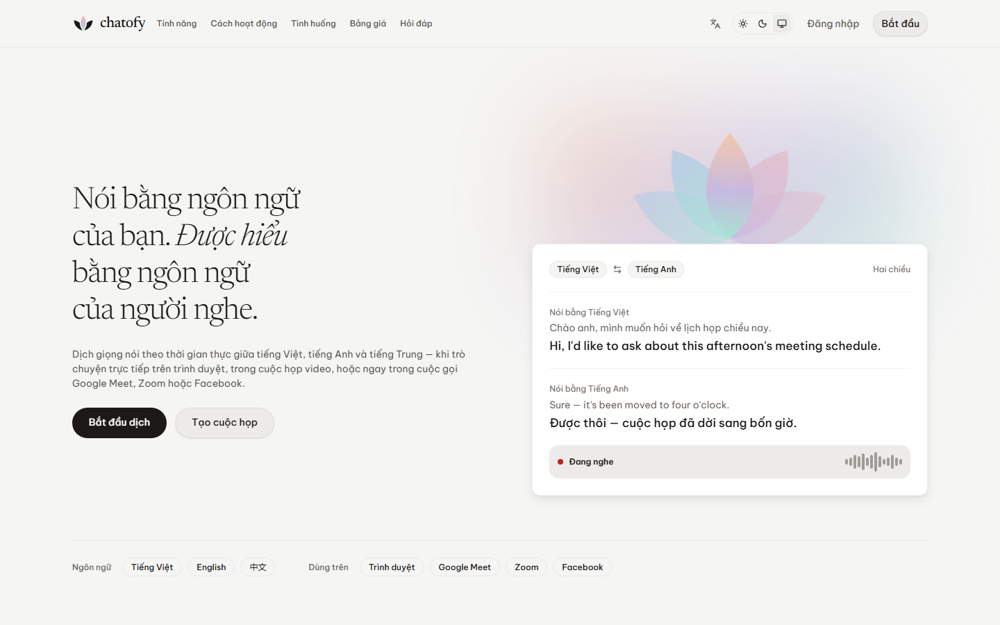
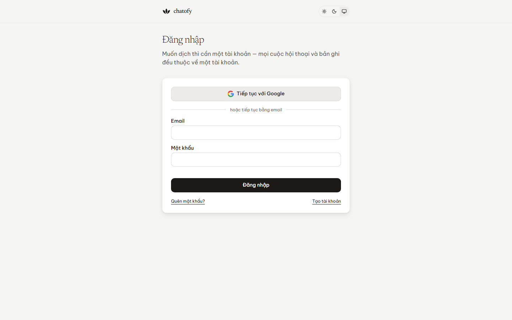
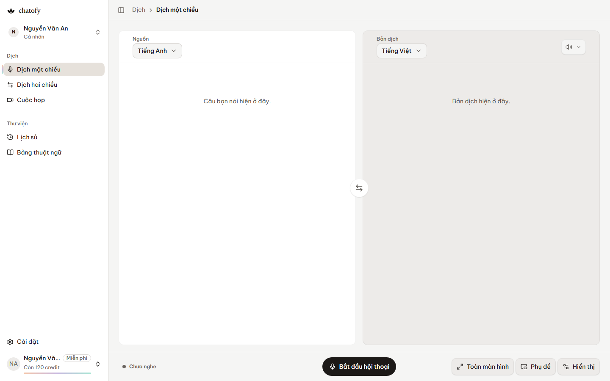
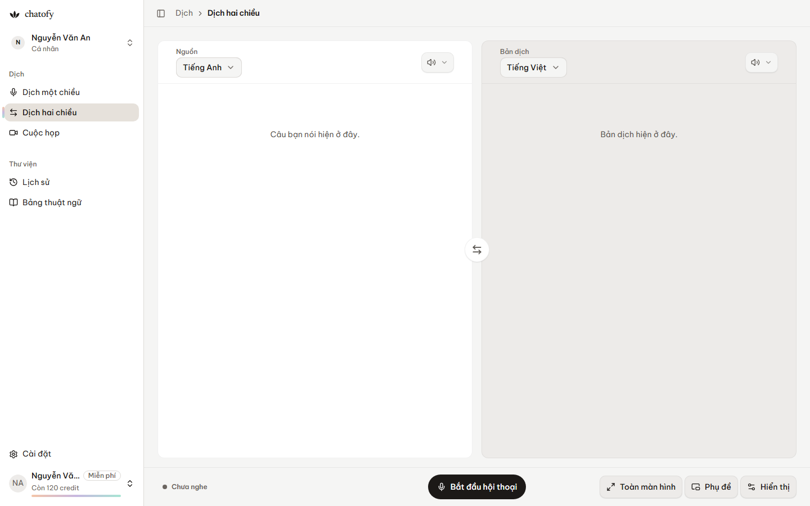
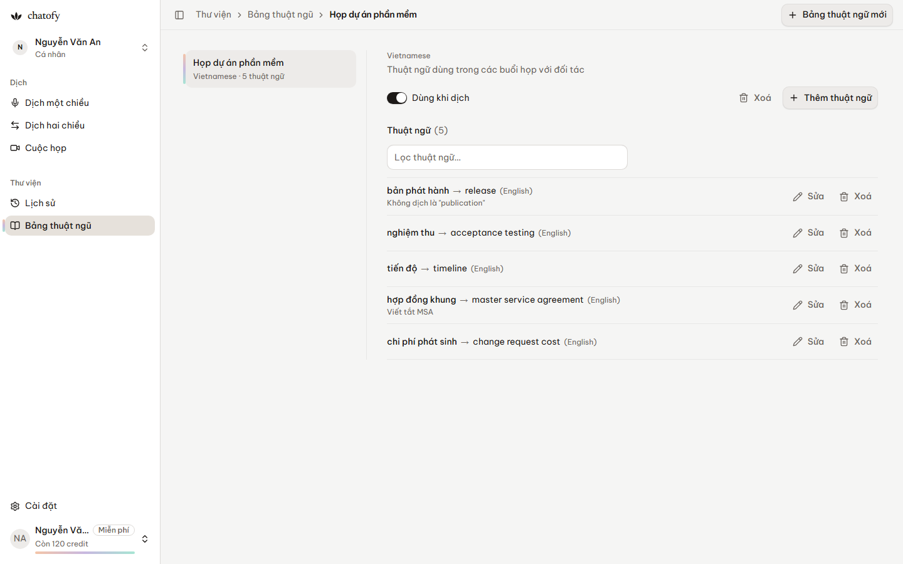
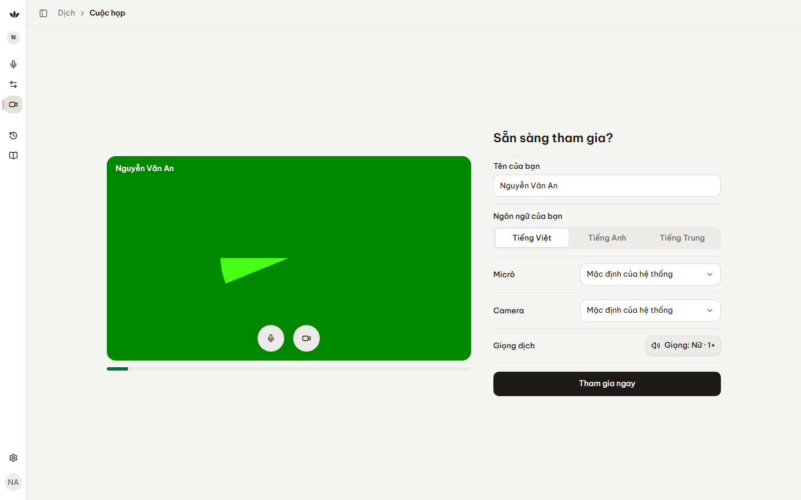
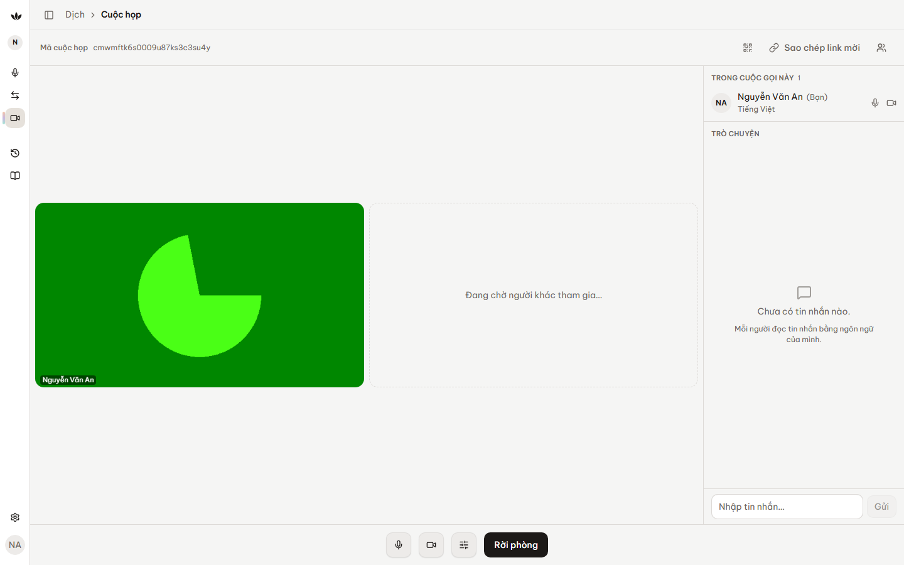
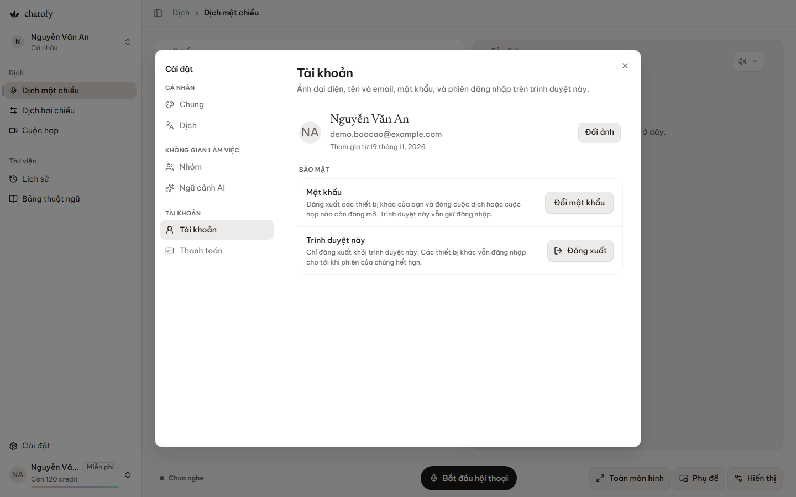
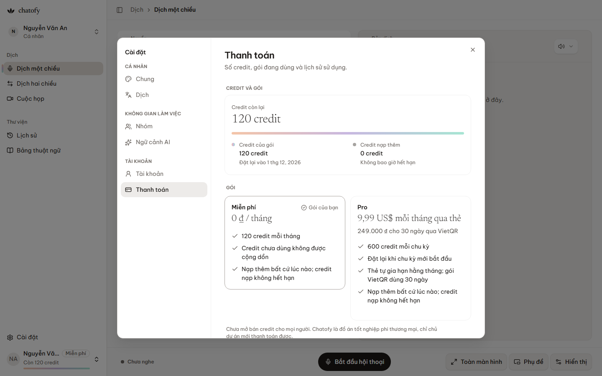

# CHƯƠNG 4. CÀI ĐẶT, GIAO DIỆN VÀ KIỂM THỬ

<!--
Ghi chú biên soạn (xoá khi chuyển sang Word):
- Số liệu kiểm thử lấy từ lần chạy CI 43833150235 trên main (commit ebb96903, 16/11/2026).
- Nguồn: README.md, docs/deployment-guide.md, .github/workflows/ci.yml, deploy.yml, docs/development-journey.md.
- [ẢNH 4.x] là chỗ cần chèn ảnh chụp màn hình; xem danh sách ở cuối file.
-->

Chương này trình bày môi trường phát triển và triển khai, quy trình tích hợp và triển khai liên tục, giao diện
của các chức năng chính, và kết quả kiểm thử hệ thống.

## 4.1 Môi trường phát triển và triển khai

### 4.1.1 Môi trường phát triển

Mã nguồn được quản lý trên GitHub dưới dạng một monorepo. Mọi thành phần không phải ứng dụng Node (PostgreSQL,
Redis, hai sidecar tiếng nói) chạy trong Docker, nên máy phát triển không cần cài Python hay PostgreSQL. Toàn bộ
cấu hình nằm trong một tệp `.env` ở thư mục gốc, được đọc bởi Docker Compose, API, web, Prisma và các bộ đo.

**Bảng 4.1. Môi trường phát triển**

| Thành phần                 | Phiên bản / công cụ                                |
| -------------------------- | -------------------------------------------------- |
| Node.js                    | 26 (theo CI)                                       |
| Trình quản lý gói          | pnpm, Turborepo                                    |
| Cơ sở dữ liệu              | PostgreSQL 16 (Docker, kèm extension `pg_trgm`)    |
| Bộ nhớ đệm                 | Redis (Docker)                                     |
| Sidecar tiếng nói          | Python, quản lý bằng `uv`, chạy trong Docker       |
| Máy phát triển và chạy thử | Intel Core i7-11700K, 8 nhân, 32 GB RAM, không GPU |

### 4.1.2 Môi trường triển khai

Hệ thống tự triển khai (_self-hosted_) trên một máy chủ. Hai bộ dịch vụ phát triển và production chạy song song
trên cùng máy nhưng tách biệt hoàn toàn về tên dự án Compose, cổng và volume dữ liệu. Mọi cổng production chỉ
lắng nghe trên `127.0.0.1`; truy cập từ Internet đi qua Cloudflare Tunnel, nên máy chủ không cần mở cổng nào ra
ngoài.

**Bảng 4.2. Hai bộ dịch vụ trên máy chủ**

| Dịch vụ                  | Phát triển             | Production                 |
| ------------------------ | ---------------------- | -------------------------- |
| PostgreSQL               | 127.0.0.1:5432         | 127.0.0.1:5433             |
| Redis                    | 127.0.0.1:6379         | 127.0.0.1:6380             |
| API                      | :3000 (chạy trực tiếp) | 127.0.0.1:4000 (container) |
| Web                      | :3001 (chạy trực tiếp) | 127.0.0.1:4001 (container) |
| local-stt                | 127.0.0.1:8002         | 127.0.0.1:8012             |
| local-tts                | 127.0.0.1:8003         | 127.0.0.1:8013             |
| Số luồng cho mỗi sidecar | 8                      | 4                          |

Sidecar STT production được cấp giới hạn bộ nhớ 5 GiB, vì khi bật nhận diện ngôn ngữ và tải đủ mô hình ba ngôn ngữ,
mức dùng đỉnh đo được là 4,4 GiB. Trọng số mô hình nằm trên ổ đĩa máy chủ và được gắn vào container ở chế độ chỉ
đọc.

## 4.2 Cài đặt hệ thống

Các bước cài đặt môi trường phát triển:

```bash
pnpm install                                  # cài phụ thuộc, sinh Prisma client
cp .env.example .env                          # tạo cấu hình
# đặt AUTH_JWT_SECRET, AUTH_SECRET và hai khoá CLOUDFLARE_REALTIME_APP_*
docker compose up -d --wait postgres redis    # khởi động cơ sở dữ liệu và Redis
pnpm --filter api exec prisma migrate deploy  # tạo lược đồ dữ liệu
pnpm dev                                      # chạy api, web và trình theo dõi của extension
```

Ở môi trường phát triển không cần cấu hình SMTP: liên kết xác thực email và đặt lại mật khẩu được in ra console của
API, nên toàn bộ luồng đăng ký, xác thực, đặt lại mật khẩu dùng được ngay. Trọng số mô hình tiếng nói được tải bằng
script của từng sidecar.

## 4.3 Tích hợp và triển khai liên tục

### 4.3.1 Quy trình tích hợp liên tục

Mỗi lần đẩy mã hoặc tạo pull request, GitHub Actions chạy workflow CI. Workflow phát hiện phần nào thay đổi để chỉ
chạy các job liên quan.

**Bảng 4.3. Các job của workflow CI**

| Job                          | Nội dung                                                                                                    |
| ---------------------------- | ----------------------------------------------------------------------------------------------------------- |
| Lint                         | ESLint trên mọi workspace; lỗi nếu còn vi phạm sau khi tự sửa                                               |
| Type check                   | Kiểm tra kiểu TypeScript trên 16 tác vụ                                                                     |
| Test                         | Kiểm thử đơn vị của 11 package qua Turborepo                                                                |
| API e2e                      | Kiểm thử đầu-cuối API không cần cơ sở dữ liệu                                                               |
| API e2e (Postgres)           | Áp dụng migration lên PostgreSQL thật, kiểm tra migration khớp schema, chạy các bộ test cần cơ sở dữ liệu   |
| Build                        | Build mọi workspace, kiểm tra sản phẩm build, thử khởi động máy chủ web                                     |
| Extension e2e                | Build tiện ích, chạy kiểm thử trên Chromium thật bằng Playwright                                            |
| Display ITN gates            | Kiểm tra ITN không sinh chữ số bịa trên tập VIVOS, LibriSpeech và đạt tỷ lệ chữ số đúng trên tập round-trip |
| STT / TTS sidecar unit tests | Kiểm thử đơn vị hai sidecar Python                                                                          |
| Realtime replay              | Phát lại các lượt nói qua chính sách phân lượt và committer                                                 |
| Supply chain                 | Kiểm tra chuỗi cung ứng phụ thuộc                                                                           |

Ngoài CI, kho mã dùng husky và commitlint để buộc thông điệp commit theo chuẩn Conventional Commits, và lint-staged để
định dạng mã trước khi commit.

### 4.3.2 Quy trình triển khai liên tục

Workflow `deploy.yml` chỉ chạy khi workflow CI trên nhánh `main` thành công, và chỉ khi lần chạy CI đến từ một lần đẩy
lên `main` của chính kho mã (không chạy cho pull request, vì runner là máy tự quản). Các bước theo thứ tự:

```
checkout(commit đã qua CI) → kiểm tra prod.env → build image → tải trọng số mô hình
→ pg_dump (sao lưu) → migrate → khởi động lại dịch vụ → smoke test cục bộ → smoke test qua tunnel → gắn tag → dọn dẹp
```

Sao lưu cơ sở dữ liệu luôn chạy ngay trước migration và được kiểm tra không rỗng. Migration là một bước riêng: nếu thất
bại, các container cũ vẫn tiếp tục phục vụ. Smoke test qua tunnel kiểm tra cả chính sách bảo mật nội dung (CSP) của web,
vì một image web cũ vẫn trả trang 200 nhưng chặn mọi yêu cầu tới API. Hệ thống giữ 14 bản sao lưu gần nhất.

**Hoàn tác.** Lỗi mã được hoàn tác bằng cách chạy lại workflow triển khai với một commit cũ hơn. Lỗi migration được hoàn
tác bằng `pg_restore` từ bản sao lưu ngay trước đó, vì `prisma migrate deploy` chỉ đi tiến. Khi `main` chuyển sang trạng
thái lỗi, một workflow riêng gửi cảnh báo.

## 4.4 Giao diện hệ thống

Giao diện web có hai ngôn ngữ (tiếng Việt và tiếng Anh), hỗ trợ chế độ sáng và tối, và được kiểm tra ở ba kích thước
1440×900, 768×1024 và 375×812. Thiết kế tuân theo hai quy tắc được kiểm tra tự động: mỗi trạng thái màn hình có tối đa
một nút dùng màu nhấn chính, và tối đa hai bề mặt nổi (mục 4.5.3).

### 4.4.1 Trang giới thiệu



Trang giới thiệu trình bày sản phẩm, ba tình huống sử dụng và bảng giá (`/pricing`). Trang có dữ liệu có cấu trúc
(JSON-LD), sitemap và tệp `llms.txt` để công cụ tìm kiếm và trợ lý AI đọc được.

### 4.4.2 Đăng ký và đăng nhập



Người dùng đăng nhập bằng email và mật khẩu hoặc bằng tài khoản Google. Liên kết "Tạo tài khoản" dẫn tới trang đăng
ký; tài khoản chỉ được tạo khi người dùng bấm liên kết xác thực gửi qua email.

### 4.4.3 Dịch hội thoại





<!-- TODO nhóm: thay Hình 4.3 hoặc 4.4 bằng ảnh đang dịch thật (văn bản nguồn và bản dịch đang hiện). Máy chụp
ảnh không build được sidecar tiếng nói (mạng chặn chứng chỉ TLS), nên chỉ chụp được trạng thái chờ. -->

Thanh bên trái là điều hướng chính: dịch một chiều, dịch hai chiều, cuộc họp, lịch sử, bảng thuật ngữ, cài đặt, cùng
số credit còn lại. Thanh dưới cùng có nút bắt đầu hội thoại (nút duy nhất dùng màu nhấn trên màn hình), các nút toàn
màn hình, phụ đề và hiển thị.

Màn hình dịch gồm hai tấm: văn bản nguồn và bản dịch. Trong lúc người dùng nói, văn bản nguồn hiện dần theo từng lần cập
nhật, bản dịch tạm xuất hiện phía sau; khi lượt kết thúc, chữ tạm chuyển dần thành chữ chính thức thay vì bị thay thế đột
ngột. Bộ chọn ngôn ngữ nguồn có tuỳ chọn tự nhận diện. Nút đổi chiều dịch làm hai tấm hoán đổi vị trí.

### 4.4.4 Lịch sử hội thoại

[ẢNH 4.5 — Danh sách lịch sử có ô tìm kiếm. CẦN CHỤP: tài khoản thử chưa có hội thoại nào.]

[ẢNH 4.6 — Chi tiết một hội thoại: các lượt theo người nói, nút nghe lại, nút sinh biên bản. CẦN CHỤP: cần một
hội thoại thật, nên chụp trên máy chạy được sidecar tiếng nói.]

Trang lịch sử liệt kê các hội thoại đã lưu, tìm kiếm không phân biệt dấu tiếng Việt (nhờ chuẩn hoá văn bản ở cả phía ghi
và phía truy vấn, kết hợp chỉ mục trigram). Trang chi tiết cho phép nghe lại bản ghi âm từ vị trí của từng lượt và sinh biên
bản gồm tóm tắt, ý chính, quyết định và việc cần làm.

### 4.4.5 Thuật ngữ và ngữ cảnh dịch



Mỗi bảng thuật ngữ có ngôn ngữ nguồn, công tắc "Dùng khi dịch" và danh sách mục thuật ngữ kèm ghi chú. Khi bảng được
bật, các mục thuật ngữ được đưa vào lời nhắc dịch để tên riêng và thuật ngữ chuyên ngành được dịch nhất quán.

### 4.4.6 Họp video





<!-- Ghi chú: khung video màu xanh là camera giả lập của trình duyệt dùng khi chụp tự động. Nhóm có thể thay bằng
ảnh cuộc họp thật có hai người và phụ đề. -->

[ẢNH 4.10 — Màn hình kết thúc họp với biên bản. CẦN CHỤP: cần cuộc họp có lượt nói thật để sinh biên bản.]

Sảnh chờ cho xem trước camera, chọn tên hiển thị, ngôn ngữ nói, micro, camera và giọng đọc bản dịch. Trong phòng họp,
danh sách người tham gia ghi rõ ngôn ngữ của từng người; khung trò chuyện dịch tin nhắn theo ngôn ngữ của người đọc.
Thanh trên cùng có mã cuộc họp, mã QR và nút sao chép liên kết mời.

Trong phòng họp, mỗi người thấy phụ đề bằng ngôn ngữ của mình. Menu phụ đề và âm thanh cho phép tắt giọng đọc bản dịch
hoặc chỉ xem phụ đề. Người dùng điện thoại có thể vào phòng bằng cách quét mã QR. Thanh bên và khung chat có thể kéo để
đổi kích thước.

### 4.4.7 Tiện ích Chrome

[ẢNH 4.11 — Popup của tiện ích khi đang dịch một cuộc gọi Google Meet. CẦN CHỤP: cần cài tiện ích vào Chrome và
mở một cuộc gọi Meet thật.]

Tiện ích thu âm thanh của tab cuộc gọi, nên dịch được lời của những người khác mà không bị lẫn với âm thanh phát ra. Chiều
ngược lại (dịch lời người dùng và phát vào cuộc gọi) được tắt mặc định.

### 4.4.8 Cài đặt và credit





Cài đặt là một hộp thoại mở trên trang hiện tại, chia thành ba nhóm: cá nhân (chung, dịch), không gian làm việc (nhóm,
ngữ cảnh AI) và tài khoản (tài khoản, thanh toán). Mục Thanh toán hiển thị số credit còn lại, phân bổ giữa credit của gói
và credit nạp thêm, và hai gói Miễn phí, Pro.

## 4.5 Kiểm thử

### 4.5.1 Chiến lược kiểm thử

Hệ thống được kiểm thử ở năm mức:

1. **Kiểm thử đơn vị** bằng Vitest cho mọi package TypeScript và bằng pytest cho hai sidecar Python.
2. **Kiểm thử đầu-cuối API**, gồm một bộ chạy trên PostgreSQL thật sau khi áp dụng toàn bộ migration.
3. **Kiểm thử trên trình duyệt thật** bằng Playwright: tiện ích Chrome trên Chromium; luồng dịch với micro được thay bằng
   tệp WAV, phần còn lại (AudioWorklet, bộ lấy mẫu lại, socket, giao diện) chạy thật.
4. **Kiểm thử phát lại** (_replay_): phát lại bản ghi hội thoại thật qua chính sách phân lượt, qua API dev hoặc
   production, để đo độ trễ, độ chính xác nhận diện ngôn ngữ và khả năng chịu rớt kết nối.
5. **Kiểm tra thiết kế tự động**: ngân sách màu nhấn, số bề mặt nổi, ngưỡng tương phản và tính nhất quán của design token
   được viết thành test.

### 4.5.2 Kết quả kiểm thử tự động

**Bảng 4.4. Kết quả kiểm thử trên CI (16/11/2026, nhánh `main`)**

| Bộ kiểm thử                | Số test đạt | Bỏ qua | Lỗi   |
| -------------------------- | ----------- | ------ | ----- |
| `web`                      | 2.406       | 0      | 0     |
| `api` (đơn vị)             | 2.064       | 0      | 0     |
| `@chatofy/realtime-client` | 598         | 8      | 0     |
| `@chatofy/ai-providers`    | 404         | 0      | 0     |
| `extension` (đơn vị)       | 271         | 0      | 0     |
| `@chatofy/types`           | 230         | 0      | 0     |
| `@chatofy/ui`              | 207         | 0      | 0     |
| `mobile`                   | 206         | 0      | 0     |
| `@chatofy/i18n`            | 40          | 0      | 0     |
| `@chatofy/api-client`      | 38          | 0      | 0     |
| Script gốc                 | 14          | 0      | 0     |
| API e2e                    | 63          | 12     | 0     |
| API e2e (PostgreSQL)       | 261         | 0      | 0     |
| Extension e2e (Chromium)   | 78          | 0      | 0     |
| Realtime replay            | 121         | 1      | 0     |
| Sidecar STT (pytest)       | 58          | 7      | 0     |
| Sidecar TTS (pytest)       | 100         | 0      | 0     |
| **Tổng**                   | **7.159**   | **28** | **0** |

Cả 13 job của workflow CI đều thành công. Lint và kiểm tra kiểu chạy sạch trên mọi workspace.

Để so sánh, vào đầu dự án (tháng 7/2026) API có 82 test, ứng dụng web chưa có test và chưa có lint, và CI chỉ chạy lint,
kiểm tra kiểu và build. Việc bổ sung test cho web xuất phát từ một quan sát cụ thể: cả ba lỗi nghiêm trọng của một vòng phát
triển đều nằm trong mã phía client chưa có test, trong khi lint, kiểm tra kiểu và build đều xanh (mục 3.5.3).

### 4.5.3 Kiểm tra thiết kế tự động

Hai quy tắc thiết kế khó kiểm tra bằng mắt được viết thành test:

- **Ngân sách màu nhấn:** mỗi trạng thái màn hình ứng dụng (trang dịch, lịch sử, glossary, phòng họp, hộp thoại cài đặt…)
  có tối đa một nút tô màu nhấn chính. Trang giới thiệu cho phép tối đa một nút mỗi phần.
- **Số bề mặt nổi:** tối đa hai bề mặt nổi trên một màn hình.

Bảng các vi phạm đã biết được kiểm tra theo cả hai chiều: khi một vi phạm được sửa, test buộc phải xoá dòng tương ứng. Bảng
này hiện rỗng. Ngoài ra, các test kiểm tra ngưỡng tương phản của mọi cặp màu chữ–nền và sự đồng bộ của design token giữa
chế độ sáng và tối.

Giới hạn của cách làm này: môi trường test (happy-dom) không có mô hình hộp, nên căn lề, tràn khung và mọi thứ đo bằng pixel
vẫn phải kiểm tra thủ công ở ba kích thước màn hình.

### 4.5.4 Kiểm thử khả năng chịu lỗi

**Rớt kết nối.** Bộ đo `benchmarks/socket-drop` dùng một proxy cắt kết nối phía trình duyệt ở giây thứ 45 trong khi giữ
nguyên phía API. Trên production, với cùng một bản ghi, hội thoại giữ được 19/19 lượt, trình duyệt kết nối lại một lần sau
593 ms và gửi lại lượt chưa được trả lời. Cơ chế heartbeat 15 giây giải phóng socket chết sau khoảng 30 giây.

**Quá tải sidecar.** Khi chạy đồng thời một phiên tự nhận diện và hai phiên hai chiều, sidecar STT nhận 20.632 yêu cầu và không
trả lỗi 503 nào. Năm socket hai chiều mở cùng lúc từ một tài khoản nhận một phiên hai chiều và bốn phiên một chiều có ghi lý do
giới hạn, không phát sinh lỗi.

**Hạn mức dịch máy.** Test đơn vị mô phỏng nhà cung cấp trả lỗi 429 và kiểm tra hệ thống chờ đúng thời gian yêu cầu, chuyển sang
mô hình dự phòng, và vẫn giữ văn bản nguồn khi việc dịch thất bại.

### 4.5.5 Đối chiếu tiêu chí thành công

**Bảng 4.5. Đối chiếu với tiêu chí thành công đặt ra**

| Tiêu chí                                           | Kết quả                                                                                                                                                     | Đánh giá                                                 |
| -------------------------------------------------- | ----------------------------------------------------------------------------------------------------------------------------------------------------------- | -------------------------------------------------------- |
| Độ trễ đầu-cuối dưới 2 s                           | Phòng thí nghiệm: 907 ms p50, 1.582 ms p95. Production, giọng thật: 1,54 s p50 khi dùng lại bản dịch suy đoán, 2,16 s khi không                             | Đạt trong phòng thí nghiệm; đạt một phần trên production |
| Hội thoại 10 phút không rớt                        | Rớt kết nối giữa chừng được tự nối lại, giữ 19/19 lượt trên production. Chưa có phép đo riêng cho hội thoại liên tục 10 phút                                | Đạt một phần                                             |
| Ít nhất 70% bản dịch đúng                          | 77,8% lượt không có lỗi nghiêm trọng (162 lượt, 17 hội thoại). Bổ sung ngữ cảnh cho hậu biên tập giảm lỗi nghiêm trọng chiều Việt → Anh từ 23,7% xuống 1,3% | Đạt                                                      |
| 120 credit miễn phí mỗi tháng, chặn khi hết        | Đã triển khai sổ cái credit, đo theo giây, không mở phiên khi dưới 1 credit                                                                                 | Đạt                                                      |
| Người dùng thử tự cài đặt và dùng không cần hỗ trợ | Chưa tổ chức thử nghiệm người dùng                                                                                                                          | Chưa đánh giá                                            |

## 4.6 Kết luận

Chương 4 đã trình bày môi trường triển khai tự quản với hai bộ dịch vụ tách biệt, quy trình CI gồm 13 job và quy trình triển
khai có sao lưu trước migration, giao diện của các chức năng chính, và kết quả kiểm thử. Tại thời điểm viết báo cáo, hệ thống
có 7.159 test tự động đều đạt, các quy tắc thiết kế được kiểm tra bằng test, và khả năng chịu rớt kết nối đã được kiểm chứng
trên production. Trong năm tiêu chí thành công, hai tiêu chí đạt, hai tiêu chí đạt một phần, và một tiêu chí chưa được đánh giá
do chưa tổ chức thử nghiệm với người dùng.

<!--
Đã chụp (19/11/2026, bản local, 1440×900, chế độ sáng, tiếng Việt, tài khoản thử demo.baocao@example.com):
4.1, 4.2, 4.3, 4.4, 4.7, 4.8, 4.9, 4.12, 4.13 — thư mục anh/. Còn thiếu: 4.5, 4.6, 4.10, 4.11.
Danh sách ảnh ban đầu:
4.1 /  ·  4.2 /login  ·  4.3 /translate/one-way khi đang dịch  ·  4.4 /translate/two-way khi đang dịch
4.5 /history  ·  4.6 /history/[id]  ·  4.7 /glossary  ·  4.8 /conference sảnh  ·  4.9 phòng họp 2 người có phụ đề
4.10 màn hình kết thúc họp  ·  4.11 popup extension trên Google Meet  ·  4.12 hộp thoại cài đặt  ·  4.13 trang credit
-->
