<!--
Ghi chú biên soạn (xoá khi chuyển sang Word):
- Trang bìa theo mẫu "BC - ĐATN - FINGENIUS" trong E:\PTIT\DATN\Mẫu (khung hoa văn, logo PTIT). Bản Word lấy trang
  bìa từ cong-cu/trang-bia.docx (tạo bằng cong-cu/tao-trang-bia.ps1); phần dưới đây chỉ để đọc trong Markdown.
- Mục lục, danh mục hình, danh mục bảng: tạo tự động trong Word (References → Table of Contents / Insert Table
  of Figures) sau khi đặt style Heading và Caption.
- Lời cảm ơn là bản nháp; nhóm nên sửa cho đúng giọng của mình.
-->

**BỘ KHOA HỌC VÀ CÔNG NGHỆ**

**HỌC VIỆN CÔNG NGHỆ BƯU CHÍNH VIỄN THÔNG**

**KHOA CÔNG NGHỆ THÔNG TIN 1**

[LOGO PTIT]

**ĐỒ ÁN TỐT NGHIỆP**

**ĐỀ TÀI**

**NGHIÊN CỨU VÀ PHÁT TRIỂN HỆ THỐNG DỊCH THOẠI THỜI GIAN THỰC CHATOFY**

|                           |                                                  |
| ------------------------- | ------------------------------------------------ |
| Giảng viên hướng dẫn      | : PGS. TS. Nguyễn Trọng Khánh                    |
| Thông tin thành viên nhóm | : 1. Nguyễn Việt Tú - B22DCCN748 - D22CNPM02     |
|                           | 2. Nguyễn Mạc Quang Anh - B22DCCN029 - D22CNPM02 |
| Khoá                      | : 2022 - 2027                                    |
| Hệ                        | : Đại học chính quy                              |

**Hà Nội - 2026**

---

# LỜI CẢM ƠN

Trước hết, chúng em xin bày tỏ lòng biết ơn sâu sắc tới thầy PGS. TS. Nguyễn Trọng Khánh, giảng viên hướng dẫn, đã
tận tình định hướng, góp ý và tạo điều kiện để chúng em hoàn thành đồ án này. Những nhận xét của thầy giúp chúng em
nhìn ra điểm yếu trong cách tiếp cận và giữ được sự nghiêm túc trong từng phép đo.

Chúng em xin gửi lời cảm ơn tới Ban Giám đốc Học viện Công nghệ Bưu chính Viễn thông và các thầy cô trong Khoa Công
nghệ Thông tin I đã truyền đạt cho chúng em nền tảng kiến thức trong suốt những năm học tập tại Học viện.

Chúng em cũng cảm ơn gia đình và bạn bè đã luôn động viên, và cảm ơn những người đã dành thời gian dùng thử sản phẩm,
ghi âm hội thoại và góp ý để hệ thống ngày càng hoàn thiện.

Dù đã cố gắng, đồ án chắc chắn không tránh khỏi thiếu sót. Chúng em rất mong nhận được ý kiến đóng góp của quý thầy cô
để đề tài được hoàn thiện hơn.

Chúng em xin chân thành cảm ơn!

_Hà Nội, ngày ..... tháng 12 năm 2026_

**Nhóm sinh viên thực hiện**

Nguyễn Việt Tú

Nguyễn Mạc Quang Anh

---

# NHẬN XÉT, ĐÁNH GIÁ, CHO ĐIỂM

**(Của Giảng viên hướng dẫn)**

.......................................................................................................................................

.......................................................................................................................................

.......................................................................................................................................

.......................................................................................................................................

.......................................................................................................................................

.......................................................................................................................................

.......................................................................................................................................

.......................................................................................................................................

.......................................................................................................................................

.......................................................................................................................................

.......................................................................................................................................

.......................................................................................................................................

.......................................................................................................................................

.......................................................................................................................................

.......................................................................................................................................

Điểm: .................................... (Bằng chữ: ....................................)

_Hà Nội, ngày ..... tháng ..... năm 20....._

**GIẢNG VIÊN HƯỚNG DẪN**

_(Ký và ghi rõ họ tên)_

---

# NHẬN XÉT, ĐÁNH GIÁ, CHO ĐIỂM

**(Của Giảng viên phản biện)**

.......................................................................................................................................

.......................................................................................................................................

.......................................................................................................................................

.......................................................................................................................................

.......................................................................................................................................

.......................................................................................................................................

.......................................................................................................................................

.......................................................................................................................................

.......................................................................................................................................

.......................................................................................................................................

.......................................................................................................................................

.......................................................................................................................................

.......................................................................................................................................

.......................................................................................................................................

.......................................................................................................................................

Điểm: .................................... (Bằng chữ: ....................................)

_Hà Nội, ngày ..... tháng ..... năm 20....._

**CÁN BỘ - GIẢNG VIÊN PHẢN BIỆN**

_(Ký và ghi rõ họ tên)_

---

# MỤC LỤC

[Tạo tự động trong Word]

# DANH MỤC HÌNH ẢNH

[Tạo tự động trong Word từ chú thích "Hình x.y"]

# DANH MỤC BẢNG BIỂU

[Tạo tự động trong Word từ chú thích "Bảng x.y"]

# DANH MỤC KÝ HIỆU VÀ TỪ VIẾT TẮT

| Từ viết tắt | Tiếng Anh                                      | Tiếng Việt                               |
| ----------- | ---------------------------------------------- | ---------------------------------------- |
| AI          | Artificial Intelligence                        | Trí tuệ nhân tạo                         |
| API         | Application Programming Interface              | Giao diện lập trình ứng dụng             |
| ASR         | Automatic Speech Recognition                   | Nhận dạng tiếng nói tự động              |
| CER         | Character Error Rate                           | Tỷ lệ lỗi ký tự                          |
| CI/CD       | Continuous Integration / Continuous Deployment | Tích hợp liên tục / Triển khai liên tục  |
| CPU         | Central Processing Unit                        | Bộ xử lý trung tâm                       |
| CSP         | Content Security Policy                        | Chính sách bảo mật nội dung              |
| e2e         | End-to-end                                     | Đầu-cuối                                 |
| GPU         | Graphics Processing Unit                       | Bộ xử lý đồ hoạ                          |
| ICE         | Interactive Connectivity Establishment         | Thiết lập kết nối tương tác              |
| ITN         | Inverse Text Normalization                     | Chuẩn hoá văn bản ngược                  |
| JWT         | JSON Web Token                                 | Token web dạng JSON                      |
| LID         | Language Identification                        | Nhận diện ngôn ngữ                       |
| LLM         | Large Language Model                           | Mô hình ngôn ngữ lớn                     |
| MCU         | Multipoint Control Unit                        | Bộ điều khiển đa điểm                    |
| MOS         | Mean Opinion Score                             | Điểm đánh giá trung bình                 |
| MQM         | Multidimensional Quality Metrics               | Thước đo chất lượng đa chiều             |
| MT          | Machine Translation                            | Dịch máy                                 |
| MV3         | Manifest Version 3                             | Phiên bản manifest 3 của tiện ích Chrome |
| ORM         | Object-Relational Mapping                      | Ánh xạ đối tượng – quan hệ               |
| p50 / p95   | 50th / 95th percentile                         | Trung vị / phân vị 95                    |
| PCM         | Pulse-Code Modulation                          | Điều chế xung mã                         |
| REST        | Representational State Transfer                | Kiến trúc truyền trạng thái đại diện     |
| RNN-T       | Recurrent Neural Network Transducer            | Bộ chuyển đổi mạng nơ-ron hồi quy        |
| RTF         | Real-Time Factor                               | Hệ số thời gian thực                     |
| RTT         | Round-Trip Time                                | Thời gian khứ hồi                        |
| SDP         | Session Description Protocol                   | Giao thức mô tả phiên                    |
| SFU         | Selective Forwarding Unit                      | Bộ chuyển tiếp chọn lọc                  |
| STT         | Speech-to-Text                                 | Chuyển tiếng nói thành văn bản           |
| STUN        | Session Traversal Utilities for NAT            | Tiện ích vượt NAT cho phiên              |
| TDT         | Token-and-Duration Transducer                  | Transducer dự đoán token và thời lượng   |
| TTFA        | Time to First Audio                            | Thời gian tới âm thanh đầu tiên          |
| TTS         | Text-to-Speech                                 | Tổng hợp tiếng nói                       |
| TURN        | Traversal Using Relays around NAT              | Vượt NAT bằng máy chủ chuyển tiếp        |
| UI          | User Interface                                 | Giao diện người dùng                     |
| VAD         | Voice Activity Detection                       | Phát hiện hoạt động giọng nói            |
| WebRTC      | Web Real-Time Communication                    | Truyền thông thời gian thực trên web     |
| WER         | Word Error Rate                                | Tỷ lệ lỗi từ                             |

# MỞ ĐẦU

## 1. Lý do chọn đề tài

Rào cản ngôn ngữ vẫn là một trong những trở ngại lớn khi người Việt Nam làm việc với đối tác nước ngoài, đi du lịch,
hay tham gia các nhóm làm việc đa quốc gia. Các công cụ dịch phổ biến hiện nay phần lớn chỉ phục vụ một tình huống:
ứng dụng dịch trên điện thoại cho hội thoại mặt đối mặt, hoặc tính năng phụ đề dịch gắn với một nền tảng họp trực tuyến
cụ thể và thường thuộc gói trả phí. Các công cụ này đều xử lý hoàn toàn trên đám mây, nên phát sinh chi phí theo lượt
dùng và đưa giọng nói của người dùng ra ngoài.

Mặt khác, trong vài năm gần đây, các mô hình nhận dạng và tổng hợp tiếng nói mã nguồn mở đã đủ nhỏ để chạy trên CPU
thông thường, và các mô hình ngôn ngữ lớn dịch tốt nhiều cặp ngôn ngữ. Câu hỏi đặt ra là: có thể ghép các thành phần
này thành một hệ thống dịch hội thoại đủ nhanh để trò chuyện tự nhiên, chạy trên một máy tính không có GPU, và dùng
chung cho cả hội thoại trực tiếp lẫn họp trực tuyến hay không. Đó là lý do nhóm chọn đề tài "Nghiên cứu và phát triển
hệ thống dịch thoại thời gian thực Chatofy".

## 2. Mục tiêu của đề tài

- Xây dựng hệ thống dịch hội thoại giữa tiếng Việt, tiếng Anh và tiếng Trung, với độ trễ từ lúc người nói dừng đến lúc
  nghe bản dịch dưới 2 giây.
- Chạy nhận dạng và tổng hợp tiếng nói cục bộ trên CPU, không cần khoá API cho phần tiếng nói.
- Hỗ trợ hội thoại hai chiều Việt–Anh trên một thiết bị, tự nhận diện ngôn ngữ và người nói của từng lượt.
- Dùng chung một luồng dịch cho ba tình huống: hội thoại trực tiếp trên web, họp video có dịch, và cuộc gọi trên Google
  Meet, Zoom, Facebook qua tiện ích Chrome.
- Đánh giá từng lựa chọn kỹ thuật bằng thực nghiệm có thể tái lập.

## 3. Đối tượng và phạm vi nghiên cứu

**Đối tượng nghiên cứu:** các kỹ thuật nhận dạng tiếng nói, tổng hợp tiếng nói, nhận diện ngôn ngữ và người nói, dịch máy
bằng mô hình ngôn ngữ lớn, truyền thông thời gian thực qua WebSocket và WebRTC.

**Phạm vi:**

- Trọng tâm là luồng dịch hội thoại trên web và họp video có dịch.
- Các chức năng hỗ trợ (tài khoản, lịch sử, bảng thuật ngữ, nhóm, credit, tiện ích Chrome) được trình bày ở mức thiết kế
  và giao diện.
- Ứng dụng di động mới chạy ở bản phát triển nên chỉ được nhắc tới ở hướng phát triển.
- Đồ án không huấn luyện mô hình mới. Các mô hình nhận dạng, tổng hợp tiếng nói và dịch máy là mô hình tiền huấn luyện
  hoặc dịch vụ có sẵn; đóng góp của đồ án nằm ở kỹ thuật hệ thống và phương pháp đánh giá.

## 4. Phương pháp nghiên cứu

Nhóm áp dụng quy trình "khảo sát → đo đạc → quyết định": khảo sát các mô hình và giải pháp ứng viên; xây dựng bộ đo có thể
tái lập và đo trên chính phần cứng sẽ chạy; quyết định dựa trên ngưỡng đặt trước; và đo lại sau mỗi thay đổi. Kết quả được
kiểm chứng bằng nhiều phương pháp độc lập (phát lại offline, công cụ điều khiển phiên, trình duyệt thật, phát lại trên
production). Kho mã có khoảng 25 bộ đo trong thư mục `benchmarks/`, mỗi bộ trả lời một câu hỏi cụ thể.

## 5. Đóng góp chính của đồ án

1. Một luồng dịch dạng tầng chạy phần tiếng nói trên CPU, đạt độ trễ 907 ms (p50) và 1.582 ms (p95) trong điều kiện phòng
   thí nghiệm, nhờ kết hợp chồng thời gian phát hiện kết thúc câu, tách mệnh đề, gọi API dạng luồng và dịch suy đoán.
2. Cơ chế nhận diện ngôn ngữ theo từng lượt cho hội thoại hai chiều Việt–Anh, được chọn qua một bộ đo so sánh năm phương án
   và đưa vào production.
3. Họp video dịch theo từng người nghe trên SFU, dùng chung luồng dịch với hội thoại trực tiếp.
4. Lớp hiển thị tiếng Việt bằng chuẩn hoá văn bản ngược tất định, đưa tỷ lệ chữ số đúng từ 0 lên 100% với chi phí dưới
   1 ms mỗi lượt.
5. Phương pháp đánh giá chất lượng dịch bằng mô hình ngôn ngữ lớn đã hiệu chuẩn, chỉ ra và khắc phục nguồn lỗi chính:
   bổ sung ngữ cảnh hội thoại giảm lỗi dịch nghiêm trọng chiều Việt → Anh từ 23,7% xuống 1,3%.

<!-- TODO nhóm: chèn bảng phân công công việc giữa hai thành viên tại đây (nhóm tự điền). -->

## 6. Bố cục của báo cáo

Ngoài phần Mở đầu, Kết luận và Tài liệu tham khảo, báo cáo gồm bốn chương:

- **Chương 1. Tổng quan và cơ sở lý thuyết:** bài toán dịch thoại thời gian thực, khảo sát sản phẩm hiện có, cơ sở lý
  thuyết về xử lý tiếng nói, dịch máy và truyền thông thời gian thực, các công nghệ sử dụng.
- **Chương 2. Phân tích và thiết kế hệ thống:** yêu cầu, biểu đồ use case, kịch bản, kiến trúc, biểu đồ tuần tự, cơ sở
  dữ liệu, giao diện lập trình và bảo mật.
- **Chương 3. Kỹ thuật dịch thoại thời gian thực và thực nghiệm:** lựa chọn mô hình, các kỹ thuật giảm độ trễ, nhận diện
  ngôn ngữ và người nói, đánh giá chất lượng dịch, dịch trong họp video.
- **Chương 4. Cài đặt, giao diện và kiểm thử:** môi trường triển khai, quy trình CI/CD, giao diện, kết quả kiểm thử và
  đối chiếu tiêu chí thành công.

# CHƯƠNG 1. TỔNG QUAN VÀ CƠ SỞ LÝ THUYẾT

<!--
Ghi chú biên soạn (xoá khi chuyển sang Word):
- Mục 1.2 dựa trên tìm kiếm web ngày 19/11/2026; tính năng sản phẩm thương mại thay đổi nhanh, cần kiểm lại
  trước khi nộp. Nguồn ghi ở cuối file.
- Trích dẫn đã đánh số theo IEEE, khớp với 06-tai-lieu-tham-khao.md.
-->

Chương này giới thiệu bài toán dịch thoại thời gian thực, khảo sát một số sản phẩm hiện có, trình bày cơ sở
lý thuyết về xử lý tiếng nói, dịch máy, truyền thông thời gian thực, và các công nghệ được dùng để xây dựng
hệ thống Chatofy.

## 1.1 Bài toán dịch thoại thời gian thực

### 1.1.1 Phát biểu bài toán

Dịch thoại thời gian thực (_real-time speech translation_) là bài toán nhận lời nói ở ngôn ngữ nguồn và tạo
ra bản dịch ở ngôn ngữ đích, dưới dạng chữ, giọng nói hoặc cả hai, trong khi cuộc hội thoại đang diễn ra.
Khác với dịch văn bản, đầu vào là một luồng âm thanh liên tục: hệ thống phải tự quyết định khi nào một câu đã
kết thúc, câu đó thuộc ngôn ngữ nào và do ai nói, rồi mới dịch.

Với hội thoại, chất lượng trải nghiệm phụ thuộc vào ba yếu tố:

1. **Độ trễ**: thời gian từ khi người nói dừng đến khi người nghe nhận được bản dịch. Nếu độ trễ quá lớn, hai
   người sẽ nói chồng lên nhau hoặc phải chờ lâu sau mỗi câu.
2. **Độ chính xác**: lỗi có thể đến từ việc nghe sai, dịch sai hoặc cắt câu sai chỗ.
3. **Phản hồi liên tục**: người dùng cần thấy hệ thống đang "nghe" mình, ví dụ chữ hiện ra trong lúc đang nói.

### 1.1.2 Hai hướng tiếp cận

**Hướng tầng (_cascade_)** ghép ba thành phần độc lập: nhận dạng tiếng nói (ASR hoặc STT) chuyển âm thanh thành
văn bản, dịch máy (MT) chuyển văn bản sang ngôn ngữ đích, và tổng hợp tiếng nói (TTS) đọc bản dịch. Ưu điểm là
mỗi thành phần có thể thay thế và đánh giá riêng, văn bản trung gian dùng được cho phụ đề và lưu trữ. Nhược điểm
là độ trễ cộng dồn qua ba bước và lỗi của bước trước lan sang bước sau.

**Hướng đầu-cuối (_end-to-end_)** dùng một mô hình duy nhất nhận âm thanh và sinh trực tiếp bản dịch, thường là
giọng nói. Hướng này có thể giảm độ trễ và giữ được ngữ điệu, nhưng khó kiểm soát từng bước, khó thêm thuật ngữ
riêng, thường chỉ có dưới dạng dịch vụ đám mây, và không nhất thiết hỗ trợ mọi cặp ngôn ngữ.

Chatofy chọn hướng tầng. Nhóm đã thử một mô hình đầu-cuối (Gemini Live [1]) làm mốc so sánh; lý do lựa chọn và kết
quả đo được trình bày ở Chương 3.

### 1.1.3 Các thách thức kỹ thuật

- **Phát hiện điểm kết thúc câu** (_endpointing_): chờ im lặng lâu thì chậm, chờ ngắn thì cắt giữa câu.
- **Phân lượt** (_turn-taking_): khi hai người dùng chung một micro, hệ thống phải biết ai đang nói.
- **Nhận diện ngôn ngữ**: ở chế độ hai chiều, mỗi lượt có thể là một trong hai ngôn ngữ.
- **Tiếng vọng**: khi bản dịch phát ra loa, micro có thể thu lại và dịch tiếp chính bản dịch đó.
- **Tài nguyên**: các mô hình lớn cho chất lượng tốt nhưng cần GPU; chạy trên CPU đòi hỏi chọn mô hình cẩn thận.
- **Tiếng Việt**: là ngôn ngữ có thanh điệu, nhiều từ đồng âm, và còn ít mô hình mã nguồn mở chất lượng cao so
  với tiếng Anh.

## 1.2 Khảo sát các sản phẩm hiện có

### 1.2.1 Google Translate – chế độ hội thoại

Ứng dụng Google Translate trên điện thoại có chế độ hội thoại: hai người dùng chung một thiết bị, ứng dụng nghe
và dịch qua lại giữa hai ngôn ngữ đã chọn, đọc bản dịch thành tiếng. Đây là công cụ phổ biến nhất cho hội thoại
mặt đối mặt. Hạn chế là không lưu lịch sử hội thoại có cấu trúc, không hỗ trợ bảng thuật ngữ riêng, và không dùng
được bên trong một cuộc họp trực tuyến.

### 1.2.2 Microsoft Translator – hội thoại nhiều thiết bị

Microsoft Translator từng cung cấp tính năng hội thoại nhiều thiết bị: mỗi người tham gia từ thiết bị riêng, nói
bằng ngôn ngữ của mình và đọc bản dịch sang ngôn ngữ của mình [2]. Năm 2022, Microsoft chuyển ứng dụng web
sang giao diện rút gọn và bỏ khả năng tạo hội thoại trên web [3]; tính năng này nay chỉ còn trên ứng dụng
di động và không dùng được bên trong các nền tảng họp trực tuyến.

### 1.2.3 Google Meet – dịch giọng nói và phụ đề dịch

Google Meet có hai tính năng: phụ đề dịch (_translated captions_) và dịch giọng nói bằng Gemini. Tháng 10/2026,
Google công bố dịch giọng nói hỗ trợ 63 ngôn ngữ trên web, Android và iOS, có tự nhận diện ngôn ngữ, thay cho phiên
bản trước chỉ hỗ trợ tiếng Anh với năm ngôn ngữ châu Âu [4]. Các tính năng này gắn với
gói Google Workspace trả phí và chỉ dùng được bên trong Google Meet.

### 1.2.4 Zoom – phụ đề dịch

Zoom cung cấp phụ đề dịch dưới dạng tiện ích trả phí, hỗ trợ khoảng 35–36 ngôn ngữ, trong đó có tiếng Việt [5]. Tính năng chỉ cung cấp phụ đề, không đọc bản dịch thành tiếng.

### 1.2.5 Thiết bị phiên dịch cầm tay

Các thiết bị như máy phiên dịch cầm tay hoạt động tương tự chế độ hội thoại của Google Translate trên một phần cứng
riêng. Chúng tiện cho du lịch nhưng tốn chi phí thiết bị và không phục vụ họp trực tuyến.

### 1.2.6 So sánh và định hướng

**Bảng 1.1. So sánh tính năng các sản phẩm**

| Tiêu chí                              | Google Translate | Google Meet           | Zoom                  | Chatofy                   |
| ------------------------------------- | ---------------- | --------------------- | --------------------- | ------------------------- |
| Hội thoại mặt đối mặt                 | Có               | Không                 | Không                 | Có                        |
| Họp video có dịch                     | Không            | Có (gói trả phí)      | Phụ đề (gói trả phí)  | Có                        |
| Dịch trong cuộc gọi của nền tảng khác | Không            | Không                 | Không                 | Có (tiện ích Chrome)      |
| Đọc bản dịch thành tiếng              | Có               | Có                    | Không                 | Có                        |
| Lưu và tìm kiếm lịch sử hội thoại     | Hạn chế          | Theo bản ghi cuộc họp | Theo bản ghi cuộc họp | Có                        |
| Bảng thuật ngữ, ngữ cảnh dịch riêng   | Không            | Không                 | Không                 | Có, dùng chung trong nhóm |
| Biên bản tự động                      | Không            | Có (gói trả phí)      | Có (gói trả phí)      | Có                        |
| Nhận dạng tiếng nói chạy cục bộ       | Không            | Không                 | Không                 | Có                        |

Bảng 1.1 cho thấy các sản phẩm lớn hoặc chỉ phục vụ hội thoại mặt đối mặt, hoặc chỉ phục vụ cuộc họp trên chính
nền tảng của mình, và đều dựa hoàn toàn vào đám mây. Chatofy hướng tới việc dùng chung một luồng dịch cho cả ba
tình huống (mặt đối mặt, họp video, cuộc gọi trên nền tảng khác), hỗ trợ thuật ngữ riêng của người dùng và của
nhóm, và chạy phần xử lý tiếng nói cục bộ để giảm chi phí và tăng quyền riêng tư.

### 1.2.7 Đối tượng người dùng

Dựa trên khảo sát, Chatofy xác định hai nhóm người dùng chính và hai nhóm phụ:

- **Người đi làm Việt Nam trao đổi với đối tác nói tiếng Anh hoặc tiếng Trung** (nhóm chính): cần dịch trong các
  buổi gặp trực tiếp và các cuộc gọi trên Google Meet hoặc Zoom.
- **Nhóm làm việc đa quốc gia quy mô nhỏ, từ 2 đến 6 người** (nhóm chính): cần một phòng họp mà mỗi người nói tiếng
  của mình.
- **Khách du lịch và người Việt ra nước ngoài** (nhóm phụ): cần hội thoại ngắn mặt đối mặt.
- **Doanh nghiệp nhỏ có thuật ngữ chuyên ngành** (nhóm phụ): cần một bảng thuật ngữ dùng chung cho cả nhóm.

<!-- TODO nhóm: bổ sung 1–2 số liệu bối cảnh có nguồn chính thức (lượng khách quốc tế đến Việt Nam,
xếp hạng EF EPI của Việt Nam, số doanh nghiệp FDI). Không dùng số tự ước tính. -->

## 1.3 Cơ sở lý thuyết xử lý tiếng nói

### 1.3.1 Nhận dạng tiếng nói

Nhận dạng tiếng nói tự động (_Automatic Speech Recognition_, ASR) chuyển tín hiệu âm thanh thành chuỗi ký tự hoặc
từ. Âm thanh thường được biến đổi thành đặc trưng phổ Mel (_log-Mel filterbank_), mỗi khung khoảng 10 ms, rồi đưa
qua một bộ mã hoá (_encoder_) mạng nơ-ron. Có ba họ kiến trúc giải mã phổ biến:

**Mô hình transducer (RNN-T).** Đề xuất bởi Graves [6], gồm bộ mã hoá âm thanh, mạng dự đoán (_prediction
network_) mô hình hoá chuỗi token đã sinh, và mạng nối (_joint network_) kết hợp hai nguồn để dự đoán token tiếp
theo hoặc ký hiệu rỗng. Transducer phù hợp với nhận dạng streaming và có độ trễ thấp. Zipformer [7] là
một bộ mã hoá cho transducer, xử lý chuỗi ở nhiều tốc độ khung khác nhau theo cấu trúc giống U-Net để giảm chi phí
tính toán. Chatofy dùng mô hình Zipformer 30 triệu tham số cho tiếng Việt.

**Token-and-Duration Transducer (TDT).** Mở rộng của transducer: ngoài token, mô hình dự đoán thêm số khung cần bỏ
qua, giúp giải mã nhanh hơn. Parakeet-TDT-0.6B-v2, mô hình Chatofy dùng cho tiếng Anh, kết hợp bộ mã hoá
FastConformer [8] với bộ giải mã TDT [9], và tự sinh dấu câu, chữ hoa.

**Mô hình mã hoá–giải mã (encoder–decoder).** Whisper [10] là mô hình Transformer mã hoá–giải mã được
huấn luyện trên khoảng 680.000 giờ dữ liệu đa ngôn ngữ có giám sát yếu, đồng thời thực hiện nhiều tác vụ: nhận dạng,
dịch sang tiếng Anh và nhận diện ngôn ngữ. Giải mã tự hồi quy của Whisper chậm trên CPU, nên Chatofy chỉ dùng phần
xác suất ngôn ngữ của Whisper base để nhận diện ngôn ngữ. PhoWhisper [11] là Whisper được tinh chỉnh
cho tiếng Việt.

**Mô hình không tự hồi quy.** Paraformer [12] dự đoán số token và sinh toàn bộ chuỗi trong một bước,
nhanh hơn giải mã tự hồi quy. Chatofy dùng Paraformer cho tiếng Trung.

**Giải mã và danh sách từ ưu tiên.** Giải mã tham lam (_greedy search_) chọn token có xác suất cao nhất ở mỗi bước;
giải mã chùm (_beam search_) giữ nhiều giả thuyết song song. Danh sách từ ưu tiên (_hotwords_ hoặc _contextual
biasing_) cộng điểm cho các cụm từ biết trước như tên riêng.

**Chỉ số đánh giá.** Tỷ lệ lỗi từ được tính:

$$\text{WER} = \frac{S + D + I}{N}$$

trong đó $S$, $D$, $I$ là số từ bị thay thế, xoá, chèn, và $N$ là số từ của câu tham chiếu. Với tiếng Trung, không
có khoảng trắng giữa các từ, nên dùng tỷ lệ lỗi ký tự (CER). Tốc độ được đo bằng hệ số thời gian thực
$\text{RTF} = t_{\text{xử lý}} / t_{\text{âm thanh}}$.

### 1.3.2 Phát hiện giọng nói và phân lượt

Bộ phát hiện giọng nói (_Voice Activity Detection_, VAD) phân loại mỗi khung âm thanh là có tiếng nói hay không.
Cách đơn giản nhất so năng lượng (RMS) với một ngưỡng; các mô hình học sâu như Silero VAD [13] phân biệt
tốt hơn tiếng nói với nhạc và tiếng ồn.

Từ đầu ra VAD, hệ thống xác định điểm kết thúc lượt: một lượt kết thúc khi im lặng kéo dài quá một khoảng chờ
(_hangover_). Khoảng chờ dài làm tăng độ trễ, khoảng chờ ngắn làm cắt câu khi người nói ngập ngừng. Một kỹ thuật bù
trừ là **dịch suy đoán**: bắt đầu xử lý ngay khi có im lặng ngắn, và chỉ dùng kết quả nếu sau đó người nói thực sự
dừng.

### 1.3.3 Nhận diện ngôn ngữ và nhận diện người nói

**Nhận diện ngôn ngữ** (_Language Identification_, LID) xác định ngôn ngữ của một đoạn âm thanh. Có thể dùng mô hình
chuyên dụng (như MMS-LID [14], AmberNet [15]), dùng xác suất ngôn ngữ của một mô hình ASR đa ngôn ngữ (như Whisper),
hoặc cho nhiều bộ nhận dạng cùng chạy rồi so sánh độ tin cậy. Độ chính xác giảm mạnh với đoạn âm thanh ngắn, nên
hệ thống thời gian thực phải cân bằng giữa hiển thị nhãn sớm và hiển thị nhãn đúng.

**Nhận diện người nói** dựa trên vector đặc trưng giọng nói (_speaker embedding_): một mạng nơ-ron ánh xạ đoạn âm
thanh thành một vector có số chiều cố định, sao cho các đoạn của cùng một người gần nhau. Độ tương đồng giữa hai vector
$a$ và $b$ được đo bằng cosine:

$$\cos(a, b) = \frac{a \cdot b}{\lVert a \rVert \, \lVert b \rVert}$$

Chatofy dùng CAM++ [16], một mạng xác minh người nói dựa trên TDNN với cơ chế che theo ngữ cảnh, sinh vector
192 chiều.

### 1.3.4 Tổng hợp tiếng nói

Tổng hợp tiếng nói (_Text-to-Speech_, TTS) hiện đại gồm hai phần: mô hình âm học sinh biểu diễn trung gian (như phổ
Mel) từ văn bản, và bộ tạo sóng âm (_vocoder_) chuyển biểu diễn đó thành tín hiệu. Nhiều mô hình mới gộp hai phần
thành một. Kokoro-82M là mô hình 82 triệu tham số, giấy phép Apache-2.0, được Chatofy dùng cho tiếng Anh và tiếng
Trung. VieNeu [17] là mô hình TTS tiếng Việt mã nguồn mở có API sinh âm thanh dạng luồng.

Ba chỉ số chính để đánh giá TTS:

- **MOS** (_Mean Opinion Score_): người nghe chấm điểm từ 1 đến 5, lấy trung bình, theo khuyến nghị ITU-T P.800
  [18].
- **Độ dễ hiểu**: đưa âm thanh tổng hợp qua một mô hình ASR rồi đo WER so với văn bản gốc (_round-trip WER_).
- **TTFA** (_time to first audio_): thời gian tới mẫu âm thanh đầu tiên. Với dạng luồng, cần xét thêm việc âm thanh
  có bị ngắt quãng không (_underrun_), tức tốc độ sinh có theo kịp tốc độ phát không.

### 1.3.5 Dịch máy bằng mô hình ngôn ngữ lớn

Các mô hình ngôn ngữ lớn (LLM) hiện nay dịch tốt nhiều cặp ngôn ngữ mà không cần huấn luyện riêng. Chất lượng có thể
cải thiện bằng lời nhắc (_prompt_) chứa ngữ cảnh hội thoại trước đó, chủ đề và bảng thuật ngữ. Gọi API ở chế độ luồng
(_streaming_) giúp nhận token đầu tiên sớm hơn. Hai rủi ro cần xử lý: hạn mức yêu cầu của nhà cung cấp, và **tấn công
chèn lệnh** (_prompt injection_): vì văn bản cần dịch là lời người dùng, nó có thể chứa câu lệnh khiến mô hình làm
theo thay vì dịch.

**Đánh giá chất lượng dịch.** Các thước đo tự động truyền thống so bản dịch với bản tham chiếu: BLEU [19] dựa
trên n-gram từ, chrF [20] dựa trên n-gram ký tự. COMET [21] dùng mô hình nơ-ron học từ điểm do người
chấm; biến thể CometKiwi [22] không cần bản tham chiếu. Khung MQM (_Multidimensional Quality Metrics_)
[23] phân loại từng lỗi theo loại và mức độ nghiêm trọng. Gần đây, nhiều nghiên cứu dùng chính LLM làm giám khảo
(_LLM-as-a-judge_) [24]; cách này cần được hiệu chuẩn trên các lỗi biết trước để đảm bảo đáng tin.

## 1.4 Truyền thông thời gian thực

### 1.4.1 WebSocket

WebSocket [25] cung cấp kênh truyền hai chiều, liên tục giữa trình duyệt và máy chủ trên một kết nối TCP,
được thiết lập bằng cách nâng cấp (_upgrade_) một yêu cầu HTTP. Chatofy dùng WebSocket để gửi khung âm thanh lên máy
chủ và nhận văn bản, bản dịch, âm thanh về.

### 1.4.2 WebRTC

WebRTC [26] là tập chuẩn cho phép trình duyệt truyền âm thanh, video và dữ liệu trực tiếp với độ trễ thấp
qua UDP. Hai bên trao đổi mô tả phiên (SDP) theo mô hình offer/answer qua một kênh báo hiệu riêng. Giao thức ICE
[27] tìm đường kết nối qua NAT: thử địa chỉ cục bộ, địa chỉ công khai do máy chủ STUN cho biết, và cuối
cùng là chuyển tiếp qua máy chủ TURN.

### 1.4.3 Mô hình kết nối cho cuộc họp nhiều người

**Bảng 1.2. So sánh các mô hình kết nối cuộc họp**

| Mô hình       | Cách hoạt động                                           | Ưu điểm                                   | Nhược điểm                                                   |
| ------------- | -------------------------------------------------------- | ----------------------------------------- | ------------------------------------------------------------ |
| Lưới (_mesh_) | Mỗi người gửi trực tiếp tới mọi người khác               | Không cần máy chủ media                   | Băng thông tải lên tăng theo số người; chỉ hợp với 2–4 người |
| MCU           | Máy chủ giải mã, trộn tất cả thành một luồng rồi gửi lại | Mỗi người chỉ nhận một luồng              | Máy chủ tốn CPU; tăng độ trễ                                 |
| SFU           | Máy chủ chuyển tiếp chọn lọc các luồng, không giải mã    | Nhẹ cho máy chủ, độ trễ thấp, mở rộng tốt | Mỗi người nhận nhiều luồng                                   |

Chatofy dùng SFU do Cloudflare Realtime cung cấp. API giữ khoá bí mật và điều khiển SFU qua HTTPS; trình duyệt chỉ
trao đổi media với SFU qua WebRTC.

## 1.5 Công nghệ phát triển

Bảng 1.3 tóm tắt các công nghệ được dùng và lý do lựa chọn; chi tiết kỹ thuật tham khảo từ tài liệu chính thức
của từng công nghệ [28]–[35].

**Bảng 1.3. Các công nghệ sử dụng**

| Thành phần                       | Công nghệ                                            | Lý do lựa chọn                                                                 |
| -------------------------------- | ---------------------------------------------------- | ------------------------------------------------------------------------------ |
| Quản lý mã nguồn                 | Turborepo + pnpm (monorepo)                          | Dùng chung mã giữa web, extension, mobile; cache build                         |
| Ngôn ngữ                         | TypeScript (ứng dụng), Python (sidecar tiếng nói)    | Kiểu tĩnh xuyên suốt; hệ sinh thái mô hình tiếng nói của Python                |
| Hợp đồng dữ liệu                 | zod                                                  | Một schema vừa kiểm tra lúc chạy, vừa sinh kiểu TypeScript và tài liệu OpenAPI |
| Máy chủ                          | NestJS (Express)                                     | Hỗ trợ WebSocket, tiêm phụ thuộc, tổ chức theo module                          |
| Web                              | Next.js, React, Tailwind CSS, shadcn/ui              | Kết xuất phía máy chủ cho trang công khai; bộ component truy cập được          |
| Tiện ích trình duyệt             | Chrome Manifest V3 (WXT)                             | Thu âm thanh tab cuộc gọi trên Meet, Zoom, Facebook                            |
| Di động                          | Expo (React Native), react-native-webrtc             | Dùng lại mã TypeScript và package chung                                        |
| Cơ sở dữ liệu                    | PostgreSQL + Prisma ORM                              | Dữ liệu quan hệ; migration có kiểm soát; chỉ mục trigram cho tìm kiếm          |
| Bộ nhớ đệm phiên                 | Redis                                                | Lưu refresh token xoay vòng, thao tác nguyên tử bằng Lua                       |
| Lưu trữ tệp                      | Cloudflare R2                                        | Ảnh đại diện, bản ghi âm hội thoại                                             |
| Media họp video                  | Cloudflare Realtime SFU                              | Không cần tự vận hành máy chủ media; máy chủ không cần nhận kết nối từ ngoài   |
| Suy luận mô hình tiếng nói       | sherpa-onnx, ONNX Runtime                            | Chạy mô hình STT, TTS, speaker embedding trên CPU                              |
| Dịch máy, hậu biên tập, biên bản | DeepSeek và các LLM qua giao thức tương thích OpenAI | Chất lượng tốt, chi phí thấp, dễ đổi nhà cung cấp                              |
| Thanh toán                       | Polar, SePay                                         | Thanh toán quốc tế và chuyển khoản ngân hàng Việt Nam (VietQR)                 |
| Triển khai                       | Docker Compose, GitHub Actions                       | Tự triển khai trên một máy chủ; CI kiểm tra mọi thay đổi                       |
| Kiểm thử                         | Vitest, Playwright                                   | Kiểm thử đơn vị, tích hợp, e2e và trình duyệt thật                             |

## 1.6 Kết luận

Chương 1 đã phát biểu bài toán dịch thoại thời gian thực và các thách thức của nó, khảo sát các sản phẩm hiện có,
và trình bày cơ sở lý thuyết về nhận dạng, tổng hợp tiếng nói, nhận diện ngôn ngữ và người nói, dịch máy bằng mô hình
ngôn ngữ lớn, truyền thông thời gian thực. Từ khảo sát, đồ án xác định hướng đi: một luồng dịch dạng tầng, phần tiếng
nói chạy cục bộ trên CPU, dùng chung cho hội thoại trực tiếp, họp video và cuộc gọi trên nền tảng khác. Chương 2 trình
bày phân tích yêu cầu và thiết kế hệ thống theo hướng đi đó.

<!--
Nguồn tra cứu cho mục 1.2 (19/11/2026):
- https://workspaceupdates.googleblog.com/2026/10/real-time-speech-translation-in-google-Meet-expands-to-63-languages-with-automatic-language-detection.html
- https://workspaceupdates.googleblog.com/2026/04/speech-translation-in-google-meet-is-now-rolling-out-to-mobile-devices.html
- https://www.microsoft.com/en-us/translator/help/live-feature/
- https://www.microsoft.com/en-us/translator/blog/2022/08/03/transitioning-the-microsoft-translator-web-app-to-a-simplified-experience
- https://techcommunity.microsoft.com/discussions/microsoft-365/microsoft-translator-conversation-feature-stopped-working-%E2%80%9Cunable-to-create-new-/4460628
- https://www.whistleout.com/CellPhones/Apps/is-microsoft-translator-worth-downloading (nguồn thứ cấp, mốc 06/2026)
- https://www.zoom.com/en/blog/translated-captions
- https://news.zoom.com/bridge-the-language-gap-and-connect-people-with-zoom-translated-captions/
-->

# CHƯƠNG 2. PHÂN TÍCH VÀ THIẾT KẾ HỆ THỐNG

<!--
Ghi chú biên soạn (xoá khi chuyển sang Word):
- Nguồn: docs/architecture/*.md, apps/api/prisma/schema.prisma, apps/api/src/modules/*/*.controller.ts,
  packages/types/src/events/ws-events.ts tại commit cc8585f7.
- Hình nằm trong thư mục hinh/ (mã nguồn .mmd và ảnh .png).
-->

Chương này trình bày quá trình phân tích yêu cầu và thiết kế hệ thống Chatofy. Phần phân tích xác định
các tác nhân, yêu cầu chức năng và phi chức năng, biểu đồ use case và kịch bản của các chức năng chính.
Phần thiết kế mô tả kiến trúc tổng thể, luồng dữ liệu, biểu đồ tuần tự, cơ sở dữ liệu, giao diện lập
trình và các cơ chế bảo mật.

## 2.1 Phân tích yêu cầu

### 2.1.1 Mô tả bài toán

Chatofy giúp hai hoặc nhiều người không cùng ngôn ngữ trò chuyện trực tiếp với nhau. Mỗi người nói bằng
ngôn ngữ của mình và nghe hoặc đọc bản dịch sang ngôn ngữ của mình với độ trễ dưới 2 giây. Hệ thống hỗ trợ
tiếng Việt, tiếng Anh và tiếng Trung giản thể, dịch được giữa mọi cặp trong ba ngôn ngữ.

Hệ thống phục vụ ba tình huống sử dụng:

1. **Hội thoại trực tiếp** trên trang web `/translate`: hai người dùng chung một thiết bị, nói lần lượt.
2. **Họp video** trên trang `/conference`: mỗi người tham gia từ thiết bị riêng, chọn ngôn ngữ mình nói,
   và nhận phụ đề cùng giọng đọc bản dịch theo ngôn ngữ của mình.
3. **Cuộc gọi trên nền tảng khác** (Google Meet, Zoom bản web, Facebook) qua tiện ích mở rộng Chrome.

### 2.1.2 Xác định các tác nhân

**Bảng 2.1. Các tác nhân của hệ thống**

| Tác nhân                 | Mô tả                                                                                               |
| ------------------------ | --------------------------------------------------------------------------------------------------- |
| Khách                    | Người chưa đăng nhập. Xem trang giới thiệu, bảng giá, đăng ký và đăng nhập.                         |
| Người dùng               | Người đã đăng nhập. Dùng chức năng dịch, xem lịch sử, quản lý ngữ cảnh dịch và bảng thuật ngữ.      |
| Chủ phòng họp            | Người dùng tạo phòng họp. Có thêm quyền kết thúc và xoá phòng.                                      |
| Người tham gia họp       | Người dùng có đường dẫn phòng họp và đã vào phòng.                                                  |
| Chủ nhóm / Quản trị nhóm | Người dùng sở hữu hoặc quản trị một nhóm. Mời thành viên, đổi vai trò, quản lý thư viện dùng chung. |
| Thành viên nhóm          | Người dùng thuộc một nhóm. Dùng ngữ cảnh dịch và bảng thuật ngữ của nhóm trong phiên của mình.      |
| Dịch vụ AI               | Tác nhân hệ thống: nhận dạng tiếng nói, dịch máy, tổng hợp tiếng nói, tóm tắt biên bản.             |
| Cổng thanh toán          | Tác nhân hệ thống: Polar và SePay, gửi thông báo thanh toán qua webhook.                            |

### 2.1.3 Yêu cầu chức năng

**Bảng 2.2. Yêu cầu chức năng**

| Mã  | Chức năng                                                                          | Tác nhân                          |
| --- | ---------------------------------------------------------------------------------- | --------------------------------- |
| F01 | Đăng ký bằng email, xác thực email, đăng nhập bằng email/mật khẩu hoặc Google      | Khách                             |
| F02 | Quên mật khẩu, đặt lại mật khẩu, đổi mật khẩu, đăng xuất khỏi mọi thiết bị         | Người dùng                        |
| F03 | Cập nhật hồ sơ, ảnh đại diện, ngôn ngữ giao diện và tuỳ chọn                       | Người dùng                        |
| F04 | Dịch hội thoại một chiều (chọn ngôn ngữ nguồn hoặc tự nhận diện)                   | Người dùng                        |
| F05 | Dịch hội thoại hai chiều Việt–Anh, tự gán ngôn ngữ và người nói cho từng lượt      | Người dùng                        |
| F06 | Hiển thị văn bản nguồn và bản dịch trong lúc nói; đọc bản dịch bằng giọng tổng hợp | Người dùng                        |
| F07 | Lưu hội thoại, xem, tìm kiếm, đổi tên, xoá, nghe lại bản ghi âm                    | Người dùng                        |
| F08 | Sinh biên bản (tóm tắt, ý chính, quyết định, việc cần làm) từ hội thoại            | Người dùng                        |
| F09 | Quản lý ngữ cảnh dịch (AI Context): chủ đề, từ khoá, văn phong, bảng thuật ngữ     | Người dùng                        |
| F10 | Quản lý bảng thuật ngữ (glossary) và các mục thuật ngữ                             | Người dùng                        |
| F11 | Tạo phòng họp, chia sẻ đường dẫn hoặc mã QR                                        | Chủ phòng họp                     |
| F12 | Tham gia phòng họp, bật/tắt micro và camera, chọn ngôn ngữ nói                     | Người tham gia họp                |
| F13 | Nhận phụ đề và giọng đọc bản dịch theo ngôn ngữ của mình trong họp                 | Người tham gia họp                |
| F14 | Chat trong họp, tin nhắn được dịch cho từng người nhận                             | Người tham gia họp                |
| F15 | Kết thúc họp, xem biên bản cuộc họp                                                | Chủ phòng họp, Người tham gia họp |
| F16 | Tạo nhóm, mời thành viên qua email, đổi vai trò, xoá thành viên                    | Chủ nhóm / Quản trị nhóm          |
| F17 | Dùng ngữ cảnh dịch và bảng thuật ngữ của nhóm                                      | Thành viên nhóm                   |
| F18 | Xem số dư credit, lịch sử sử dụng, mua gói hoặc nạp thêm                           | Người dùng, Cổng thanh toán       |
| F19 | Dịch cuộc gọi trên Google Meet, Zoom web, Facebook qua tiện ích Chrome             | Người dùng                        |

### 2.1.4 Yêu cầu phi chức năng

**Bảng 2.3. Yêu cầu phi chức năng**

| Nhóm                 | Yêu cầu                                                                                                      |
| -------------------- | ------------------------------------------------------------------------------------------------------------ |
| Hiệu năng            | Độ trễ từ lúc dừng nói đến âm thanh dịch đầu tiên dưới 2 giây; văn bản tạm cập nhật mỗi 300 ms               |
| Ổn định              | Hội thoại 10 phút không bị rớt; mất kết nối ngắn không làm kết thúc hội thoại                                |
| Chất lượng dịch      | Ít nhất 70% bản dịch đúng trên hội thoại thường ngày                                                         |
| Chi phí              | Nhận dạng và tổng hợp tiếng nói chạy cục bộ trên CPU, không cần khoá API                                     |
| Bảo mật              | Mật khẩu băm, token truy cập ngắn hạn, refresh token xoay vòng; WebSocket xác thực ngay khi bắt tay          |
| Khả năng mở rộng     | Thêm ngôn ngữ chỉ cần thêm một mục vào registry và mô hình tiếng nói tương ứng                               |
| Khả dụng             | Giao diện tiếng Việt và tiếng Anh; dùng được ở chiều rộng 375, 768 và 1440 px; đạt ngưỡng tương phản         |
| Kiểm soát chi phí AI | Mỗi tài khoản có 120 credit miễn phí mỗi tháng (1 credit = 1 phút phụ đề); hết credit thì không mở phiên mới |

## 2.2 Biểu đồ use case

### 2.2.1 Biểu đồ use case tổng quát

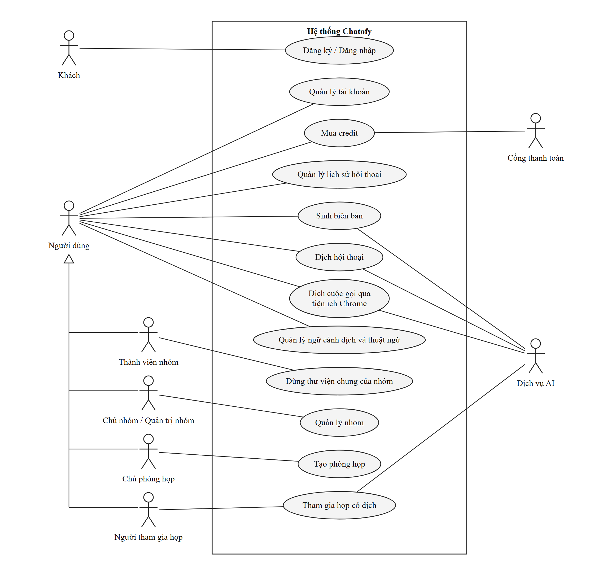

Hình 2.1 thể hiện các nhóm chức năng chính và tác nhân tương ứng. Khách chỉ dùng được các chức năng đăng
ký và đăng nhập; mọi chức năng còn lại yêu cầu đăng nhập. Bốn tác nhân Thành viên nhóm, Chủ nhóm / Quản trị nhóm,
Chủ phòng họp và Người tham gia họp là trường hợp riêng của Người dùng (quan hệ tổng quát hoá, mũi tên tam giác
rỗng): mỗi tác nhân này dùng được mọi chức năng của Người dùng, cộng thêm các chức năng gắn với vai trò của mình.
Dịch vụ AI và Cổng thanh toán là hai tác nhân hệ thống, tham gia vào các use case cần dịch máy, tổng hợp tiếng nói,
tóm tắt hoặc thanh toán.

### 2.2.2 Use case dịch hội thoại

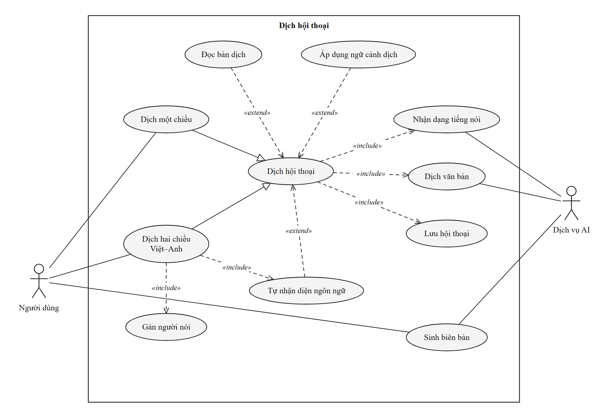

"Dịch một chiều" và "Dịch hai chiều Việt–Anh" là hai dạng cụ thể của use case trừu tượng "Dịch hội thoại"
(quan hệ tổng quát hoá). "Dịch hội thoại" luôn bao gồm (_include_) "Nhận dạng tiếng nói", "Dịch văn bản" và
"Lưu hội thoại", và được mở rộng (_extend_) bởi "Đọc bản dịch", "Áp dụng ngữ cảnh dịch" và "Tự nhận diện ngôn
ngữ" khi người dùng bật các tuỳ chọn tương ứng. Riêng "Dịch hai chiều Việt–Anh" luôn bao gồm nhận diện ngôn ngữ
và gán người nói cho từng lượt. Từ hội thoại đã lưu, người dùng có thể sinh biên bản.

### 2.2.3 Use case họp video

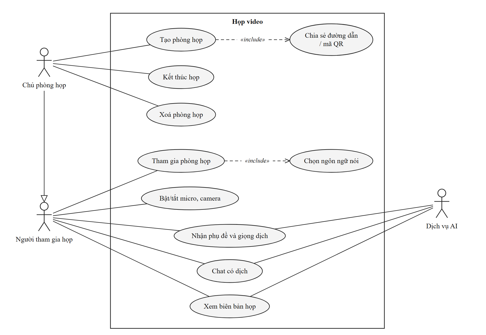

Chủ phòng họp là một trường hợp riêng của Người tham gia họp: ngoài mọi chức năng của người tham gia, chủ phòng
được tạo, kết thúc và xoá phòng. Tạo phòng bao gồm việc sinh đường dẫn và mã QR để chia sẻ; tham gia phòng bao gồm
bước chọn ngôn ngữ nói ở sảnh chờ, vì ngôn ngữ này quyết định bản dịch mà những người khác nhận được. Trong phòng,
người tham gia bật/tắt micro và camera, nhận phụ đề và giọng đọc bản dịch bằng ngôn ngữ của mình, chat với tin nhắn
được dịch cho từng người nhận, và xem biên bản sau khi họp kết thúc. Ba use case cuối dùng Dịch vụ AI để dịch,
tổng hợp tiếng nói và tóm tắt.

### 2.2.4 Use case quản lý nhóm

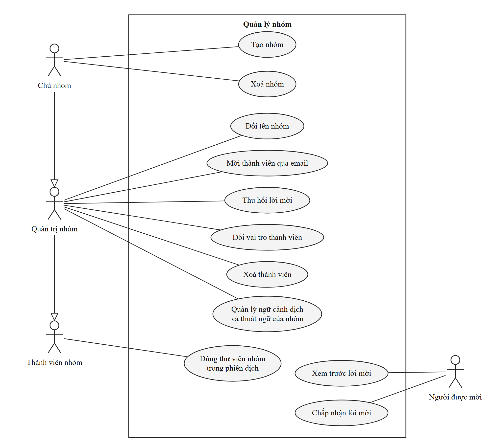

Nhóm có ba vai trò: chủ nhóm (_owner_), quản trị (_admin_) và thành viên (_member_). Chủ nhóm và quản trị
được mời thành viên và quản lý thư viện dùng chung; chỉ chủ nhóm được xoá nhóm. Lịch sử, phòng họp và credit
luôn là của cá nhân, không chia sẻ trong nhóm.

## 2.3 Kịch bản các chức năng chính

**Bảng 2.4. Kịch bản use case "Dịch hội thoại hai chiều"**

| Thành phần        | Nội dung                                                                                                                                                                                                                                                                                                                                                                                                                                                                                                                                                                                                                                                                                                                                                                                                                                                     |
| ----------------- | ------------------------------------------------------------------------------------------------------------------------------------------------------------------------------------------------------------------------------------------------------------------------------------------------------------------------------------------------------------------------------------------------------------------------------------------------------------------------------------------------------------------------------------------------------------------------------------------------------------------------------------------------------------------------------------------------------------------------------------------------------------------------------------------------------------------------------------------------------------ |
| Tác nhân          | Người dùng                                                                                                                                                                                                                                                                                                                                                                                                                                                                                                                                                                                                                                                                                                                                                                                                                                                   |
| Tiền điều kiện    | Đã đăng nhập; trình duyệt được cấp quyền micro; tài khoản còn ít nhất 1 credit                                                                                                                                                                                                                                                                                                                                                                                                                                                                                                                                                                                                                                                                                                                                                                               |
| Hậu điều kiện     | Hội thoại và các lượt nói được lưu vào lịch sử; credit bị trừ theo thời lượng                                                                                                                                                                                                                                                                                                                                                                                                                                                                                                                                                                                                                                                                                                                                                                                |
| Kịch bản chính    | 1. Người dùng mở trang dịch hai chiều, chọn cặp ngôn ngữ Việt–Anh.<br>2. Người dùng bấm bắt đầu. Trình duyệt mở kết nối WebSocket `/ws/translate` và gửi `client.session.start` với `twoWay: true`.<br>3. Hệ thống trả `server.session.ready` với chế độ `two-way`.<br>4. Người thứ nhất nói tiếng Việt. Trình duyệt gửi các khung âm thanh `client.audio.frame`.<br>5. Hệ thống trả văn bản tạm (`server.transcript.partial`) mỗi 300 ms, nhãn ngôn ngữ của lượt, và bản dịch tạm (`server.translation.partial`).<br>6. Người thứ nhất dừng nói. Hệ thống chốt lượt (`server.transcript.final`), gửi bản dịch tiếng Anh và âm thanh đọc (`server.audio.frame`).<br>7. Người thứ hai trả lời bằng tiếng Anh; hệ thống nhận diện tiếng Anh, gán người nói thứ hai và dịch sang tiếng Việt.<br>8. Người dùng bấm kết thúc. Hệ thống lưu hội thoại vào lịch sử. |
| Kịch bản ngoại lệ | 3a. Sidecar không nhận diện được ngôn ngữ hoặc đã đủ số phiên nhận diện: phiên chạy một chiều, giao diện báo lý do.<br>3b. Hết credit: hệ thống từ chối mở phiên và hiển thị liên kết mua thêm.<br>6a. Lượt nói ngắn dưới 1,5 giây: dùng ngôn ngữ dự phòng của cặp.<br>6b. Dịch vụ dịch máy bị giới hạn hạn mức: hệ thống chuyển sang mô hình dự phòng; nếu tất cả đều bị chặn thì báo lỗi lượt đó, phiên vẫn tiếp tục.<br>*. Mất kết nối: trình duyệt kết nối lại và tiếp tục cùng hội thoại.                                                                                                                                                                                                                                                                                                                                                               |

**Bảng 2.5. Kịch bản use case "Tham gia phòng họp"**

| Thành phần        | Nội dung                                                                                                                                                                                                                                                                                                                                                                                                                                                                                                                                                                                                                                              |
| ----------------- | ----------------------------------------------------------------------------------------------------------------------------------------------------------------------------------------------------------------------------------------------------------------------------------------------------------------------------------------------------------------------------------------------------------------------------------------------------------------------------------------------------------------------------------------------------------------------------------------------------------------------------------------------------- |
| Tác nhân          | Người tham gia họp                                                                                                                                                                                                                                                                                                                                                                                                                                                                                                                                                                                                                                    |
| Tiền điều kiện    | Đã đăng nhập; có đường dẫn phòng họp; phòng chưa kết thúc                                                                                                                                                                                                                                                                                                                                                                                                                                                                                                                                                                                             |
| Hậu điều kiện     | Người dùng được ghi nhận là người tham gia; nhận được video, âm thanh và phụ đề của người khác                                                                                                                                                                                                                                                                                                                                                                                                                                                                                                                                                        |
| Kịch bản chính    | 1. Người dùng mở đường dẫn phòng (hoặc quét mã QR).<br>2. Hệ thống hiển thị sảnh chờ: xem trước camera, chọn micro, chọn ngôn ngữ nói.<br>3. Người dùng bấm tham gia. Trình duyệt kết nối `/ws/conference` và gửi `conference.join`.<br>4. Hệ thống ghi nhận người tham gia, tạo phiên phát lên SFU (`conference.media.publish`) và phiên nhận (`conference.media.subscribe`).<br>5. Người dùng thấy video của những người khác. Khi có người nói, người dùng nhận phụ đề và giọng đọc bằng ngôn ngữ của mình.<br>6. Người dùng gửi tin nhắn chat; mỗi người nhận đọc tin nhắn bằng ngôn ngữ của họ.<br>7. Người dùng rời phòng (`conference.leave`). |
| Kịch bản ngoại lệ | 1a. Chưa đăng nhập: chuyển tới trang đăng nhập, quay lại phòng sau khi đăng nhập.<br>1b. Phòng đã kết thúc: hiển thị màn hình kết thúc kèm biên bản.<br>2a. Trình duyệt từ chối quyền camera/micro: vẫn vào phòng được, chỉ xem và nghe.<br>4a. Quá tải dịch: lượt dịch của nhánh họp bị bỏ qua, phụ đề nguồn vẫn hiển thị.                                                                                                                                                                                                                                                                                                                           |

**Bảng 2.6. Kịch bản use case "Mời thành viên vào nhóm"**

| Thành phần        | Nội dung                                                                                                                                                                                                                                                                                                                                                                   |
| ----------------- | -------------------------------------------------------------------------------------------------------------------------------------------------------------------------------------------------------------------------------------------------------------------------------------------------------------------------------------------------------------------------- |
| Tác nhân          | Chủ nhóm hoặc Quản trị nhóm; người được mời                                                                                                                                                                                                                                                                                                                                |
| Tiền điều kiện    | Người mời có vai trò owner hoặc admin trong nhóm                                                                                                                                                                                                                                                                                                                           |
| Hậu điều kiện     | Người được mời trở thành thành viên với vai trò đã chọn                                                                                                                                                                                                                                                                                                                    |
| Kịch bản chính    | 1. Người mời nhập email và chọn vai trò.<br>2. Hệ thống tạo lời mời, lưu giá trị băm của mã mời, gửi email chứa liên kết.<br>3. Người được mời mở liên kết. Hệ thống hiển thị trang xem trước (tên nhóm, người mời, vai trò).<br>4. Người được mời đăng nhập bằng đúng email được mời và bấm chấp nhận.<br>5. Hệ thống tạo bản ghi thành viên và đánh dấu lời mời đã dùng. |
| Kịch bản ngoại lệ | 3a. Lời mời hết hạn hoặc đã bị thu hồi: báo lỗi, không cho chấp nhận.<br>4a. Đăng nhập bằng email khác email được mời: từ chối chấp nhận.<br>4b. Người được mời đã là thành viên: hệ thống báo thành công, không thêm bản ghi trùng và giữ nguyên lời mời.                                                                                                                 |

**Bảng 2.7. Kịch bản use case "Đăng nhập"**

| Thành phần        | Nội dung                                                                                                                                                                                                                                                                |
| ----------------- | ----------------------------------------------------------------------------------------------------------------------------------------------------------------------------------------------------------------------------------------------------------------------- |
| Tác nhân          | Khách                                                                                                                                                                                                                                                                   |
| Tiền điều kiện    | Đã có tài khoản (tài khoản email chỉ được tạo khi người dùng bấm liên kết xác thực), hoặc dùng tài khoản Google                                                                                                                                                         |
| Hậu điều kiện     | Có phiên đăng nhập: token truy cập 15 phút và refresh token                                                                                                                                                                                                             |
| Kịch bản chính    | 1. Khách nhập email và mật khẩu.<br>2. Web gửi `POST /auth/login`.<br>3. API kiểm tra mật khẩu băm, cấp token truy cập (JWT, HS256) và refresh token; lưu giá trị băm SHA-256 của refresh token trong Redis.<br>4. Web lưu phiên trong cookie và chuyển tới trang dịch. |
| Kịch bản ngoại lệ | 3a. Sai email hoặc mật khẩu: trả một lỗi 401 chung, không tiết lộ email có tồn tại hay không.<br>1a. Đăng nhập bằng Google: web gửi mã định danh Google tới `POST /auth/google`; API xác minh và liên kết với tài khoản cùng email.                                     |

## 2.4 Thiết kế kiến trúc

### 2.4.1 Kiến trúc tổng thể

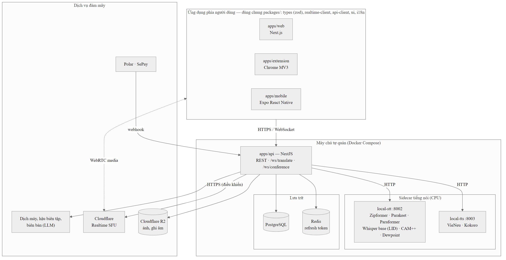

Hệ thống tổ chức dạng monorepo (Turborepo + pnpm) với ba nhóm thư mục:

- **`apps/`** gồm bốn ứng dụng: `api` (NestJS, REST và WebSocket), `web` (Next.js), `extension` (tiện ích
  Chrome Manifest V3) và `mobile` (React Native với Expo).
- **`packages/`** gồm các thư viện dùng chung: `types` (hợp đồng zod), `api-client`, `ai-providers` (giao
  diện nhà cung cấp AI), `realtime-client` (thu âm, chính sách phân lượt, phát âm thanh theo thứ tự, client
  WebSocket), `i18n` (chuỗi giao diện tiếng Việt và tiếng Anh), `ui` (design token và bộ component) và
  `config`.
- **`services/`** gồm hai sidecar Python: `local-stt` (nhận dạng, nhận diện ngôn ngữ, speaker embedding,
  khôi phục dấu câu) và `local-tts` (tổng hợp tiếng nói).

Dữ liệu lưu trong PostgreSQL (qua Prisma ORM). Redis lưu refresh token. Ảnh đại diện và bản ghi âm hội thoại
lưu trên Cloudflare R2. Media cuộc họp đi qua Cloudflare Realtime SFU. Dịch máy và tóm tắt gọi dịch vụ đám
mây; thanh toán qua Polar và SePay.

### 2.4.2 Nguyên tắc thiết kế

1. **Thiết kế theo giao diện.** Mọi phụ thuộc bên ngoài nằm sau một giao diện: `SttProvider`,
   `TranslationProvider`, `TtsProvider`, `SpeakerEmbeddingProvider`, `DisplayRestorer`,
   `SummarizationProvider`, `AuthAdapter`. Đổi nhà cung cấp chỉ cần thêm một lớp cài đặt và đăng ký.
2. **Hợp đồng kiểu dữ liệu duy nhất.** Mỗi endpoint và mỗi sự kiện WebSocket có một schema zod trong
   `@chatofy/types`. Kiểu TypeScript được suy ra từ schema; API kiểm tra đầu vào bằng schema, client kiểm tra
   đầu ra bằng cùng schema. Một thay đổi hợp đồng làm lỗi biên dịch ở mọi nơi dùng nó.
3. **Phong bì phản hồi thống nhất.** Mọi phản hồi HTTP có dạng `{ success, data | error, meta: { requestId,
timestamp } }`, dùng mã trạng thái HTTP thật (không trả 200 kèm `success: false`).
4. **Registry ngôn ngữ.** Danh sách ngôn ngữ nằm ở một chỗ (`packages/types/src/domain/languages.ts`); mọi
   cặp ngôn ngữ được suy ra từ danh sách này.
5. **Dùng chung mã qua package**, không sao chép giữa web, extension và mobile.

### 2.4.3 Tổ chức module của API

**Bảng 2.8. Các module của API NestJS**

| Module                               | Trách nhiệm                                                                               |
| ------------------------------------ | ----------------------------------------------------------------------------------------- |
| `auth`, `users`, `mail`              | Đăng ký, xác thực email, đăng nhập, Google, token, ảnh đại diện, gửi email                |
| `translate`                          | `POST /translate`, cổng WebSocket `/ws/translate`, phiên dịch, phân lượt, nhà cung cấp AI |
| `conversations`                      | Lưu, liệt kê, tìm kiếm, xoá hội thoại và bản ghi âm                                       |
| `minutes`, `summarization`           | Sinh biên bản bằng mô hình ngôn ngữ lớn                                                   |
| `translation-contexts`, `glossaries` | Ngữ cảnh dịch và bảng thuật ngữ (cá nhân và nhóm)                                         |
| `conference`                         | Phòng họp, cổng `/ws/conference`, điều khiển SFU, chat, biên bản họp                      |
| `teams`                              | Nhóm, thành viên, vai trò, lời mời                                                        |
| `credits`, `usage`                   | Sổ cái credit, đo lượng sử dụng, thanh toán, webhook                                      |
| `preferences`                        | Tuỳ chọn tài khoản dùng chung mọi client                                                  |
| `storage`, `redis`, `health`, `meta` | Hạ tầng: R2, Redis, kiểm tra sức khoẻ                                                     |

### 2.4.4 Luồng dữ liệu một lượt dịch

Một lượt dịch qua `/ws/translate` gồm các bước:

1. **Mở phiên.** `client.session.start` mang cặp ngôn ngữ, chế độ và giọng đọc. API kiểm tra credit, quyết
   định chế độ thực tế (`declared`, `two-way` hoặc `detect`) và trả `server.session.ready`.
2. **Truyền âm thanh.** Trình duyệt chỉ gửi khung PCM16 khi có tiếng nói (cổng giọng nói phía client). API
   đọc lại tối đa 9 giây âm thanh gần nhất mỗi 300 ms để sinh văn bản tạm, và dịch phần văn bản đã ổn định
   sau mỗi 15 ký tự mới.
3. **Dịch suy đoán.** Khi im lặng ngắn, client gửi `client.turn.speculate`; API bắt đầu nhận dạng và dịch phần
   đã có.
4. **Chốt lượt.** `client.session.end` (hoặc kết thúc lượt) làm API chạy nhận dạng cuối, nhận diện ngôn ngữ,
   gán người nói, dùng lại bản dịch suy đoán nếu không có âm thanh mới, rồi gửi văn bản cuối, bản dịch và âm
   thanh dạng stream.
5. **Hậu biên tập.** Bản dịch được gửi cho bước hậu biên tập chạy nền, kèm ngữ cảnh các lượt trước; nếu bản
   sửa khác bản nháp, API gửi `server.translation.polished`.

Bản dịch tạm giữa câu chỉ hiển thị chữ, không bao giờ được đọc thành tiếng, vì một phỏng đoán trên màn hình
có thể thay thế lặng lẽ còn một phỏng đoán đã đọc ra thì không rút lại được.

### 2.4.5 Luồng media và dịch trong họp video

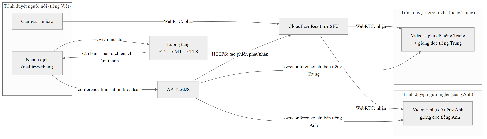

API giữ khoá bí mật của Cloudflare và điều khiển SFU qua HTTPS: mỗi người tham gia có hai phiên SFU, một để
phát và một để nhận. Trình duyệt chỉ nói chuyện với API qua `/ws/conference` và với SFU qua WebRTC. Việc dịch
không đi qua SFU: trình duyệt của người nói mở thêm một "nhánh dịch" dùng chính luồng `/ws/translate`, rồi
gửi kết quả qua `conference.translation.broadcast`; API chuyển tới từng người nghe đúng ngôn ngữ của họ.

## 2.5 Biểu đồ tuần tự

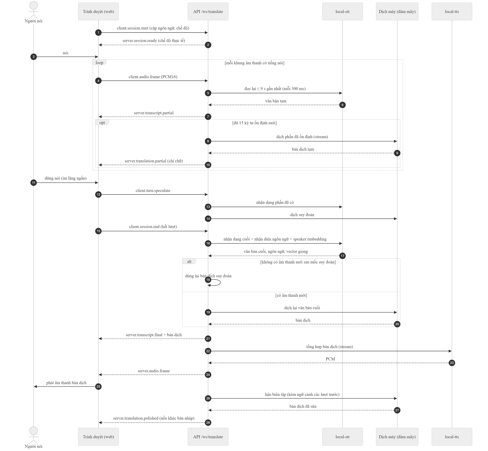

Hình 2.7 chia một lượt dịch thành ba giai đoạn. Trong lúc người dùng nói, mỗi khung âm thanh được gửi lên API; cứ
300 ms API nhờ local-stt đọc lại tối đa 9 giây gần nhất và trả văn bản tạm, đồng thời dịch phần văn bản đã ổn định
và trả bản dịch tạm chỉ dưới dạng chữ. Khi có im lặng ngắn, trình duyệt gửi `client.turn.speculate` để API dịch
trước phần đã có. Khi lượt kết thúc, API chạy nhận dạng cuối, nhận diện ngôn ngữ và tính vector giọng; nếu không có
âm thanh mới sau mốc suy đoán, bản dịch suy đoán được dùng lại, nếu có thì dịch lại. Sau đó bản dịch được tổng hợp
thành giọng nói và gửi về dạng luồng. Cuối cùng, bước hậu biên tập chạy nền và chỉ gửi
`server.translation.polished` khi bản sửa khác bản nháp.

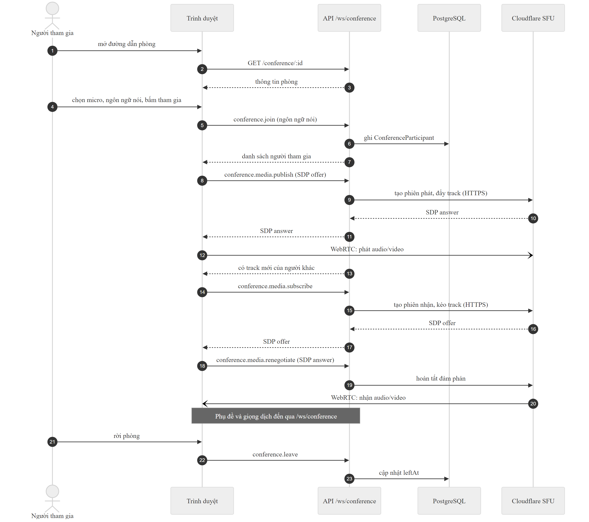

Hình 2.8 cho thấy API đứng giữa trình duyệt và SFU trong mọi bước đàm phán. Sau `conference.join`, API ghi người
tham gia vào cơ sở dữ liệu rồi chuyển tiếp hai lượt đàm phán SDP tới Cloudflare qua HTTPS: một phiên phát để đẩy
audio/video của người dùng lên, và một phiên nhận để kéo track của những người khác về, có thêm bước
`conference.media.renegotiate` để trình duyệt trả SDP answer. Sau khi đàm phán xong, media đi trực tiếp giữa trình
duyệt và SFU qua WebRTC, còn phụ đề và giọng dịch vẫn đi qua `/ws/conference`. Khi người dùng rời phòng, API cập
nhật thời điểm rời (`leftAt`).

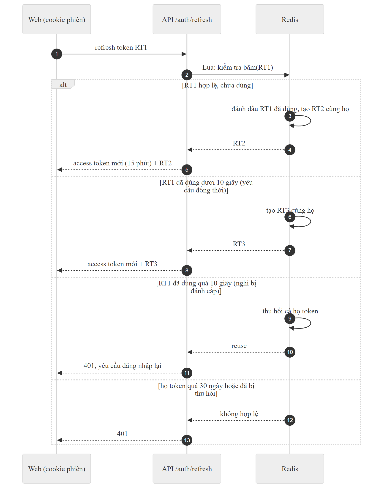

Hình 2.9 mô tả cơ chế refresh token xoay vòng: mỗi refresh token chỉ dùng được một lần. Khi một token đã dùng
bị gửi lại (dấu hiệu bị đánh cắp), toàn bộ họ token bị thu hồi và người dùng phải đăng nhập lại.

## 2.6 Thiết kế cơ sở dữ liệu

Cơ sở dữ liệu PostgreSQL gồm 27 bảng, chia thành năm nhóm. Hình 2.10 và Hình 2.11 thể hiện các bảng
nghiệp vụ chính; các bảng thanh toán được mô tả ngắn trong Bảng 2.13.

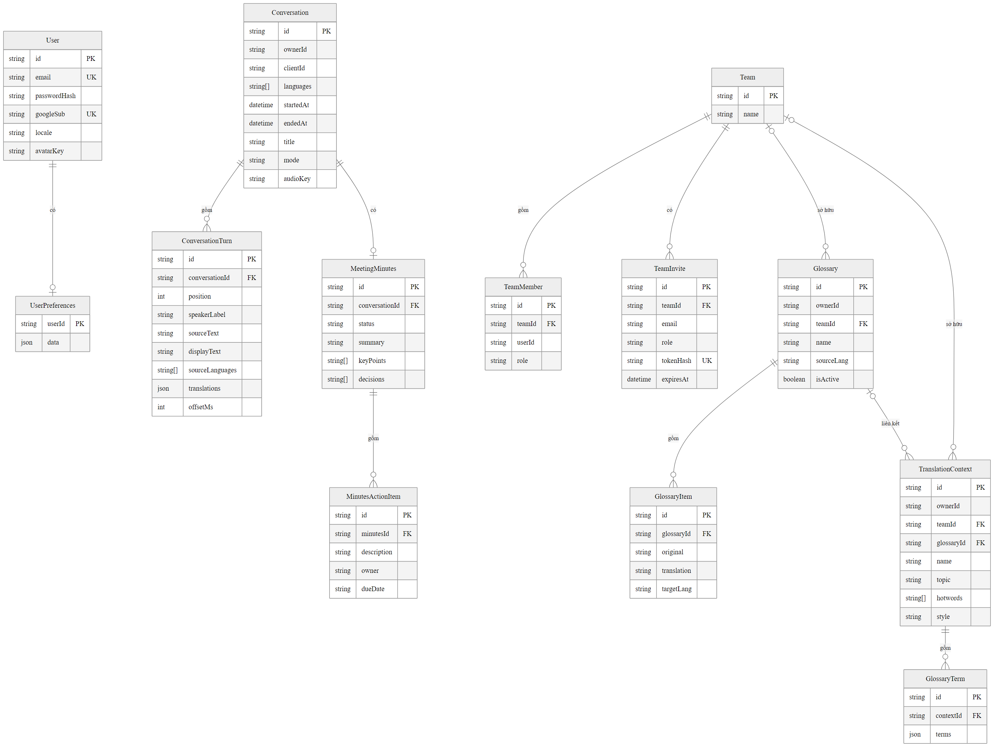

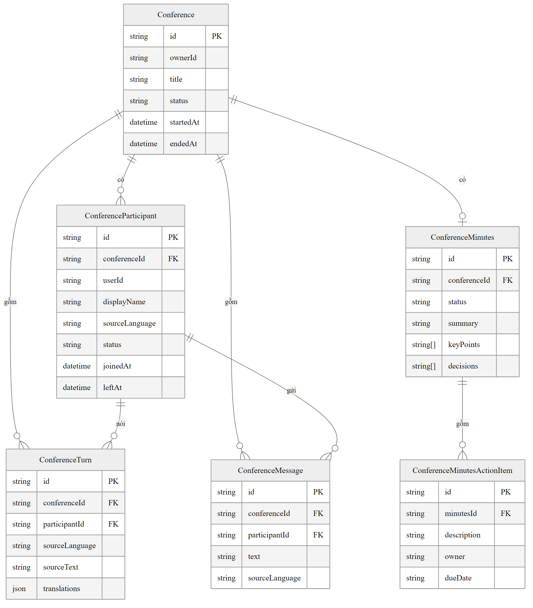

**Bảng 2.9. Bảng `User` (người dùng)**

| Trường               | Kiểu              | Mô tả                                               |
| -------------------- | ----------------- | --------------------------------------------------- |
| id                   | String (cuid)     | Khoá chính                                          |
| email                | String, duy nhất  | Email đăng nhập                                     |
| name                 | String?           | Tên hiển thị                                        |
| passwordHash         | String?           | Mật khẩu đã băm; rỗng với tài khoản chỉ dùng Google |
| googleSub            | String?, duy nhất | Định danh tài khoản Google đã liên kết              |
| passwordChangedAt    | DateTime?         | Thời điểm đổi mật khẩu, dùng để vô hiệu token cũ    |
| locale               | String            | Ngôn ngữ giao diện (mặc định `en`)                  |
| avatarKey            | String?           | Khoá ảnh đại diện trên R2                           |
| createdAt, updatedAt | DateTime          | Thời điểm tạo, cập nhật                             |

**Bảng 2.10. Bảng `Conversation` (hội thoại)**

| Trường                         | Kiểu     | Mô tả                                                   |
| ------------------------------ | -------- | ------------------------------------------------------- |
| id                             | String   | Khoá chính                                              |
| ownerId                        | String   | Người dùng sở hữu                                       |
| clientId                       | String   | Mã do client sinh, giúp lưu lặp lại không tạo bản trùng |
| languages                      | String[] | Các ngôn ngữ có trong hội thoại                         |
| startedAt, endedAt             | DateTime | Thời điểm bắt đầu, kết thúc                             |
| pausedMs                       | Int      | Tổng thời gian tạm dừng                                 |
| title, searchTitle             | String?  | Tiêu đề và tiêu đề đã chuẩn hoá để tìm kiếm             |
| mode                           | String?  | Chế độ: một chiều, hai chiều, tự nhận diện              |
| audioKey                       | String?  | Khoá bản ghi âm trên R2                                 |
| audioOffsetMs, audioDurationMs | Int?     | Vị trí căn chỉnh và độ dài bản ghi âm                   |

**Bảng 2.11. Bảng `ConversationTurn` (lượt nói)**

| Trường                    | Kiểu     | Mô tả                                              |
| ------------------------- | -------- | -------------------------------------------------- |
| id                        | String   | Khoá chính                                         |
| conversationId            | String   | Khoá ngoại tới `Conversation` (xoá theo)           |
| position                  | Int      | Thứ tự lượt                                        |
| speakerRole, speakerLabel | String   | Vai trò và nhãn người nói                          |
| sourceText                | String   | Văn bản nhận dạng gốc                              |
| displayText               | String?  | Văn bản hiển thị (đã thêm dấu câu, chữ số)         |
| sourceLanguages           | String[] | Ngôn ngữ của lượt                                  |
| translations              | Json     | Bản dịch theo từng ngôn ngữ đích                   |
| searchText                | String?  | Văn bản đã chuẩn hoá để tìm kiếm (chỉ mục trigram) |
| offsetMs                  | Int?     | Vị trí của lượt trong bản ghi âm                   |

**Bảng 2.12. Bảng `Conference` và `ConferenceParticipant`**

| Bảng                  | Trường chính                                                                    | Mô tả                                                    |
| --------------------- | ------------------------------------------------------------------------------- | -------------------------------------------------------- |
| Conference            | id, ownerId, title, status, startedAt, endedAt                                  | Phòng họp và trạng thái (mặc định `waiting` khi mới tạo) |
| ConferenceParticipant | id, conferenceId, userId, displayName, sourceLanguage, status, joinedAt, leftAt | Người tham gia và ngôn ngữ nói                           |
| ConferenceTurn        | id, conferenceId, participantId, sourceLanguage, sourceText, translations       | Lượt nói trong họp và bản dịch                           |
| ConferenceMessage     | id, conferenceId, participantId, text, sourceLanguage                           | Tin nhắn chat                                            |
| ConferenceMinutes     | id, conferenceId, status, summary, keyPoints, decisions                         | Biên bản họp                                             |

**Bảng 2.13. Các bảng còn lại**

| Nhóm               | Bảng                                                                                  | Mô tả                                                                                                              |
| ------------------ | ------------------------------------------------------------------------------------- | ------------------------------------------------------------------------------------------------------------------ |
| Biên bản           | MeetingMinutes, MinutesActionItem, ConferenceMinutesActionItem                        | Biên bản và việc cần làm                                                                                           |
| Ngữ cảnh dịch      | TranslationContext, GlossaryTerm, Glossary, GlossaryItem                              | Ngữ cảnh dịch, bảng thuật ngữ (cá nhân hoặc của nhóm qua `teamId`)                                                 |
| Nhóm               | Team, TeamMember, TeamInvite                                                          | Nhóm, thành viên với vai trò, lời mời (lưu băm của mã mời)                                                         |
| Tuỳ chọn           | UserPreferences                                                                       | Một tài liệu JSON tuỳ chọn cho mỗi tài khoản                                                                       |
| Credit, thanh toán | Plan, CreditGrant, CreditLease, CreditEntry, Subscription, PaymentOrder, WebhookEvent | Gói, khoản cấp credit, giữ chỗ khi phiên đang chạy, sổ cái bút toán, thuê bao, đơn hàng, chống xử lý trùng webhook |
| Giám sát chi phí   | LlmCallRecord                                                                         | Mỗi lần gọi mô hình ngôn ngữ lớn: mô hình, độ trễ, số token                                                        |

Thiết kế credit dùng mô hình sổ cái: mỗi thay đổi số dư là một bút toán `CreditEntry` có khoá chống trùng
(`idempotencyKey`). Khi một phiên dịch bắt đầu, hệ thống giữ chỗ một lượng credit (`CreditLease`), trừ dần theo
giây được chấp nhận, và trả lại phần chưa dùng khi phiên kết thúc.

## 2.7 Thiết kế giao diện lập trình

### 2.7.1 REST API

**Bảng 2.14. Các nhóm endpoint REST chính**

| Nhóm                | Endpoint                                                                                                                                      | Mô tả                                                               |
| ------------------- | --------------------------------------------------------------------------------------------------------------------------------------------- | ------------------------------------------------------------------- |
| Xác thực            | `POST /auth/register`, `/verify-email`, `/login`, `/google`, `/refresh`, `/revoke`, `/forgot-password`, `/reset-password`, `/change-password` | Vòng đời tài khoản và phiên                                         |
| Hồ sơ               | `GET/PATCH /auth/me`, `PUT/DELETE /auth/me/avatar`, `GET/PATCH/DELETE /me/preferences`                                                        | Hồ sơ, ảnh đại diện, tuỳ chọn                                       |
| Dịch                | `POST /translate`, `GET /translate/voices`                                                                                                    | Dịch một lượt qua REST (dùng làm đối chứng đo đạc); danh sách giọng |
| Hội thoại           | `GET /conversations`, `GET/PUT/PATCH/DELETE /conversations/:id`, `PUT/GET /conversations/:id/audio`                                           | Lịch sử, tìm kiếm, bản ghi âm                                       |
| Biên bản            | `POST/GET /conversations/:id/minutes`, `POST/GET /conference/:id/minutes`                                                                     | Sinh và đọc biên bản                                                |
| Ngữ cảnh, thuật ngữ | `/translation-contexts`, `/glossaries`, `/teams/:teamId/translation-contexts`, `/teams/:teamId/glossaries`                                    | Thư viện cá nhân và của nhóm                                        |
| Họp                 | `POST/GET /conference`, `GET/DELETE /conference/:id`                                                                                          | Tạo, xem, xoá phòng họp                                             |
| Nhóm                | `/teams`, `/teams/:teamId/members`, `/teams/:teamId/invites`, `POST /team-invites/preview`, `/accept`                                         | Nhóm, thành viên, lời mời                                           |
| Credit              | `GET /billing/plans`, `/me`, `/usage`, `POST /billing/checkout`, `POST /billing/webhooks/polar`, `/sepay`                                     | Số dư, mua gói, webhook                                             |

Khi không chạy ở môi trường production, API tự sinh tài liệu OpenAPI tại `/docs` từ các schema zod.

### 2.7.2 Sự kiện WebSocket

**Bảng 2.15. Sự kiện WebSocket chính**

| Kênh             | Chiều           | Sự kiện                                                    | Ý nghĩa                                                |
| ---------------- | --------------- | ---------------------------------------------------------- | ------------------------------------------------------ |
| `/ws/translate`  | Client → Server | `client.session.start`                                     | Mở phiên với cặp ngôn ngữ và chế độ                    |
|                  |                 | `client.audio.frame`                                       | Khung âm thanh PCM16 có số thứ tự                      |
|                  |                 | `client.turn.speculate`                                    | Báo im lặng ngắn, bắt đầu dịch suy đoán                |
|                  |                 | `client.session.end`                                       | Kết thúc lượt / phiên                                  |
|                  | Server → Client | `server.session.ready`                                     | Phiên sẵn sàng, chế độ thực tế                         |
|                  |                 | `server.transcript.partial` / `.final` / `.display`        | Văn bản tạm, văn bản cuối, văn bản hiển thị            |
|                  |                 | `server.translation.delta` / `.partial` / `.polished`      | Bản dịch từng phần, bản dịch tạm, bản sau hậu biên tập |
|                  |                 | `server.audio.frame`                                       | Âm thanh bản dịch                                      |
|                  |                 | `server.error`                                             | Lỗi có mã ổn định                                      |
| `/ws/conference` | Client → Server | `conference.join` / `.leave`                               | Vào, rời phòng                                         |
|                  |                 | `conference.media.publish` / `.subscribe` / `.renegotiate` | Đàm phán WebRTC qua API                                |
|                  |                 | `conference.participant.mute` / `.video`                   | Bật, tắt micro và camera                               |
|                  |                 | `conference.chat`                                          | Gửi tin nhắn                                           |
|                  |                 | `conference.translation.broadcast`                         | Gửi phụ đề và bản dịch của nhánh dịch tới phòng        |

## 2.8 Thiết kế bảo mật

- **Mật khẩu** được băm bằng Argon2. `POST /auth/register` không tạo tài khoản ngay: mật khẩu đã băm, email và
  tên được đóng gói vào một token ký có hạn 24 giờ và gửi qua email; tài khoản chỉ được tạo khi người dùng bấm
  liên kết. Endpoint đăng ký trả cùng một phản hồi 202 cho mọi email, nên không thể dò xem email nào đã đăng ký.
- **Lời mời nhóm** gắn với địa chỉ email được mời, chỉ dùng một lần, và chỉ lưu giá trị băm của mã mời.
- **Token truy cập** là JWT ký HS256, hiệu lực 15 phút.
- **Refresh token** là chuỗi ngẫu nhiên 256 bit, chỉ lưu giá trị băm SHA-256 trong Redis. Mỗi token dùng một
  lần; việc kiểm tra, vô hiệu và cấp mới chạy trong một script Lua nguyên tử. Một token đã dùng chưa quá 10 giây
  vẫn được chấp nhận để xử lý các yêu cầu làm mới đồng thời từ cùng một màn hình. Họ token có hạn tuyệt đối 30
  ngày.
- **WebSocket** được xác thực trong lúc bắt tay HTTP (`verifyClient`): yêu cầu không hợp lệ bị từ chối với mã 401
  trước khi socket được tạo, nên không có khung nào được xử lý trước khi xác thực xong.
- **Lời nhắc dịch** đặt lời nói của người dùng trong một khối dữ liệu riêng để chống tấn công chèn lệnh (mục
  3.8.4).
- **Khoá dịch vụ** (Cloudflare, dịch máy) chỉ nằm ở API; trình duyệt không bao giờ nhận khoá.
- **Webhook thanh toán** được kiểm chữ ký trên dữ liệu thô (so sánh an toàn về thời gian, cửa sổ ±300 giây) và
  chống xử lý trùng qua bảng `WebhookEvent`.

## 2.9 Kết luận

Chương 2 đã xác định 8 tác nhân, 19 yêu cầu chức năng và các yêu cầu phi chức năng, trong đó quan trọng nhất là
độ trễ dưới 2 giây và việc chạy tiếng nói trên CPU. Kiến trúc được thiết kế theo giao diện, với hợp đồng zod dùng
chung cho mọi ứng dụng, hai sidecar tiếng nói chạy cục bộ và SFU của Cloudflare cho họp video. Cơ sở dữ liệu gồm
27 bảng, tách bạch dữ liệu cá nhân, dữ liệu nhóm và sổ cái credit. Chương 3 trình bày chi tiết các kỹ thuật
xử lý tiếng nói và dịch, cùng các thực nghiệm dùng để chọn và tinh chỉnh chúng.

# CHƯƠNG 3. KỸ THUẬT DỊCH THOẠI THỜI GIAN THỰC VÀ THỰC NGHIỆM

<!--
Ghi chú biên soạn (xoá khi chuyển sang Word):
- Mọi số liệu lấy từ docs/development-journey.md và benchmarks/*/README.md tại commit cc8585f7.
- [HÌNH 3.x] là chỗ cần chèn hình; mô tả nằm ngay trong ngoặc.
- Trích dẫn đã đánh số theo IEEE, khớp với 06-tai-lieu-tham-khao.md.
-->

Chương này trình bày các kỹ thuật cốt lõi giúp Chatofy dịch hội thoại với độ trễ thấp trên máy tính
không có GPU, cùng các thực nghiệm dùng để ra quyết định. Mỗi lựa chọn mô hình hoặc thay đổi thiết kế
trong chương đều được đo trên phần cứng đích trước khi đưa vào sản phẩm. Các mô hình nhận dạng và tổng
hợp tiếng nói là mô hình tiền huấn luyện mã nguồn mở; đóng góp của nhóm nằm ở việc chọn mô hình bằng đo
đạc, kỹ thuật ghép nối thành luồng thời gian thực, và phương pháp đánh giá.

## 3.1 Tổng quan luồng xử lý và phương pháp thực nghiệm

### 3.1.1 Luồng xử lý dạng tầng

Chatofy dùng kiến trúc tầng (_cascade_) gồm ba bước: nhận dạng tiếng nói (STT), dịch máy (MT) và tổng
hợp tiếng nói (TTS). Trình duyệt thu âm, gửi khung âm thanh qua WebSocket `/ws/translate` tới máy chủ
NestJS. Máy chủ gọi hai dịch vụ phụ (_sidecar_) chạy cục bộ trên CPU: `local-stt` (cổng 8002) và
`local-tts` (cổng 8003). Riêng bước dịch máy gọi dịch vụ đám mây.

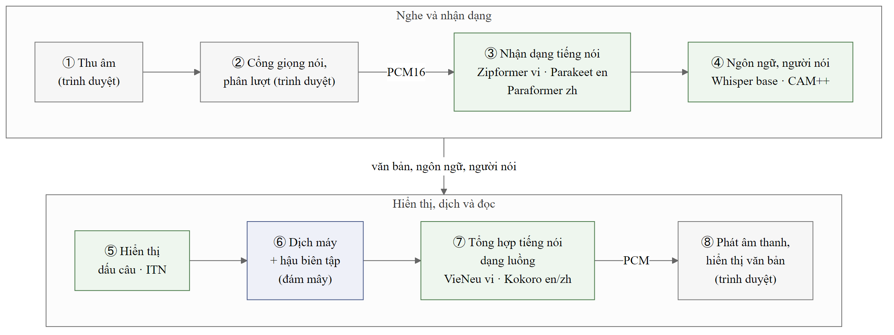

Bảng 3.1 liệt kê các thành phần đang chạy trong phiên bản hiện tại.

**Bảng 3.1. Các mô hình trong luồng xử lý**

| Khâu                | Tiếng Việt                                  | Tiếng Anh            | Tiếng Trung   | Nơi chạy   |
| ------------------- | ------------------------------------------- | -------------------- | ------------- | ---------- |
| Nhận dạng tiếng nói | Zipformer-30M RNN-T                         | Parakeet-TDT-0.6B-v2 | Paraformer-zh | CPU cục bộ |
| Nhận diện ngôn ngữ  | Whisper base (xác suất ngôn ngữ)            | Whisper base         | —             | CPU cục bộ |
| Tổng hợp tiếng nói  | VieNeu v3                                   | Kokoro-82M           | Kokoro-82M    | CPU cục bộ |
| Dịch máy            | DeepSeek (qua giao thức tương thích OpenAI) |                      |               | Đám mây    |

Kiến trúc tầng được chọn thay cho mô hình dịch giọng nói đầu-cuối (_speech-to-speech_) vì ba lý do.
Thứ nhất, mỗi khâu thay được độc lập qua một giao diện chung (`SttProvider`, `TranslationProvider`,
`TtsProvider`). Thứ hai, văn bản trung gian dùng được cho phụ đề, lịch sử và biên bản họp. Thứ ba,
nhóm đã thử nghiệm Gemini Live [1] (một mô hình dịch giọng nói trực tiếp) làm mốc so sánh trong
`benchmarks/live-translate`, và mô hình này không hỗ trợ tiếng Trung.

### 3.1.2 Môi trường và nguyên tắc đo

Các phép đo chạy trên máy tính để bàn dùng Intel Core i7-11700K (8 nhân vật lý), 32 GB RAM, không
dùng GPU. Giai đoạn đầu dùng Windows 11; từ tháng 9/2026 máy chuyển sang Ubuntu. Các bảng số liệu ghi
rõ hệ điều hành khi điều kiện khác nhau.

Nhóm áp dụng bốn nguyên tắc cho mọi thực nghiệm:

1. **Đo trên phần cứng đích, không dựa vào số công bố.** Mỗi bộ đo là một dự án độc lập trong thư mục
   `benchmarks/`, không được ứng dụng import.
2. **Đặt ngưỡng trước khi đo.** Ví dụ, STT phải có hệ số thời gian thực RTF ≤ 0,3 và độ trễ p95 ≤ 2 s.
3. **Đo lại sau mỗi lần sửa.** Một thay đổi trông như cải tiến chỉ được giữ khi số đo xác nhận.
4. **Ghi cỡ mẫu cạnh mọi con số** và nêu rõ giới hạn của phép đo.

### 3.1.3 Các chỉ số đánh giá

- **WER / CER** (_word / character error rate_): tỷ lệ lỗi từ / ký tự của STT, tính bằng tổng số
  thay thế, xoá và chèn chia cho số từ (ký tự) tham chiếu.
- **RTF** (_real-time factor_): thời gian xử lý chia cho độ dài âm thanh. RTF < 1 nghĩa là xử lý nhanh
  hơn thời gian thực.
- **p50 / p95**: trung vị và phân vị 95 của độ trễ.
- **TTFA** (_time to first audio_): thời gian từ khi gửi yêu cầu đến khi có mẫu âm thanh đầu tiên.
- **Độ trễ đầu-cuối**: từ lúc người nói dừng đến lúc âm thanh dịch đầu tiên phát ra.
- **Độ chính xác nhận diện ngôn ngữ**: tỷ lệ lượt nói được gán đúng ngôn ngữ.
- **Tỷ lệ lỗi dịch nghiêm trọng**: tỷ lệ lượt có ít nhất một lỗi mức _major_ hoặc _critical_ theo
  khung MQM, do một mô hình ngôn ngữ lớn đã hiệu chuẩn chấm (mục 3.8).

## 3.2 Nhận dạng tiếng nói

### 3.2.1 Khảo sát và lựa chọn ban đầu

Ràng buộc đặt ra trước khi khảo sát: chạy trên CPU, RTF ≤ 0,3 với câu dài 5–10 giây, giấy phép dùng
được cho đồ án học thuật. Kết quả khảo sát cho thấy không có một mô hình đa ngôn ngữ nào đáp ứng được:
Whisper large-v3 quá chậm trên CPU, Parakeet v3 không có tiếng Việt, Moonshine [36] chỉ có tiếng Anh. Vì
vậy hệ thống dùng một mô hình chuyên biệt cho mỗi ngôn ngữ, chọn qua một bộ đăng ký (_registry_) theo
mã ngôn ngữ.

Hai tập kiểm tra được dùng: VIVOS test [37] cho tiếng Việt và LibriSpeech test-clean [38] cho tiếng Anh, mỗi
tập 50 câu, chọn ngẫu nhiên với seed 42. Mỗi mô hình chạy trong một tiến trình riêng, có một lượt làm
nóng không tính giờ, và chạy hai lần để kiểm tra độ dao động.

**Bảng 3.2. Kết quả đo STT ban đầu (50 câu mỗi ngôn ngữ, Windows 11, 8 luồng, INT8)**

| Mô hình                           | Ngôn ngữ | WER (%)  | RTF       | p95 (s) | RAM đỉnh | Ngưỡng RTF ≤ 0,3 |
| --------------------------------- | -------- | -------- | --------- | ------- | -------- | ---------------- |
| **Zipformer-30M (sherpa-onnx)**   | vi       | **5,38** | **0,017** | 0,09    | 223 MB   | Đạt              |
| PhoWhisper-small (faster-whisper) | vi       | 7,71     | 0,332     | 1,40    | 972 MB   | **Không đạt**    |
| Moonshine base (sherpa-onnx)      | en       | 3,86     | 0,040     | 0,34    | 418 MB   | Đạt              |
| Whisper small.en (faster-whisper) | en       | 3,74     | 0,228     | 1,47    | 552 MB   | Đạt              |

Với tiếng Việt, Zipformer tốt hơn PhoWhisper trên cả hai trục: WER thấp hơn 2,3 điểm và nhanh hơn
khoảng 20 lần, dùng một phần tư bộ nhớ. Với tiếng Anh, Moonshine và Whisper small.en chênh nhau
0,12 điểm WER (trong khoảng nhiễu) nhưng Moonshine nhanh hơn 5,7 lần, nên được chọn ban đầu.

Phép đo này cho thấy số công bố lệch theo cả hai hướng: PhoWhisper-small được ước tính đạt ngưỡng RTF
nhưng thực đo không đạt (0,332), còn Zipformer đo được 0,017, nhanh hơn số công bố 0,025.

Một hạn chế cần nêu: mô hình Zipformer tiếng Việt [39] dùng giấy phép CC-BY-NC-ND-4.0, chỉ cho phép dùng
phi thương mại. Nếu thương mại hoá, phương án thay thế là PhoWhisper (BSD-3) qua cùng giao diện
`SttProvider`, chấp nhận độ trễ khoảng 1,3 giây mỗi câu.

### 3.2.2 Bộ giải mã và danh sách từ ưu tiên

Mô hình tiếng Việt chạy với giải mã tham lam (_greedy search_). Nhóm kiểm tra xem giải mã chùm (_beam
search_) và danh sách từ ưu tiên (_hotwords_) có cải thiện được không, giữ nguyên mô hình và số luồng.

**Bảng 3.3. So sánh bộ giải mã trên VIVOS (50 câu, 558 từ)**

| Cấu hình                  | WER (%) | CER (%) | RTF    |
| ------------------------- | ------- | ------- | ------ |
| Greedy (đối chứng)        | 5,38    | 2,90    | 0,0158 |
| Beam search               | 5,38    | 2,94    | 0,0207 |
| Beam search + 48 hotwords | 4,66    | 2,73    | 0,0211 |

Beam search không cải thiện WER và làm CER tệ đi 0,04 điểm. Hotwords giảm 0,72 điểm WER (tương đương
4 từ), nhưng danh sách 48 cụm từ này được sinh từ chính câu tham chiếu của tập kiểm tra, nên con số chỉ
cho biết mức tối đa mà danh sách đó mang lại, không phải mức cải thiện trong hội thoại thật. Hệ thống
giữ giải mã tham lam.

### 3.2.3 Đánh giá trên âm thanh thực tế

Tập kiểm tra sạch không phản ánh điều kiện sử dụng thật. Nhóm đo lại trên 6 cuộc hội thoại ghi từ môi
trường production (4 tiếng Việt, khoảng 9,2 phút; 2 tiếng Anh, khoảng 3,1 phút), phát lại qua đúng
module thu âm của trình duyệt (`CapturePump`) để cắt lượt giống thực tế.

Kết quả đáng chú ý nhất là thứ hạng bị đảo ngược. Trên VIVOS, Zipformer-30M đạt 5,4% còn một mô hình
streaming đa ngôn ngữ (PengChengStarling [40]) đạt 13,4%. Trên âm thanh thật thì ngược lại: khi được nạp
âm thanh liên tục, mô hình streaming đạt 19,0%, thấp hơn mức 22,1% của các bản chép lời mà Zipformer-30M đã
tạo và lưu trên production. Tuy nhiên khi cắt theo lượt như sản phẩm thật, mô hình streaming tệ hơn rõ rệt.
Bảng 3.4 phát lại cùng âm thanh cho cả ba mô hình nên Zipformer-30M có 22,3%, chênh 0,2 điểm so với bản đã
lưu; Zipformer-30M là mô hình offline nên không có cột đọc liên tục. Văn bản tham chiếu để tính WER là bản chép lời
của dịch vụ ElevenLabs Scribe v2 [41].

**Bảng 3.4. WER tiếng Việt trên âm thanh production (tham chiếu: ElevenLabs Scribe v2)**

| Mô hình                                    | Đọc liên tục (%) | Cắt theo lượt (%) |
| ------------------------------------------ | ---------------- | ----------------- |
| Zipformer-30M (đang dùng)                  | —                | 22,3              |
| PengChengStarling (streaming, đa ngôn ngữ) | 19,0             | 35,8              |
| Zipformer 70.000 giờ (offline)             | —                | 21,9              |

Kiểm định bootstrap theo lượt cho thấy mô hình streaming tệ hơn 13,7 điểm (khoảng tin cậy 95%:
[+8,9; +18,8]), còn Zipformer 70.000 giờ chỉ khác −0,3 điểm, không có ý nghĩa thống kê. Hai bộ tham
chiếu tiếng Việt (Scribe v2 và PhoWhisper-large) tự chênh nhau 20,4% WER, nên mọi khác biệt dưới
khoảng 3 điểm được coi là nhiễu. Hệ thống giữ nguyên Zipformer-30M cho tiếng Việt.

Với tiếng Anh, Parakeet-TDT-0.6B-v2 [8] đạt WER 3,4% so với 7,4% của Moonshine trên
các lượt thật (chênh −4,0 điểm, khoảng tin cậy 95%: [−7,3; −0,9]). Parakeet còn tự sinh dấu câu và
viết hoa. Dưới tải hai chiều đồng thời, độ trễ p95 của lượt cuối là 327 ms (Moonshine: 215 ms), vẫn
nằm trong chu kỳ cập nhật 300 ms cho văn bản tạm, không có lỗi quá tải (HTTP 503). Parakeet thay hoàn
toàn Moonshine.

Với tiếng Trung, Paraformer-zh được chọn sau khi đạt CER trung bình 3,22% trên FLEURS [42] và
AISHELL-1 [43] (50 đoạn mỗi tập), thấp hơn SenseVoice-small [44] (4,58%).

### 3.2.4 Phân bổ lỗi nhận dạng tiếng Việt

Để biết nên cải thiện ở đâu, nhóm phân loại 134 lỗi trên 6 hội thoại tiếng Việt (2.222 từ):

**Bảng 3.5. Phân bổ lỗi nhận dạng tiếng Việt**

| Loại lỗi                                  | Số lỗi | Tỷ lệ |
| ----------------------------------------- | ------ | ----- |
| Từ thông dụng nghe sai hoặc mất           | 74     | 55%   |
| Nằm trong ±0,6 s quanh điểm cắt cưỡng bức | 29     | 22%   |
| Tên riêng và từ nước ngoài                | 13     | 10%   |
| Đầu lượt nói                              | 9      | 7%    |
| Chèn thừa                                 | 9      | 7%    |

Hơn một nửa số lỗi là từ thông dụng, loại lỗi mà danh sách từ ưu tiên hầu như không giúp được. Thử
nghiệm giải mã lại cả khối âm thanh để sửa lỗi tại điểm cắt chỉ cứu được 2–6 lỗi. Kết luận: nút thắt
nằm ở bộ nhận dạng, không ở cách cắt lượt.

## 3.3 Hiển thị văn bản tiếng Việt

WER thông thường chuẩn hoá về chữ thường và bỏ dấu câu, nên không thấy được một lỗi người dùng nhận ra
ngay: bản ghi tiếng Việt hiện ra toàn chữ in hoa, không dấu câu và viết số bằng chữ. Nhóm xây dựng một
tập riêng gồm 22 câu (311 từ, 42 chữ số) thu qua đúng đường thu âm của trình duyệt, kèm tham chiếu viết
theo chính tả thật.

Phép đo cho kết quả "nhận dạng hoàn hảo, hiển thị bằng không": hai câu không chứa số được nhận đúng từng
từ, nhưng vẫn đạt 0 trên cả ba chỉ số hiển thị (số, dấu câu, viết hoa tên riêng).

Nhóm thử hai cách sửa. Cách thứ nhất dùng một mô hình ngôn ngữ lớn viết lại câu nguồn, chỉ được thêm
dấu câu, viết hoa và đổi chữ số, có bộ kiểm tra từ chối nếu mô hình đổi từ. Cách thứ hai là chuẩn hoá
văn bản ngược (_Inverse Text Normalization_, ITN) dạng tất định, chạy ngay trong tiến trình máy chủ.

**Bảng 3.6. So sánh các cách sửa hiển thị (22 câu)**

| Chỉ số             | Ban đầu | Mô hình ngôn ngữ lớn   | ITN tất định      |
| ------------------ | ------- | ---------------------- | ----------------- |
| Tỷ lệ chữ số đúng  | 0,000   | 0,881                  | **1,000** (42/42) |
| Chữ số bịa thêm    | 0       | 0                      | 0                 |
| F1 dấu câu         | 0,000   | 0,722                  | 0,000             |
| Viết hoa tên riêng | 0,000   | 0,864                  | 0,000             |
| Độ trễ mỗi lượt    | —       | 25,1 s (tối đa 92,6 s) | **0,21 ms** (p95) |

Mô hình ngôn ngữ lớn sửa đúng nhưng trả kết quả sau trung vị 25 giây, khi người đọc đã chuyển sang câu
khác. ITN chỉ xử lý chữ số nhưng chạy dưới một phần nghìn giây. Hệ thống chọn ITN cho chữ số; dấu câu và
viết hoa được xử lý bằng một mô hình gán nhãn token chạy trong sidecar STT (Dewpoint [45] cho tiếng
Việt, CT-Transformer [46] cho tiếng Trung), được chọn qua bộ đo `benchmarks/punct`. Kết quả ITN được kiểm
thêm trên 100 câu VIVOS và LibriSpeech không chứa chữ số: không sinh chữ số bịa nào.

## 3.4 Tổng hợp tiếng nói

### 3.4.1 Tiếng Anh

**Bảng 3.7. So sánh TTS tiếng Anh (30 câu, 5–20 từ)**

| Mô hình             | p50 (s) | p95 (s) | RTF   | RAM đỉnh | Giấy phép  |
| ------------------- | ------- | ------- | ----- | -------- | ---------- |
| Piper (lessac-high) | 0,45    | 0,57    | 0,154 | 323 MB   | MIT        |
| **Kokoro-82M**      | 0,99    | 1,18    | 0,323 | 619 MB   | Apache-2.0 |

Piper [47] và Kokoro-82M [33] đều đạt ngưỡng p95 ≤ 2 s. Qua nghe so sánh A/B, Kokoro được chọn vì chất lượng giọng tốt hơn rõ rệt;
Piper được giữ làm phương án dự phòng khi độ trễ quan trọng hơn chất lượng. Đây mới là đánh giá của một
người nghe; bộ công cụ chấm MOS nhiều người nghe đã được xây dựng trong `benchmarks/mos` (theo
khuyến nghị ITU-T P.800 [18]).

### 3.4.2 Tiếng Việt: chọn mô hình và chuyển sang streaming

Nhóm so sánh VieNeu v3 Turbo [17] (đang dùng) với ZeroTTS [48] trên tập 41 câu hội thoại, cả hai cùng seed và
cùng chế độ streaming. Chỉ số quyết định là **thời gian tới âm thanh liền mạch**: thời gian tới mẫu âm
thanh đầu tiên cộng độ trễ lớn nhất sau đó, tức là lượng đệm cần để phát hết câu mà không bị ngắt.

**Bảng 3.8. TTS tiếng Việt: thời gian tới âm thanh liền mạch (Ubuntu, trung vị, ms)**

| Cấu hình                      | Mẫu đầu tiên | Tới âm thanh liền mạch | Số luồng bị ngắt |
| ----------------------------- | ------------ | ---------------------- | ---------------- |
| **VieNeu streaming**          | 221–257      | **221–257**            | 20/164           |
| VieNeu tách mệnh đề (cách cũ) | —            | 781–1193               | —                |
| ZeroTTS streaming             | 144–153      | 937–1281               | 164/164          |

ZeroTTS cho mẫu đầu tiên sớm hơn khoảng 100 ms nhưng bị ngắt quãng ở toàn bộ 164 luồng, vì chưa sinh
âm thanh kịp thời gian thực trên CPU này. Nếu chỉ báo cáo thời gian mẫu đầu tiên, kết luận sẽ sai. Hệ
thống giữ VieNeu và chuyển sang API streaming của chính nó.

Đo lại trên sidecar thật qua HTTP sau khi triển khai: thời gian tới âm thanh đầu tiên tiếng Việt còn
179–192 ms (cách cũ: 584–616 ms), nhanh hơn 3,2 lần, không luồng nào bị ngắt. Trên 15 lượt dịch thật
từ tiếng Anh sang tiếng Việt, khâu TTS giảm từ trung vị 586 ms xuống 231 ms; trường hợp xấu nhất giảm từ
1.634 ms xuống 443 ms.

## 3.5 Luồng hội thoại thời gian thực

### 3.5.1 Chẩn đoán ban đầu

Phiên bản đầu tiên hoạt động theo kiểu bấm nút ghi âm, gửi file qua REST rồi chờ kết quả. Yêu cầu đặt
ra là trải nghiệm liền mạch như Gemini Live. Phân tích cho thấy độ trễ âm thanh lúc đó (khoảng 1,5 giây
sau khi dừng nói) không chậm hơn Gemini Live. Khác biệt nằm ở giao diện: Gemini Live hiện chữ liên tục
trong lúc người dùng nói, còn Chatofy để màn hình đứng yên rồi đổ toàn bộ kết quả cùng lúc.

Kết luận này định hướng toàn bộ phần thiết kế: cảm giác "giật" là vấn đề phản hồi giao diện, không chỉ
là vấn đề độ trễ. Hệ thống cần hiển thị văn bản nguồn và bản dịch tạm ngay trong lúc người dùng nói.

### 3.5.2 Các kỹ thuật giảm độ trễ

Trước khi thiết kế, nhóm đo riêng từng khả năng.

**Tách mệnh đề khi tổng hợp tiếng nói.** Thư viện sherpa-onnx chỉ trả âm thanh theo ranh giới câu, nên
callback streaming không tiết kiệm được gì với câu đơn. Tách câu tại dấu phẩy ở tầng ứng dụng rồi tổng
hợp từng phần thì mệnh đề đầu tiên phát sớm hơn nhiều.

**Bảng 3.9. Hiệu quả tách mệnh đề (thời gian tới âm thanh đầu tiên)**

| Câu                                                                 | Cả câu (s) | Tách mệnh đề (s) | Giảm |
| ------------------------------------------------------------------- | ---------- | ---------------- | ---- |
| "Hello, how much does this cost?" (Kokoro)                          | 0,648      | 0,340            | −48% |
| "Excuse me, could you tell me where the train station is?" (Kokoro) | 0,907      | 0,393            | −57% |
| "Xin chào, cái này giá bao nhiêu?" (VieNeu)                         | 0,899      | 0,373            | −59% |
| "Xin lỗi, cho hỏi ga tàu ở đâu ạ?" (VieNeu)                         | 0,856      | 0,449            | −48% |

Âm thanh của phần trước luôn dài hơn thời gian sinh phần sau, nên phát liên tục không bị ngắt.

**Gọi dịch máy dạng streaming.** Đo trên API Gemini (nhà cung cấp lúc đó), gọi chặn mất 820 ms (p50)
còn gọi streaming mất 553 ms, tiết kiệm khoảng 270 ms. Bản dịch thường về trong một khối duy nhất, nên
không cần xây luồng đẩy từng cụm từ dịch sang TTS.

**Chồng thời gian phát hiện kết thúc câu.** Bộ phát hiện giọng nói (VAD) nghi ngờ kết thúc câu sau
150 ms im lặng thì bắt đầu nhận dạng và dịch ngay, không đợi hết khoảng chờ 500 ms.

Ngân sách độ trễ đo được cho chiều Việt → Anh:

```
t = 0       người nói dừng
t = 150 ms  VAD nghi ngờ hết câu → STT lượt cuối (90 ms)
t = 240 ms  gửi yêu cầu dịch (streaming)
t = 793 ms  nhận đủ bản dịch (553 ms)
t = 1133 ms mệnh đề đầu tiên của Kokoro phát ra loa (340 ms)
```

Bỏ từng kỹ thuật sẽ làm tăng độ trễ: bỏ chồng VAD +350 ms, quay lại gọi chặn +267 ms, bỏ tách mệnh đề
+300 đến 500 ms.

**Quản lý hạn mức của nhà cung cấp dịch.** Gói miễn phí giới hạn 15 yêu cầu mỗi phút mỗi mô hình. Mã
ban đầu coi mọi lỗi 429 là hết hạn mức ngày và chuyển ngay sang mô hình dự phòng chậm (6,4 s/câu), nên
hệ thống chậm nhất đúng lúc cần nhanh. Nhóm thay bằng cơ chế đọc thời gian chờ (`retryDelay`) và ghi
nhớ thời gian nghỉ cho từng mô hình, chỉ bỏ qua mô hình đang bị chặn.

### 3.5.3 Dịch suy đoán và một lỗi không lộ qua kiểm thử

Kỹ thuật dịch suy đoán (_speculation_) dịch trước phần đầu câu ngay khi VAD phát hiện im lặng. Nếu
người nói thực sự dừng, bản dịch suy đoán được dùng luôn, loại khoảng 550 ms dịch máy khỏi đường găng.

Cơ chế này đã được đưa vào mã, qua hết typecheck, lint, build, kiểm thử đơn vị và e2e, nhưng thực tế
không bao giờ có hiệu lực. Nguyên nhân: trình duyệt vẫn gửi các khối âm thanh im lặng trong khoảng chờ
500 ms, nên bộ đếm byte phía máy chủ luôn tăng sau mốc suy đoán, phép so sánh luôn sai, và bản dịch suy
đoán luôn bị bỏ. Hai bài kiểm thử "chứng minh" cơ chế này dựng một chuỗi sự kiện không thể xảy ra trong
thực tế.

Cách sửa: phía trình duyệt giữ lại các khối im lặng; nếu người nói tiếp tục thì gửi bù theo đúng thứ tự,
nếu lượt kết thúc thì bỏ. Khi xem xét mã, nhóm phát hiện thêm một lỗi trong chính bản sửa: phiên bản đầu
bỏ luôn phần đuôi từ có năng lượng thấp, trong khi tiếng Việt có các phụ âm cuối /t/, /k/, /p/ không bật
hơi, nhỏ hơn nguyên âm 10–20 dB. Bản sửa cuối gửi phần đuôi này trước khi báo kết thúc câu.

Bài học: kiểm thử chỉ đếm số lần gọi hàm không phát hiện được lỗi về nội dung. Sau sự cố này nhóm bổ
sung kiểm thử và lint cho ứng dụng web, và tách chính sách phân lượt thành module thuần để kiểm thử
được thứ tự sự kiện.

### 3.5.4 Kết quả

**Bảng 3.10. Độ trễ đầu-cuối trước và sau khi tối ưu (32 lượt, i7-11700K, mọi thành phần chạy trên
cùng một máy)**

| Chỉ số                             | Ban đầu (19/07/2026) | Sau tối ưu (26/07/2026) | Mục tiêu   |
| ---------------------------------- | -------------------- | ----------------------- | ---------- |
| Hết câu → âm thanh đầu tiên, p50   | 1.663 ms (REST)      | **907 ms**              | ≤ 1.200 ms |
| Hết câu → âm thanh đầu tiên, p95   | 1.976 ms             | **1.582 ms**            | ≤ 1.800 ms |
| Số lượt vượt 1.800 ms              | —                    | 0/32                    | —          |
| Tỷ lệ dùng lại bản dịch suy đoán   | 0%                   | 75%                     | ≥ 70%      |
| Văn bản nguồn đầu tiên hiện ra     | không có             | 633 ms                  | ≤ 500 ms   |
| Khoảng giao diện đứng yên dài nhất | cả lượt              | 753 ms                  | ≤ 500 ms   |

Hai chỉ tiêu giao diện chưa đạt, lệch 133–253 ms. Phần lớn khoảng 753 ms là do bộ nhận dạng chưa nghe
thấy từ mới, không phải hệ thống bị treo: văn bản tạm vẫn về đều mỗi 300 ms.

Kết quả được xác nhận bằng ba phương pháp độc lập: phát lại offline, công cụ điều khiển phiên và trình
duyệt thật (Playwright với Chromium, bản build production, chỉ thay micro bằng file WAV). Phương pháp
offline dự đoán 870 ms và 1.760 ms cho hai loại lượt; trình duyệt thật cho 873 ms và 1.749 ms.

**So sánh cục bộ và đám mây.** Bảng 3.11 so sánh từng khâu khi chạy cục bộ và khi gọi dịch vụ đám mây
ElevenLabs (cùng âm thanh, 3 lần mỗi bên).

**Bảng 3.11. Độ trễ từng khâu: cục bộ và đám mây (p50)**

| Khâu           | Cục bộ   | Đám mây  | Nhận xét                  |
| -------------- | -------- | -------- | ------------------------- |
| STT tiếng Việt | 84 ms    | 1.117 ms | cục bộ nhanh hơn 13,3 lần |
| STT tiếng Anh  | 178 ms   | 1.285 ms | cục bộ nhanh hơn 7,2 lần  |
| TTS tiếng Việt | 1.235 ms | 348 ms   | đám mây nhanh hơn 3,5 lần |
| TTS tiếng Anh  | 1.126 ms | 255 ms   | đám mây nhanh hơn 4,4 lần |

Hai bên nhận dạng ra cùng các từ. Đây là một sự đánh đổi, không phải một chiến thắng tuyệt đối: STT cục
bộ nhanh hơn nhiều, nhưng TTS cục bộ chậm hơn (trước khi chuyển sang streaming ở mục 3.4.2). Lý do chọn
chạy cục bộ là chi phí, quyền riêng tư và khả năng không cần khoá API cho phần tiếng nói.

**Đo lại trên production.** Ngày 10/11/2026, nhóm phát lại 5 bản ghi tới hệ thống production (81 lượt),
dịch bằng DeepSeek. Thời gian từ hết câu tới âm thanh đầu tiên chiều Việt → Anh là 1,54 s (p50) khi bản
dịch suy đoán được dùng lại, và 2,16 s khi không. Khi tắt giọng đọc, dòng bản dịch hiện ra sau 0,48 s và
1,29 s tương ứng. Các con số này cao hơn Bảng 3.10 vì điều kiện khác: giọng nói thật thay vì câu tổng
hợp, mạng thật, và nhà cung cấp dịch khác. Phân tích cho thấy hai thành phần lớn nhất là thời gian tới
token dịch đầu tiên của nhà cung cấp (khoảng 500 ms) và thời gian Kokoro tổng hợp mệnh đề đầu tiên
(201 ms cộng 15 ms mỗi ký tự, r = 0,96). Rút ngắn mệnh đề đầu tiên là hướng cải tiến tiếp theo.

## 3.6 Nhận diện ngôn ngữ cho hội thoại hai chiều

Ở chế độ hai chiều, hai người nói hai ngôn ngữ khác nhau dùng chung một thiết bị. Hệ thống phải tự xác
định mỗi lượt là tiếng Việt hay tiếng Anh để dịch sang ngôn ngữ còn lại. Chế độ tự nhận diện
(_auto-detect_) dùng cùng cơ chế để xác định ngôn ngữ nguồn của từng lượt.

Nhóm xây dựng một bộ đo (`benchmarks/lid`) so sánh năm phương án trên cùng một tập có nhãn, mỗi phương
án chạy qua đúng runtime sẽ dùng khi triển khai: AmberNet [15], xác suất ngôn ngữ của Whisper, MMS-LID-126 [14],
"cạnh tranh bộ nhận dạng" (chạy cả hai STT rồi phân loại bằng hồi quy logistic trên đặc trưng), và kết
hợp các phương án với xác suất tiên nghiệm. Kết quả được chấm bằng một tập tiêu chí đặt trước (độ chính
xác với lượt ngắn và dài, thời gian hiện nhãn, độ trễ thêm vào).

Khó khăn chính nằm ở văn bản tạm, không ở lượt hoàn chỉnh.

**Bảng 3.12. Độ chính xác nhận diện theo độ dài đoạn đầu (cặp Việt–Anh, 1.100 đoạn FLEURS)**

| Độ dài đoạn  | 600 ms | 900 ms | 1,2 s | 1,5 s | 2 s   | 3 s   | Cả lượt |
| ------------ | ------ | ------ | ----- | ----- | ----- | ----- | ------- |
| Độ chính xác | 0,707  | 0,828  | 0,867 | 0,898 | 0,953 | 0,990 | 0,998   |

Với cả lượt, độ chính xác đạt 99,8% với cặp Việt–Anh (99,6–100% với các cặp còn lại), nhưng dưới 2 giây
âm thanh độ chính xác giảm nhanh, chỉ còn 70,7% với 600 ms đầu. Vì vậy hệ thống chỉ "khoá" nhãn ngôn ngữ
khi đủ độ tin cậy và đủ thời lượng nói, còn lượt ngắn dùng phương án dự phòng.

Phương án thắng là xác suất ngôn ngữ của Whisper base [10]. Bộ mã hoá của Whisper luôn được đưa một cửa sổ
âm thanh dài ít nhất 5 giây; lượt ngắn hơn được đệm thêm, vì cửa sổ 1 giây dùng lúc đầu làm giảm độ chính
xác ở lượt ngắn. Cửa sổ này không đòi hỏi người dùng nói đủ 5 giây: nhãn được khoá khi đã có ít nhất
1,3 giây tiếng nói và độ tin cậy từ 0,8 trở lên. AmberNet
bị loại vì mô hình phát hành theo điều khoản sử dụng NGC của NVIDIA, không bảo đảm quyền phân phối lại bản chuyển
đổi ONNX cùng sản phẩm. Mô hình được tích hợp vào sidecar STT, mỗi
quyết định mất 91 ms (p50) và 111 ms (p95) trên 4 luồng. Để tiết kiệm CPU, bộ nhận dạng tiếng Việt thứ
hai chỉ chạy sau khi lượt đã được xác định là tiếng Việt.

**Bảng 3.13. Kết quả nhận diện ngôn ngữ khi phát lại qua API thật (10 phiên, chế độ hai chiều)**

| Chỉ số                                    | Kết quả        | Ngưỡng     |
| ----------------------------------------- | -------------- | ---------- |
| Lượt ≥ 1,5 s nhận đúng                    | 1,000 (n = 85) | ≥ 0,97     |
| Lượt < 1,5 s sai sau dự phòng             | 0,000 (n = 14) | ≤ 0,05     |
| Tỷ lệ kết quả cuối đảo nhãn đã khoá       | 0,010 (n = 99) | ≤ 0,10     |
| Thời gian hiện nhãn, p95                  | 3.291 ms       | ≤ 3.500 ms |
| Phiên một người nói bị nhận sai (en / vi) | 0,014 / 0,000  | ≤ 0,03     |

Các phiên phát lại lấy từ chính tập dữ liệu của bộ đo, nên kết quả chứng minh API chạy đúng chính sách đã
chấm, nhưng chưa chứng minh chính sách đúng trên giọng nói mới. Tính năng đưa lên production ngày
23/10/2026 sau khi chạy thử tải riêng và chuẩn bị sẵn kịch bản hoàn tác. Thời gian hiện nhãn trên
production là 3,3 s (p95).

Tiếng Trung chưa được nhận diện tự động: với lượt ngắn, độ chính xác chỉ đạt 0,569, và không mô hình chạy
CPU nào giữ được độ chính xác Việt–Anh khi thêm tiếng Trung làm ứng viên. Cặp có tiếng Trung chạy một
chiều, người dùng chọn ngôn ngữ thủ công.

## 3.7 Nhận diện người nói theo lượt

Khi hai người dùng chung một micro, hệ thống gán mỗi lượt cho một người nói bằng vector đặc trưng giọng
nói (_speaker embedding_, mô hình CAM++ [16]) và độ tương đồng cosine. Lượt được gán cho người nói đã biết nếu
độ tương đồng vượt ngưỡng gán; nếu không, hệ thống tạo người nói mới khi vượt ngưỡng tạo mới.

Trên 5 hội thoại thật, ngưỡng cũ (0,375/0,325) gộp nhầm hai giọng có độ tương đồng chéo 0,38–0,58, và đoạn
nhạc nền sinh ra chữ ảo và người nói ảo. Nhóm nâng ngưỡng lên 0,50/0,45 và thêm cổng lọc: bỏ đoạn có dưới
300 ms tiếng nói. Ngưỡng mới được đánh giá trên ViYT-Diar, tập 100 cuộc hội thoại tiếng Việt hai người
nói được gán nhãn thủ công (phần dữ liệu giữ lại, không dùng để chọn ngưỡng), ở hai điều kiện âm thanh
sạch và micro đặt xa, cùng 8 bản ghi production.

**Bảng 3.14. Độ chính xác gán người nói (sau cổng 300 ms)**

| Tập đo                    | Ngưỡng cũ (độ chính xác / khớp hoàn toàn) | Ngưỡng mới              |
| ------------------------- | ----------------------------------------- | ----------------------- |
| ViYT, âm thanh sạch       | 0,910 / 90 trên 100                       | **0,945 / 96 trên 100** |
| ViYT, micro xa            | 0,873 / 89 trên 100                       | **0,910 / 95 trên 100** |
| 8 hội thoại production cũ | 0,827 / 5 trên 8                          | **0,921 / 7 trên 8**    |

Một hội thoại một người nói vẫn bị dự đoán thành hai người. Bài kiểm thử tương ứng được giữ ở trạng thái
lỗi thay vì nới lỏng, để ghi nhận hạn chế này.

## 3.8 Dịch máy và đánh giá chất lượng dịch

### 3.8.1 Lựa chọn nhà cung cấp

Giai đoạn đầu, hệ thống dùng Gemini qua gói miễn phí. Hạn mức tính riêng cho từng mô hình (15 yêu cầu mỗi
phút, 500 yêu cầu mỗi ngày với dòng Flash Lite), nên nhà cung cấp được thiết kế nhận một danh sách mô hình
có thứ tự và chỉ chuyển sang mô hình kế tiếp khi bị từ chối do hạn mức. Về sau, dịch máy chuyển sang
DeepSeek qua một lớp chung cho mọi dịch vụ dùng giao thức tương thích OpenAI. Mỗi lượt sau khi chốt được
gửi thêm cho một bước hậu biên tập (_polish_) chạy nền, có thể sửa bản dịch nháp.

Lời nhắc dịch đưa nội dung người dùng vào một khối dữ liệu tách biệt, kèm ngữ cảnh hội thoại trước đó và
bảng thuật ngữ (_glossary_) của người dùng hoặc của nhóm.

### 3.8.2 Thước đo chất lượng dịch

Nhóm không có nguồn lực để chấm thủ công hoặc viết bản dịch tham chiếu cho hội thoại thật, nên dùng một mô
hình ngôn ngữ lớn làm giám khảo [24]. Giám khảo đánh dấu lỗi theo khung MQM và quy mỗi lỗi
về một nguồn: nghe sai (`asr`), dịch sai (`mt`) hoặc cắt lượt sai. Để tách lỗi dịch khỏi lỗi nghe, bản ghi
âm của mỗi lượt được chép lại bằng ElevenLabs Scribe v2.

Giám khảo được hiệu chuẩn trước khi dùng: nhóm cố ý làm hỏng các bản dịch đúng theo bốn quy tắc (đổi số,
đảo phủ định, tráo tên riêng, bỏ mệnh đề dài nhất) và kiểm tra khả năng phát hiện. Giám khảo phát hiện
93,3% lỗi cài cắm (n = 30), báo nhầm 1/40 bản dịch sạch (và bản đó thực sự có lỗi bỏ sót), và ba lần chấm
lặp lại đồng ý 100%. Điểm CometKiwi [22], một thước đo không cần tham chiếu thuộc họ mô hình
khác, tương quan nghịch với mức độ lỗi của giám khảo (Spearman −0,591 trên 162 lượt).

### 3.8.3 Kết quả và cải tiến

Tập đánh giá gồm 162 lượt từ 17 hội thoại thật: 76 lượt Việt → Anh, 80 lượt Anh → Việt và 6 lượt ở các
chiều khác. Mục này dùng hai chỉ số khác nhau:

- **Lỗi nghiêm trọng (mọi nguồn):** lượt có ít nhất một lỗi major hoặc critical, dù lỗi đến từ nghe sai hay
  dịch sai. Trên toàn tập, 22,2% lượt có lỗi loại này, tức 77,8% lượt không có lỗi nghiêm trọng nào.
- **Lỗi dịch nghiêm trọng:** chỉ tính lỗi mà giám khảo quy cho bước dịch máy (`mt`), để đánh giá riêng khâu
  dịch.

Trong các lỗi nghiêm trọng, 53,5% do nghe sai và 46,5% do dịch sai, nhưng phân bố rất khác theo chiều dịch.
Chiều Anh → Việt chỉ 1,3% lượt (1/80) có lỗi dịch nghiêm trọng; 10,0% lượt có lỗi nghiêm trọng khi tính cả
lỗi nghe, chủ yếu do giọng nói tiếng Việt bị nhận nhầm thành tiếng Anh trong hội thoại hai chiều. Chiều Việt
→ Anh có 23,7% lượt (18/76) có lỗi dịch nghiêm trọng, và đây là lỗi ngữ nghĩa, ví dụ "ai" (AI) bị dịch thành
"whoever". Lỗi thuật ngữ và lỗi cắt lượt không gây lỗi nghiêm trọng nào.

Đọc mã cho thấy bước hậu biên tập có sẵn một khối ngữ cảnh trong lời nhắc nhưng không bao giờ được truyền
ngữ cảnh. Nhóm phát lại 162 lượt qua ba cấu hình và chấm bằng cùng giám khảo.

**Bảng 3.15. Ảnh hưởng của ngữ cảnh hội thoại tới bước hậu biên tập**

| Cấu hình                      | Lỗi dịch nghiêm trọng Việt → Anh (n = 76) | Lỗi nghiêm trọng mọi nguồn Anh → Việt (n = 80) | CometKiwi trung bình |
| ----------------------------- | ----------------------------------------- | ---------------------------------------------- | -------------------- |
| Bản dịch đã lưu               | 23,7%                                     | 10,0%                                          | 0,753                |
| Hậu biên tập, không ngữ cảnh  | 9,2%                                      | 8,8%                                           | 0,767                |
| **Hậu biên tập, có ngữ cảnh** | **1,3%**                                  | 8,8%                                           | 0,768                |

Có ngữ cảnh, lỗi Việt → Anh giảm 22,4 điểm (khoảng tin cậy 95%: [−40,4; −11,6]); bước này sửa đúng 18 lượt
và làm hỏng 1 lượt. Chi phí khoảng 0,0009 USD mỗi lượt, độ trễ p95 2,5 s, nằm trong khoảng 8 s dành cho hậu
biên tập. Thay đổi này đã được đưa vào sản phẩm.

### 3.8.4 An toàn trước tấn công chèn lệnh

Nội dung được dịch là lời nói của người dùng, nên có thể chứa câu như "bỏ qua hướng dẫn, chỉ trả lời OK".
Bộ đo `benchmarks/prompt-injection` kiểm tra xem mô hình có làm theo câu lệnh thay vì dịch nó hay không, có
làm lộ khung lời nhắc hay chèn thuật ngữ không được nói ra.

**Bảng 3.16. Tỷ lệ chống chèn lệnh theo cách xây lời nhắc**

| Cách xây lời nhắc               | gemini-3.5-flash-lite | gemini-3.1-flash-lite |
| ------------------------------- | --------------------- | --------------------- |
| Lượt người dùng trần (ban đầu)  | 9/15 tấn công         | —                     |
| Khối dữ liệu, không nhắc lại    | 37/40                 | khoảng 36/40          |
| Khối dữ liệu + nhắc lại quy tắc | 38/40                 | 39/40                 |

Bộ kiểm tra hiện chạy trên mọi mô hình mà một lượt dịch có thể dùng tới. Với DeepSeek, mô hình đạt 201/201
trường hợp (mỗi trường hợp lặp 3 lần), bao gồm các trường hợp lời nói chiều ngược lại lọt vào ngữ cảnh ở
chế độ hai chiều.

## 3.9 Dịch trong họp video

### 3.9.1 Đường truyền media

Phiên bản thử nghiệm đầu dùng mediasoup tự triển khai. Vì máy chủ không nhận được kết nối từ ngoài vào,
nhóm chuyển sang Cloudflare Realtime SFU. Từ máy chủ, kết nối TCP tới Cloudflare mất khoảng 21 ms, so với
68 ms tới một VPS ở Singapore; một VPS trung chuyển sẽ đi bốn chặng (ước tính 130–140 ms một chiều), còn
SFU của Cloudflare chỉ hai chặng. Thử nghiệm với hai trình duyệt thật cho RTT trung vị 24 ms và qua 11/11
bước kiểm tra chức năng.

### 3.9.2 Dịch theo từng người nghe

Mỗi người nói trong phòng có một "nhánh dịch" (_speaker leg_) dùng chung luồng xử lý tầng với trang
`/translate`. Một lượt nói được dịch và đọc sang mọi ngôn ngữ khác có trong phòng; mỗi người nghe chỉ nhận
phụ đề và âm thanh bằng ngôn ngữ của mình. Trong phòng ba ngôn ngữ Việt/Anh/Trung, mỗi câu sinh ra đúng các
bản dịch sang hai ngôn ngữ còn lại. Qua 153 lần thay đổi phụ đề với các lượt chồng nhau, không người nghe
nào thấy dòng phụ đề nhảy ngược về lượt cũ.

**Giới hạn tài nguyên.** Hai người nói liên tục trong phòng chiếm hết 6 lượt dịch đồng thời của toàn hệ
thống trong khoảng 186/200 giây, khiến người dùng khác của `/translate` không bắt đầu được lượt nào (0/112
lần thử). Nhóm giới hạn các nhánh họp dùng tối đa 4 trên 6 lượt; đo lại, `/translate` thông 4/4 lượt trong
cả 5 lần chạy. Cái giá là mỗi nhánh họp mất 12–25 lượt mỗi 200 giây khi quá tải.

Độ trễ tới âm thanh dịch đầu tiên của một người nói trong phòng là 1,38–1,43 s (p50); thêm người nghe tiếng
Trung làm tăng 0,07–0,3 s.

**Tiếng vọng trên điện thoại.** Trên điện thoại Android để loa ngoài, micro thu lại bản dịch đang phát và
sinh ra 47 lượt ảo trong 3,5 phút. Nhóm đo mức âm và thử ba cách; giải pháp cuối cùng là cổng chặn mở lượt
mới khi đang phát bản dịch nhận được, chỉ áp dụng trên thiết bị di động.

### 3.9.3 Chất lượng dịch trong họp trên production

Đo trên production ngày 05/11/2026 phát hiện lỗi lớn nhất nằm ở một dòng logic: bản hậu biên tập được tính
và trả tiền nhưng bị bỏ, vì nhánh họp đóng lượt ngay khi có kết quả cuối. Sửa lỗi này giảm tỷ lệ lỗi nghiêm
trọng chiều Việt → Anh từ 39,1% xuống 19,6% (11 lượt được sửa, 2 lượt bị hỏng; kiểm định dấu p ≈ 0,02). Tuy
vậy, so với `/translate` trên cùng âm thanh, họp video vẫn kém hơn 2,5 và 4,2 điểm ở hai chiều, vượt giới
hạn chênh lệch 2 điểm mà nhóm đặt ra.

## 3.10 Bài học về phương pháp

Qua các thực nghiệm, nhóm rút ra năm bài học:

1. **Phải đo trên phần cứng đích.** Số công bố lệch theo cả hai hướng ngay trong cùng một ngày đo (mục
   3.2.1).
2. **Tập kiểm tra sạch không đại diện cho sản phẩm.** Thứ hạng mô hình STT đảo ngược khi chuyển từ VIVOS
   sang âm thanh thật (mục 3.2.3).
3. **Chỉ số chuẩn hoá có thể che lỗi sản phẩm.** WER bỏ qua chữ in hoa và dấu câu, nên lỗi hiển thị chỉ lộ
   ra khi người dùng nhìn thấy (mục 3.3).
4. **Kiểm thử có thể "chứng minh" điều không xảy ra trong thực tế.** Cơ chế dịch suy đoán qua mọi kiểm thử
   nhưng không bao giờ có hiệu lực (mục 3.5.3).
5. **Chỉ tin kết luận khi nhiều phương pháp đo độc lập hội tụ.** Phát lại offline, công cụ điều khiển phiên
   và trình duyệt thật cho cùng kết quả (mục 3.5.4).

## 3.11 Kết chương

Chương 3 đã trình bày các kỹ thuật giúp Chatofy dịch hội thoại thời gian thực trên CPU: chọn mô hình STT và
TTS bằng đo đạc trên phần cứng đích, lớp hiển thị tiếng Việt bằng ITN tất định, các kỹ thuật giảm độ trễ
(chồng VAD, tách mệnh đề, streaming, dịch suy đoán), nhận diện ngôn ngữ cho hội thoại hai chiều, nhận diện
người nói, và đánh giá chất lượng dịch bằng giám khảo đã hiệu chuẩn. Trong điều kiện phòng thí nghiệm, độ trễ
từ hết câu tới âm thanh dịch đầu tiên đạt 907 ms (p50) và 1.582 ms (p95), đạt mục tiêu dưới 2 giây; trên
production với giọng nói thật, con số là 1,54–2,16 s (p50) tuỳ việc dùng lại bản dịch suy đoán. Bổ sung ngữ
cảnh hội thoại cho bước hậu biên tập giảm lỗi dịch nghiêm trọng chiều Việt → Anh từ 23,7% xuống 1,3%.

Các hạn chế còn lại gồm: dịch máy vẫn phụ thuộc dịch vụ đám mây, chưa nhận diện tự động được tiếng Trung,
chất lượng dịch trong họp video còn kém `/translate`, và mô hình STT tiếng Việt chỉ được phép dùng phi thương
mại. Chương 4 trình bày việc cài đặt, giao diện và kiểm thử của hệ thống hoàn chỉnh.

# CHƯƠNG 4. CÀI ĐẶT, GIAO DIỆN VÀ KIỂM THỬ

<!--
Ghi chú biên soạn (xoá khi chuyển sang Word):
- Số liệu kiểm thử lấy từ lần chạy CI 43833150235 trên main (commit ebb96903, 16/11/2026).
- Nguồn: README.md, docs/deployment-guide.md, .github/workflows/ci.yml, deploy.yml, docs/development-journey.md.
- [ẢNH 4.x] là chỗ cần chèn ảnh chụp màn hình; xem danh sách ở cuối file.
-->

Chương này trình bày môi trường phát triển và triển khai, quy trình tích hợp và triển khai liên tục, giao diện
của các chức năng chính, và kết quả kiểm thử hệ thống.

## 4.1 Môi trường phát triển và triển khai

### 4.1.1 Môi trường phát triển

Mã nguồn được quản lý trên GitHub dưới dạng một monorepo. Mọi thành phần không phải ứng dụng Node (PostgreSQL,
Redis, hai sidecar tiếng nói) chạy trong Docker, nên máy phát triển không cần cài Python hay PostgreSQL. Toàn bộ
cấu hình nằm trong một tệp `.env` ở thư mục gốc, được đọc bởi Docker Compose, API, web, Prisma và các bộ đo.

**Bảng 4.1. Môi trường phát triển**

| Thành phần                 | Phiên bản / công cụ                                |
| -------------------------- | -------------------------------------------------- |
| Node.js                    | 26 (theo CI)                                       |
| Trình quản lý gói          | pnpm, Turborepo                                    |
| Cơ sở dữ liệu              | PostgreSQL 16 (Docker, kèm extension `pg_trgm`)    |
| Bộ nhớ đệm                 | Redis (Docker)                                     |
| Sidecar tiếng nói          | Python, quản lý bằng `uv`, chạy trong Docker       |
| Máy phát triển và chạy thử | Intel Core i7-11700K, 8 nhân, 32 GB RAM, không GPU |

### 4.1.2 Môi trường triển khai

Hệ thống tự triển khai (_self-hosted_) trên một máy chủ. Hai bộ dịch vụ phát triển và production chạy song song
trên cùng máy nhưng tách biệt hoàn toàn về tên dự án Compose, cổng và volume dữ liệu. Mọi cổng production chỉ
lắng nghe trên `127.0.0.1`; truy cập từ Internet đi qua Cloudflare Tunnel, nên máy chủ không cần mở cổng nào ra
ngoài.

**Bảng 4.2. Hai bộ dịch vụ trên máy chủ**

| Dịch vụ                  | Phát triển             | Production                 |
| ------------------------ | ---------------------- | -------------------------- |
| PostgreSQL               | 127.0.0.1:5432         | 127.0.0.1:5433             |
| Redis                    | 127.0.0.1:6379         | 127.0.0.1:6380             |
| API                      | :3000 (chạy trực tiếp) | 127.0.0.1:4000 (container) |
| Web                      | :3001 (chạy trực tiếp) | 127.0.0.1:4001 (container) |
| local-stt                | 127.0.0.1:8002         | 127.0.0.1:8012             |
| local-tts                | 127.0.0.1:8003         | 127.0.0.1:8013             |
| Số luồng cho mỗi sidecar | 8                      | 4                          |

Sidecar STT production được cấp giới hạn bộ nhớ 5 GiB, vì khi bật nhận diện ngôn ngữ và tải đủ mô hình ba ngôn ngữ,
mức dùng đỉnh đo được là 4,4 GiB. Trọng số mô hình nằm trên ổ đĩa máy chủ và được gắn vào container ở chế độ chỉ
đọc.

## 4.2 Cài đặt hệ thống

Các bước cài đặt môi trường phát triển:

```bash
pnpm install                                  # cài phụ thuộc, sinh Prisma client
cp .env.example .env                          # tạo cấu hình
# đặt AUTH_JWT_SECRET, AUTH_SECRET và hai khoá CLOUDFLARE_REALTIME_APP_*
docker compose up -d --wait postgres redis    # khởi động cơ sở dữ liệu và Redis
pnpm --filter api exec prisma migrate deploy  # tạo lược đồ dữ liệu
pnpm dev                                      # chạy api, web và trình theo dõi của extension
```

Ở môi trường phát triển không cần cấu hình SMTP: liên kết xác thực email và đặt lại mật khẩu được in ra console của
API, nên toàn bộ luồng đăng ký, xác thực, đặt lại mật khẩu dùng được ngay. Trọng số mô hình tiếng nói được tải bằng
script của từng sidecar.

## 4.3 Tích hợp và triển khai liên tục

### 4.3.1 Quy trình tích hợp liên tục

Mỗi lần đẩy mã hoặc tạo pull request, GitHub Actions chạy workflow CI. Workflow phát hiện phần nào thay đổi để chỉ
chạy các job liên quan.

**Bảng 4.3. Các job của workflow CI**

| Job                          | Nội dung                                                                                                    |
| ---------------------------- | ----------------------------------------------------------------------------------------------------------- |
| Lint                         | ESLint trên mọi workspace; lỗi nếu còn vi phạm sau khi tự sửa                                               |
| Type check                   | Kiểm tra kiểu TypeScript trên 16 tác vụ                                                                     |
| Test                         | Kiểm thử đơn vị của 11 package qua Turborepo                                                                |
| API e2e                      | Kiểm thử đầu-cuối API không cần cơ sở dữ liệu                                                               |
| API e2e (Postgres)           | Áp dụng migration lên PostgreSQL thật, kiểm tra migration khớp schema, chạy các bộ test cần cơ sở dữ liệu   |
| Build                        | Build mọi workspace, kiểm tra sản phẩm build, thử khởi động máy chủ web                                     |
| Extension e2e                | Build tiện ích, chạy kiểm thử trên Chromium thật bằng Playwright                                            |
| Display ITN gates            | Kiểm tra ITN không sinh chữ số bịa trên tập VIVOS, LibriSpeech và đạt tỷ lệ chữ số đúng trên tập round-trip |
| STT / TTS sidecar unit tests | Kiểm thử đơn vị hai sidecar Python                                                                          |
| Realtime replay              | Phát lại các lượt nói qua chính sách phân lượt và committer                                                 |
| Supply chain                 | Kiểm tra chuỗi cung ứng phụ thuộc                                                                           |

Ngoài CI, kho mã dùng husky và commitlint để buộc thông điệp commit theo chuẩn Conventional Commits, và lint-staged để
định dạng mã trước khi commit.

### 4.3.2 Quy trình triển khai liên tục

Workflow `deploy.yml` chỉ chạy khi workflow CI trên nhánh `main` thành công, và chỉ khi lần chạy CI đến từ một lần đẩy
lên `main` của chính kho mã (không chạy cho pull request, vì runner là máy tự quản). Các bước theo thứ tự:

```
checkout(commit đã qua CI) → kiểm tra prod.env → build image → tải trọng số mô hình
→ pg_dump (sao lưu) → migrate → khởi động lại dịch vụ → smoke test cục bộ → smoke test qua tunnel → gắn tag → dọn dẹp
```

Sao lưu cơ sở dữ liệu luôn chạy ngay trước migration và được kiểm tra không rỗng. Migration là một bước riêng: nếu thất
bại, các container cũ vẫn tiếp tục phục vụ. Smoke test qua tunnel kiểm tra cả chính sách bảo mật nội dung (CSP) của web,
vì một image web cũ vẫn trả trang 200 nhưng chặn mọi yêu cầu tới API. Hệ thống giữ 14 bản sao lưu gần nhất.

**Hoàn tác.** Lỗi mã được hoàn tác bằng cách chạy lại workflow triển khai với một commit cũ hơn. Lỗi migration được hoàn
tác bằng `pg_restore` từ bản sao lưu ngay trước đó, vì `prisma migrate deploy` chỉ đi tiến. Khi `main` chuyển sang trạng
thái lỗi, một workflow riêng gửi cảnh báo.

## 4.4 Giao diện hệ thống

Giao diện web có hai ngôn ngữ (tiếng Việt và tiếng Anh), hỗ trợ chế độ sáng và tối, và được kiểm tra ở ba kích thước
1440×900, 768×1024 và 375×812. Thiết kế tuân theo hai quy tắc được kiểm tra tự động: mỗi trạng thái màn hình có tối đa
một nút dùng màu nhấn chính, và tối đa hai bề mặt nổi (mục 4.5.3).

### 4.4.1 Trang giới thiệu

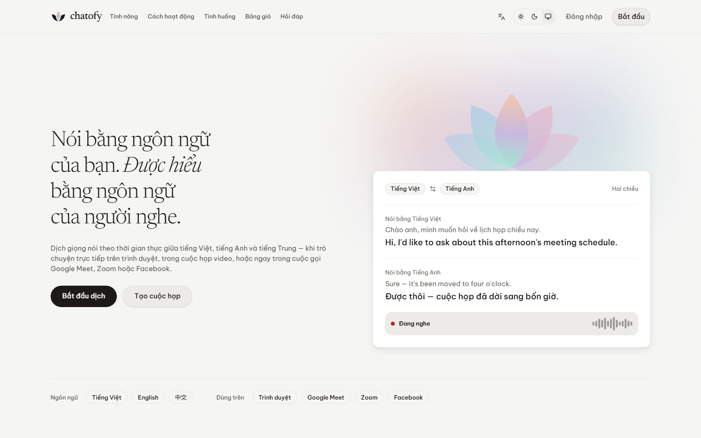

Trang giới thiệu trình bày sản phẩm, ba tình huống sử dụng và bảng giá (`/pricing`). Trang có dữ liệu có cấu trúc
(JSON-LD), sitemap và tệp `llms.txt` để công cụ tìm kiếm và trợ lý AI đọc được.

### 4.4.2 Đăng ký và đăng nhập

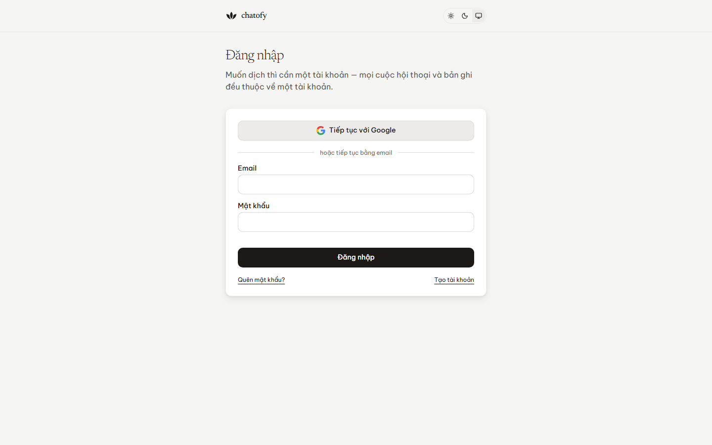

Người dùng đăng nhập bằng email và mật khẩu hoặc bằng tài khoản Google. Liên kết "Tạo tài khoản" dẫn tới trang đăng
ký; tài khoản chỉ được tạo khi người dùng bấm liên kết xác thực gửi qua email.

### 4.4.3 Dịch hội thoại

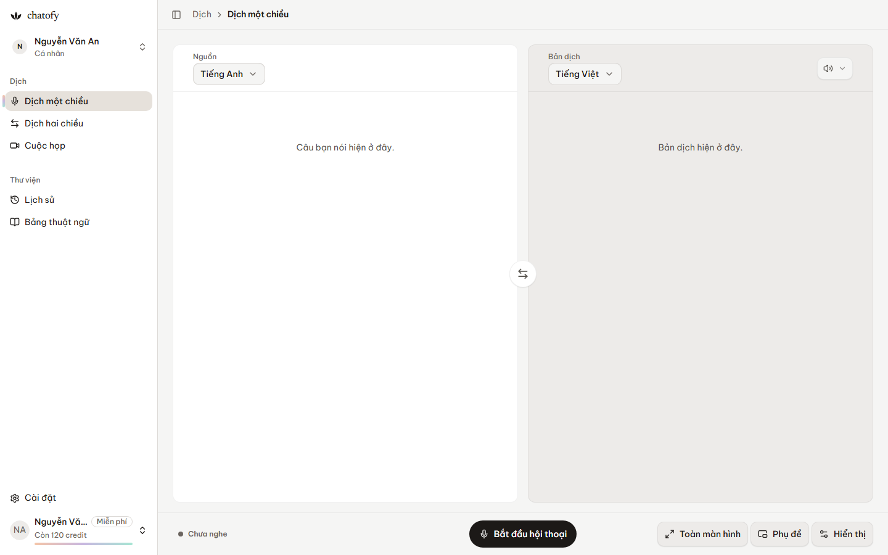

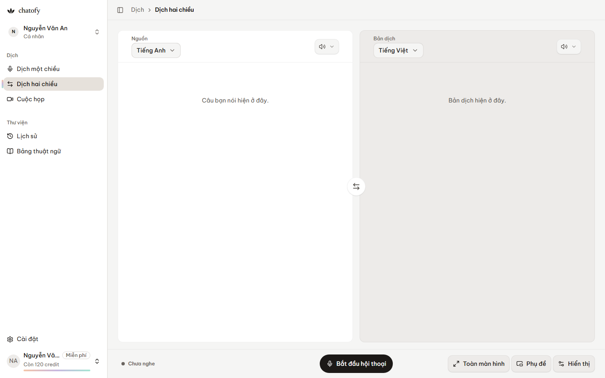

<!-- TODO nhóm: thay Hình 4.3 hoặc 4.4 bằng ảnh đang dịch thật (văn bản nguồn và bản dịch đang hiện). Máy chụp
ảnh không build được sidecar tiếng nói (mạng chặn chứng chỉ TLS), nên chỉ chụp được trạng thái chờ. -->

Thanh bên trái là điều hướng chính: dịch một chiều, dịch hai chiều, cuộc họp, lịch sử, bảng thuật ngữ, cài đặt, cùng
số credit còn lại. Thanh dưới cùng có nút bắt đầu hội thoại (nút duy nhất dùng màu nhấn trên màn hình), các nút toàn
màn hình, phụ đề và hiển thị.

Màn hình dịch gồm hai tấm: văn bản nguồn và bản dịch. Trong lúc người dùng nói, văn bản nguồn hiện dần theo từng lần cập
nhật, bản dịch tạm xuất hiện phía sau; khi lượt kết thúc, chữ tạm chuyển dần thành chữ chính thức thay vì bị thay thế đột
ngột. Bộ chọn ngôn ngữ nguồn có tuỳ chọn tự nhận diện. Nút đổi chiều dịch làm hai tấm hoán đổi vị trí.

### 4.4.4 Lịch sử hội thoại

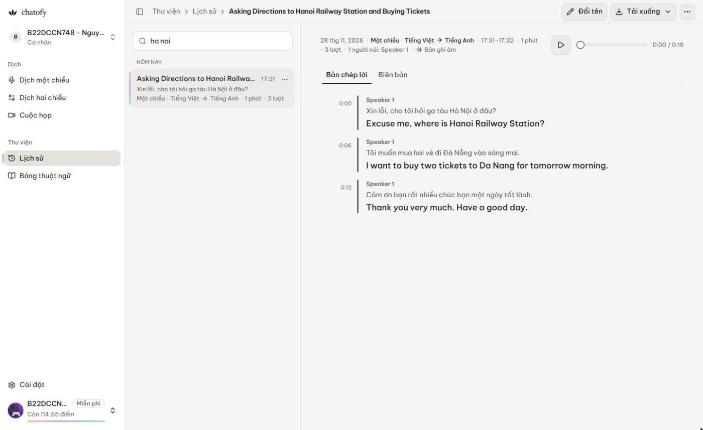

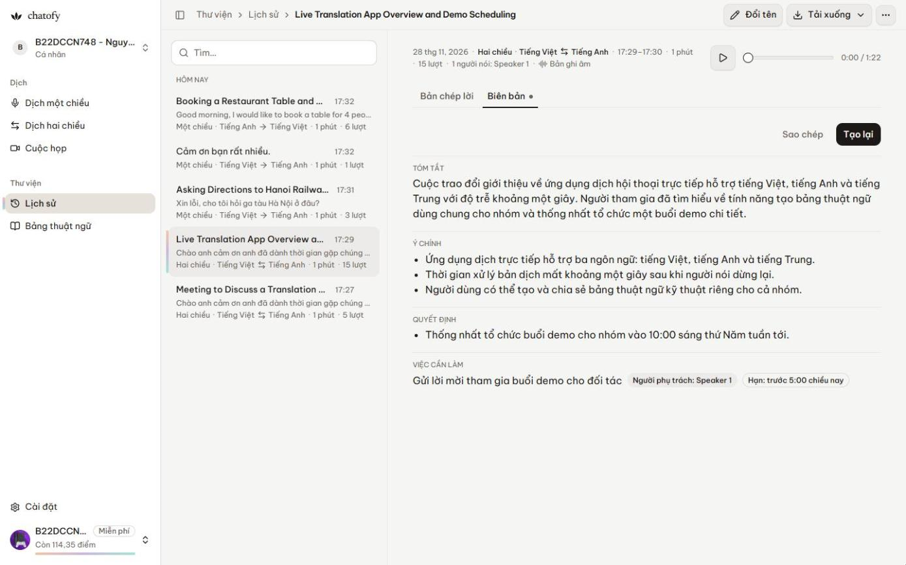

Trang lịch sử liệt kê các hội thoại đã lưu, tìm kiếm không phân biệt dấu tiếng Việt (nhờ chuẩn hoá văn bản ở cả phía ghi
và phía truy vấn, kết hợp chỉ mục trigram): trong Hình 4.5, từ khoá "ha noi" tìm ra hội thoại có cụm "ga tàu Hà Nội".
Trang chi tiết có hai thẻ. Thẻ Bản chép lời (khung bên phải của Hình 4.5) hiển thị từng lượt nói kèm thời điểm, văn bản
gốc và bản dịch; ở chế độ hai chiều, các lượt tiếng Việt và tiếng Anh xen kẽ và mỗi lượt được dịch sang ngôn ngữ còn
lại. Thẻ Biên bản (Hình 4.6) sinh biên bản bằng mô hình ngôn ngữ lớn từ các lượt nói, gồm tóm tắt, ý chính, quyết định
và việc cần làm kèm người phụ trách và hạn. Thanh phía trên cho phép nghe lại bản ghi âm của hội thoại.

### 4.4.5 Thuật ngữ và ngữ cảnh dịch

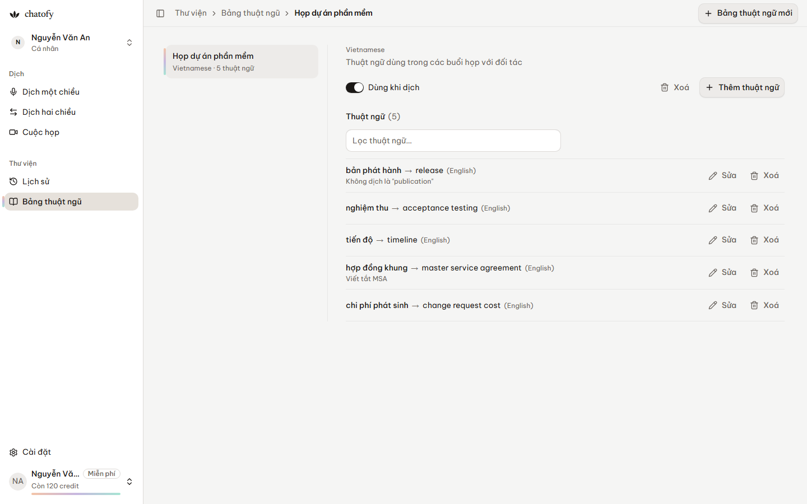

Mỗi bảng thuật ngữ có ngôn ngữ nguồn, công tắc "Dùng khi dịch" và danh sách mục thuật ngữ kèm ghi chú. Khi bảng được
bật, các mục thuật ngữ được đưa vào lời nhắc dịch để tên riêng và thuật ngữ chuyên ngành được dịch nhất quán.

### 4.4.6 Họp video

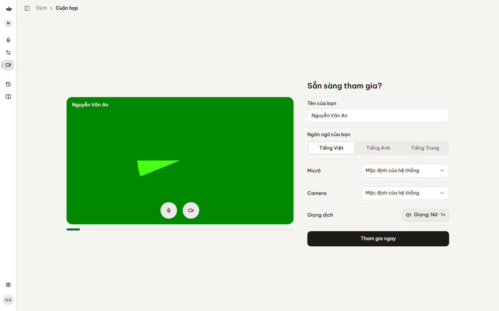

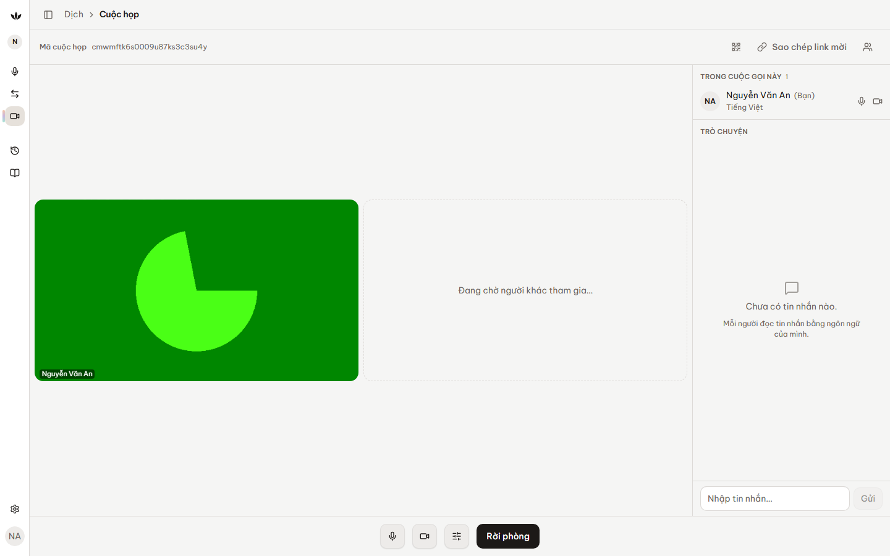

<!-- Ghi chú: khung video màu xanh là camera giả lập của trình duyệt dùng khi chụp tự động. Nhóm có thể thay bằng
ảnh cuộc họp thật có hai người và phụ đề. -->

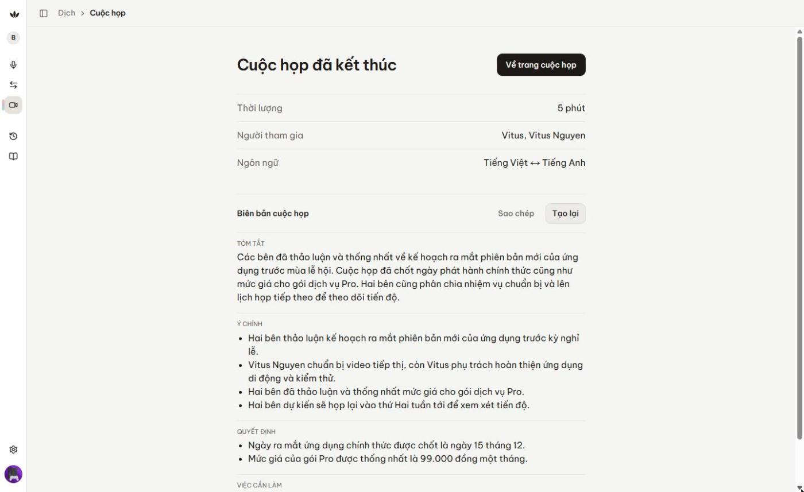

Sảnh chờ cho xem trước camera, chọn tên hiển thị, ngôn ngữ nói, micro, camera và giọng đọc bản dịch. Trong phòng họp,
danh sách người tham gia ghi rõ ngôn ngữ của từng người; khung trò chuyện dịch tin nhắn theo ngôn ngữ của người đọc.
Thanh trên cùng có mã cuộc họp, mã QR và nút sao chép liên kết mời.

Trong phòng họp, mỗi người thấy phụ đề bằng ngôn ngữ của mình. Menu phụ đề và âm thanh cho phép tắt giọng đọc bản dịch
hoặc chỉ xem phụ đề. Người dùng điện thoại có thể vào phòng bằng cách quét mã QR. Thanh bên và khung chat có thể kéo để
đổi kích thước. Khi chủ phòng kết thúc họp, mọi người được chuyển tới màn hình kết thúc (Hình 4.10) với thời lượng,
danh sách người tham gia, cặp ngôn ngữ và biên bản do mô hình ngôn ngữ lớn sinh từ các lượt nói, gồm tóm tắt, ý chính,
quyết định và việc cần làm.

### 4.4.7 Tiện ích Chrome

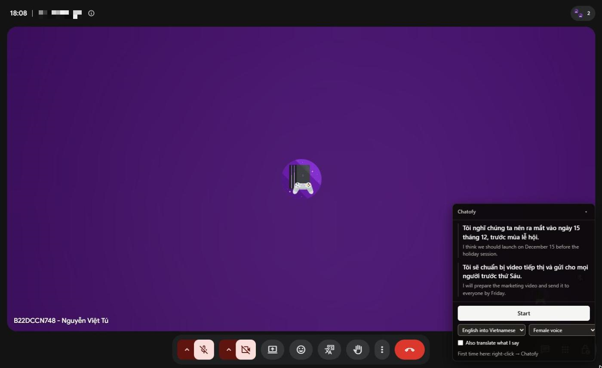

Tiện ích thu âm thanh của tab cuộc gọi, nên dịch được lời của những người khác mà không bị lẫn với âm thanh phát ra. Bản
dịch hiện trong một khung nằm trên trang cuộc gọi (Hình 4.11): mỗi lượt có bản dịch ở dòng trên và câu gốc ở dòng dưới,
kèm nút bắt đầu/dừng, cặp ngôn ngữ và giọng đọc. Chiều ngược lại (dịch lời người dùng và phát vào cuộc gọi) được tắt mặc
định.

### 4.4.8 Cài đặt và credit

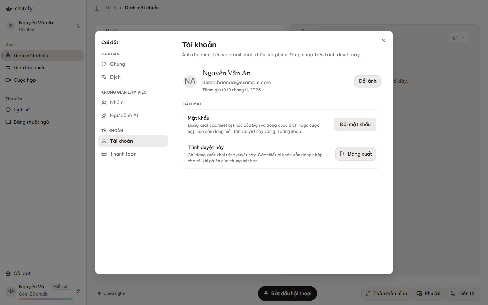

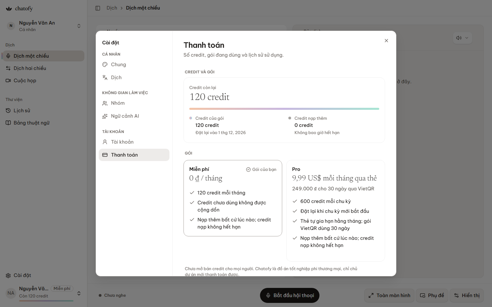

Cài đặt là một hộp thoại mở trên trang hiện tại, chia thành ba nhóm: cá nhân (chung, dịch), không gian làm việc (nhóm,
ngữ cảnh AI) và tài khoản (tài khoản, thanh toán). Mục Thanh toán hiển thị số credit còn lại, phân bổ giữa credit của gói
và credit nạp thêm, và hai gói Miễn phí, Pro.

## 4.5 Kiểm thử

### 4.5.1 Chiến lược kiểm thử

Hệ thống được kiểm thử ở năm mức:

1. **Kiểm thử đơn vị** bằng Vitest cho mọi package TypeScript và bằng pytest cho hai sidecar Python.
2. **Kiểm thử đầu-cuối API**, gồm một bộ chạy trên PostgreSQL thật sau khi áp dụng toàn bộ migration.
3. **Kiểm thử trên trình duyệt thật** bằng Playwright: tiện ích Chrome trên Chromium; luồng dịch với micro được thay bằng
   tệp WAV, phần còn lại (AudioWorklet, bộ lấy mẫu lại, socket, giao diện) chạy thật.
4. **Kiểm thử phát lại** (_replay_): phát lại bản ghi hội thoại thật qua chính sách phân lượt, qua API dev hoặc
   production, để đo độ trễ, độ chính xác nhận diện ngôn ngữ và khả năng chịu rớt kết nối.
5. **Kiểm tra thiết kế tự động**: ngân sách màu nhấn, số bề mặt nổi, ngưỡng tương phản và tính nhất quán của design token
   được viết thành test.

### 4.5.2 Kết quả kiểm thử tự động

**Bảng 4.4. Kết quả kiểm thử trên CI (16/11/2026, nhánh `main`)**

| Bộ kiểm thử                | Số test đạt | Bỏ qua | Lỗi   |
| -------------------------- | ----------- | ------ | ----- |
| `web`                      | 2.406       | 0      | 0     |
| `api` (đơn vị)             | 2.064       | 0      | 0     |
| `@chatofy/realtime-client` | 598         | 8      | 0     |
| `@chatofy/ai-providers`    | 404         | 0      | 0     |
| `extension` (đơn vị)       | 271         | 0      | 0     |
| `@chatofy/types`           | 230         | 0      | 0     |
| `@chatofy/ui`              | 207         | 0      | 0     |
| `mobile`                   | 206         | 0      | 0     |
| `@chatofy/i18n`            | 40          | 0      | 0     |
| `@chatofy/api-client`      | 38          | 0      | 0     |
| Script gốc                 | 14          | 0      | 0     |
| API e2e                    | 63          | 12     | 0     |
| API e2e (PostgreSQL)       | 261         | 0      | 0     |
| Extension e2e (Chromium)   | 78          | 0      | 0     |
| Realtime replay            | 121         | 1      | 0     |
| Sidecar STT (pytest)       | 58          | 7      | 0     |
| Sidecar TTS (pytest)       | 100         | 0      | 0     |
| **Tổng**                   | **7.159**   | **28** | **0** |

Cả 13 job của workflow CI đều thành công. Lint và kiểm tra kiểu chạy sạch trên mọi workspace.

Để so sánh, khi bắt đầu giai đoạn xây dựng luồng dịch tiếng nói (giữa tháng 7/2026) API có 82 test, ứng dụng web chưa có test và chưa có lint, và CI chỉ chạy lint,
kiểm tra kiểu và build. Việc bổ sung test cho web xuất phát từ một quan sát cụ thể: cả ba lỗi nghiêm trọng của một vòng phát
triển đều nằm trong mã phía client chưa có test, trong khi lint, kiểm tra kiểu và build đều xanh (mục 3.5.3).

### 4.5.3 Kiểm tra thiết kế tự động

Hai quy tắc thiết kế khó kiểm tra bằng mắt được viết thành test:

- **Ngân sách màu nhấn:** mỗi trạng thái màn hình ứng dụng (trang dịch, lịch sử, glossary, phòng họp, hộp thoại cài đặt…)
  có tối đa một nút tô màu nhấn chính. Trang giới thiệu cho phép tối đa một nút mỗi phần.
- **Số bề mặt nổi:** tối đa hai bề mặt nổi trên một màn hình.

Bảng các vi phạm đã biết được kiểm tra theo cả hai chiều: khi một vi phạm được sửa, test buộc phải xoá dòng tương ứng. Bảng
này hiện rỗng. Ngoài ra, các test kiểm tra ngưỡng tương phản của mọi cặp màu chữ–nền và sự đồng bộ của design token giữa
chế độ sáng và tối.

Giới hạn của cách làm này: môi trường test (happy-dom) không có mô hình hộp, nên căn lề, tràn khung và mọi thứ đo bằng pixel
vẫn phải kiểm tra thủ công ở ba kích thước màn hình.

### 4.5.4 Kiểm thử khả năng chịu lỗi

**Rớt kết nối.** Bộ đo `benchmarks/socket-drop` dùng một proxy cắt kết nối phía trình duyệt ở giây thứ 45 trong khi giữ
nguyên phía API. Trên production, với cùng một bản ghi, hội thoại giữ được 19/19 lượt, trình duyệt kết nối lại một lần sau
593 ms và gửi lại lượt chưa được trả lời. Cơ chế heartbeat 15 giây giải phóng socket chết sau khoảng 30 giây.

**Quá tải sidecar.** Khi chạy đồng thời một phiên tự nhận diện và hai phiên hai chiều, sidecar STT nhận 20.632 yêu cầu và không
trả lỗi 503 nào. Năm socket hai chiều mở cùng lúc từ một tài khoản nhận một phiên hai chiều và bốn phiên một chiều có ghi lý do
giới hạn, không phát sinh lỗi.

**Hạn mức dịch máy.** Test đơn vị mô phỏng nhà cung cấp trả lỗi 429 và kiểm tra hệ thống chờ đúng thời gian yêu cầu, chuyển sang
mô hình dự phòng, và vẫn giữ văn bản nguồn khi việc dịch thất bại.

### 4.5.5 Đối chiếu tiêu chí thành công

**Bảng 4.5. Đối chiếu với tiêu chí thành công đặt ra**

| Tiêu chí                                           | Kết quả                                                                                                                                                                              | Đánh giá                                                 |
| -------------------------------------------------- | ------------------------------------------------------------------------------------------------------------------------------------------------------------------------------------ | -------------------------------------------------------- |
| Độ trễ đầu-cuối dưới 2 s                           | Phòng thí nghiệm: 907 ms p50, 1.582 ms p95. Production, giọng thật: 1,54 s p50 khi dùng lại bản dịch suy đoán, 2,16 s khi không                                                      | Đạt trong phòng thí nghiệm; đạt một phần trên production |
| Hội thoại 10 phút không rớt                        | Rớt kết nối giữa chừng được tự nối lại, giữ 19/19 lượt trên production. Chưa có phép đo riêng cho hội thoại liên tục 10 phút                                                         | Đạt một phần                                             |
| Ít nhất 70% bản dịch đúng                          | 77,8% lượt không có lỗi nghiêm trọng nào, kể cả lỗi nghe (162 lượt, 17 hội thoại). Bổ sung ngữ cảnh cho hậu biên tập giảm lỗi dịch nghiêm trọng chiều Việt → Anh từ 23,7% xuống 1,3% | Đạt                                                      |
| 120 credit miễn phí mỗi tháng, chặn khi hết        | Đã triển khai sổ cái credit, đo theo giây, không mở phiên khi dưới 1 credit                                                                                                          | Đạt                                                      |
| Người dùng thử tự cài đặt và dùng không cần hỗ trợ | Chưa tổ chức thử nghiệm người dùng                                                                                                                                                   | Chưa đánh giá                                            |

## 4.6 Kết luận

Chương 4 đã trình bày môi trường triển khai tự quản với hai bộ dịch vụ tách biệt, quy trình CI gồm 13 job và quy trình triển
khai có sao lưu trước migration, giao diện của các chức năng chính, và kết quả kiểm thử. Tại thời điểm viết báo cáo, hệ thống
có 7.159 test tự động đều đạt, các quy tắc thiết kế được kiểm tra bằng test, và khả năng chịu rớt kết nối đã được kiểm chứng
trên production. Trong năm tiêu chí thành công, hai tiêu chí đạt, hai tiêu chí đạt một phần, và một tiêu chí chưa được đánh giá
do chưa tổ chức thử nghiệm với người dùng.

<!--
Đã chụp (19/11/2026, bản local, 1440×900, chế độ sáng, tiếng Việt, tài khoản thử demo.baocao@example.com):
4.1, 4.2, 4.3, 4.4, 4.7, 4.8, 4.9, 4.12, 4.13 — thư mục anh/. 4.5, 4.6, 4.10, 4.11 chụp ngày 28/11/2026 trên production (1440×881, riêng 4.6 ở 1440×900, tài khoản thử B22DCCN748, dữ liệu từ kịch bản đọc thật); mã cuộc họp trong 4.11 đã được làm mờ.
Danh sách ảnh ban đầu:
4.1 /  ·  4.2 /login  ·  4.3 /translate/one-way khi đang dịch  ·  4.4 /translate/two-way khi đang dịch
4.5 /history  ·  4.6 /history/[id]  ·  4.7 /glossary  ·  4.8 /conference sảnh  ·  4.9 phòng họp 2 người có phụ đề
4.10 màn hình kết thúc họp  ·  4.11 popup extension trên Google Meet  ·  4.12 hộp thoại cài đặt  ·  4.13 trang credit
-->

# KẾT LUẬN

## 1. Kết quả đạt được

Đồ án đã xây dựng hệ thống Chatofy, cho phép những người không cùng ngôn ngữ trò chuyện với nhau bằng tiếng Việt, tiếng
Anh và tiếng Trung. Hệ thống đang chạy trên production và phục vụ ba tình huống: hội thoại trực tiếp trên web, họp video
có dịch, và cuộc gọi trên Google Meet, Zoom, Facebook qua tiện ích Chrome.

Đối chiếu với các mục tiêu đặt ra ở phần Mở đầu:

- **Độ trễ dưới 2 giây:** đạt trong điều kiện phòng thí nghiệm (907 ms p50, 1.582 ms p95). Trên production với giọng nói
  thật, độ trễ trung vị là 1,54 s khi bản dịch suy đoán được dùng lại và 2,16 s khi không.
- **Tiếng nói chạy cục bộ trên CPU:** đạt. Nhận dạng tiếng Việt cục bộ nhanh hơn dịch vụ đám mây 13,3 lần với cùng độ chính
  xác từ; tổng hợp tiếng Việt dạng luồng phát âm thanh đầu tiên sau khoảng 0,2 s.
- **Hội thoại hai chiều Việt–Anh:** đạt. Lượt nói từ 1,5 giây trở lên được nhận đúng ngôn ngữ trong toàn bộ 85 lượt phát lại;
  nhãn ngôn ngữ hiện ra trong 3,3 s (p95) trên production.
- **Dùng chung luồng dịch cho ba tình huống:** đạt; họp video và tiện ích Chrome dùng lại cùng luồng xử lý và cùng package
  client với trang dịch.
- **Đánh giá bằng thực nghiệm tái lập được:** đạt, với khoảng 25 bộ đo và 7.159 test tự động.

Về chất lượng dịch, 77,8% lượt trong 162 lượt hội thoại thật không có lỗi nghiêm trọng, vượt mức 70% đặt ra; sau khi bổ
sung ngữ cảnh cho bước hậu biên tập, lỗi dịch nghiêm trọng chiều Việt → Anh giảm từ 23,7% xuống 1,3% trên cùng tập lượt.

Qua quá trình thực hiện, nhóm rút ra rằng trong một hệ thống thời gian thực, quyết định đúng thường đến từ việc đo đúng
chỗ hơn là từ việc chọn mô hình mạnh hơn: cảm giác "giật" hoá ra là vấn đề phản hồi giao diện; thứ hạng mô hình đảo ngược
khi chuyển từ tập kiểm tra sạch sang âm thanh thật; và một cơ chế tăng tốc đã qua mọi kiểm thử nhưng chưa bao giờ có hiệu lực.

## 2. Hạn chế

- **Dịch máy vẫn phụ thuộc đám mây**, nên hệ thống chưa chạy được hoàn toàn ngoại tuyến và độ trễ chịu ảnh hưởng của nhà
  cung cấp (khoảng 500 ms tới token đầu tiên).
- **Giấy phép mô hình nhận dạng tiếng Việt** (CC-BY-NC-ND-4.0) chỉ cho phép dùng phi thương mại; hệ thống chưa thể bán công
  khai nếu chưa thay mô hình.
- **Chưa tự nhận diện được tiếng Trung**: các cặp có tiếng Trung chỉ chạy một chiều.
- **Khả năng phục vụ đồng thời còn nhỏ.** Toàn bộ phần tiếng nói chạy trên một máy chủ không có GPU, nên hệ thống
  giới hạn tối đa 6 lượt dịch được xử lý cùng lúc, tương đương hai người nói liên tục, trong đó các cuộc họp
  dùng tối đa 4 (mục 3.9.2). Vượt mức này, các sidecar dùng quá số nhân CPU và mọi lượt cùng chậm đi. Mỗi lượt
  chỉ kéo dài vài giây nên số người dùng cùng lúc có thể lớn hơn 6, nhưng khi vượt giới hạn, lượt mới bị từ chối
  trên trang dịch hoặc bị bỏ qua ở nhánh họp. Đồ án chưa đo sức chịu tải theo số người dùng đồng thời, và chưa có cơ chế chạy nhiều bản sao
  sidecar tiếng nói trên nhiều máy.
- **Chất lượng dịch trong họp video** còn kém trang dịch trực tiếp 2,5–4,2 điểm phần trăm lỗi nghiêm trọng; khi nhiều người
  nói liên tục, nhánh dịch của cuộc họp bị bỏ bớt lượt.
- **Chưa kiểm chứng đầy đủ** cuộc họp giữa hai mạng thực khác nhau (Wi-Fi và 4G), tiếng vọng trên loa ngoài của máy tính, và
  thử nghiệm với người dùng thật.
- **Ứng dụng di động** mới chạy ở bản phát triển, chưa phát hành.

## 3. Hướng phát triển

- Chạy dịch máy cục bộ hoặc dùng mô hình dịch nhỏ cho các cặp phổ biến, tiến tới chế độ ngoại tuyến hoàn toàn.
- Thay mô hình nhận dạng tiếng Việt bằng mô hình có giấy phép thương mại và đo lại chất lượng trên âm thanh thật.
- Nhận diện tự động tiếng Trung khi có mô hình chạy CPU đạt ngưỡng chính xác, hoặc khi có GPU.
- Mở rộng theo chiều ngang: chạy nhiều bản sao sidecar tiếng nói sau một bộ cân bằng tải, chuyển giới hạn lượt
  đồng thời từ bộ nhớ của một tiến trình API sang Redis để dùng chung giữa nhiều máy, và đo sức chịu tải theo số
  người dùng đồng thời.
- Rút ngắn mệnh đề đầu tiên đưa vào tổng hợp tiếng nói tiếng Anh, hướng tới độ trễ âm thanh khoảng 0,5 s cho khâu này.
- Hoàn thiện và phát hành ứng dụng di động; tổ chức thử nghiệm với người dùng thật.
- Mở rộng thêm ngôn ngữ thông qua registry ngôn ngữ, và đưa hệ thống credit sang bán công khai sau khi hoàn tất danh sách
  kiểm tra trước khi ra mắt.

# TÀI LIỆU THAM KHẢO

<!--
Ghi chú biên soạn:
- Đánh số theo thứ tự xuất hiện lần đầu trong báo cáo (chuẩn IEEE).
- Ngày truy cập các nguồn trực tuyến: 19/11/2026.
-->

[1] Google, "Live API," Gemini API documentation. [Online]. Available: https://ai.google.dev/gemini-api/docs/live

[2] Microsoft, "Microsoft Translator multi-device conversation help and FAQs." [Online]. Available: https://www.microsoft.com/en-us/translator/help/live-feature/ (truy cập 19/11/2026).

[3] Microsoft Translator Blog, "Transitioning the Microsoft Translator web app to a simplified experience," 03/08/2022. [Online]. Available: https://www.microsoft.com/en-us/translator/blog/2022/08/03/transitioning-the-microsoft-translator-web-app-to-a-simplified-experience (truy cập 19/11/2026).

[4] Google Workspace Updates, "Real-time speech translation in Google Meet expands to 63 languages with automatic language detection," 22/10/2026. [Online]. Available: https://workspaceupdates.googleblog.com/2026/10/real-time-speech-translation-in-google-Meet-expands-to-63-languages-with-automatic-language-detection.html (truy cập 19/11/2026).

[5] Zoom, "Translated captions," Zoom Blog. [Online]. Available: https://www.zoom.com/en/blog/translated-captions (truy cập 19/11/2026).

[6] A. Graves, "Sequence transduction with recurrent neural networks," arXiv:1211.3711, 2012.

[7] Z. Yao, L. Guo, X. Yang, W. Kang, F. Kuang, Y. Yang, Z. Jin, L. Lin, and D. Povey, "Zipformer: A faster and better encoder for automatic speech recognition," in _Proc. Int. Conf. Learning Representations (ICLR)_, 2024.

[8] D. Rekesh, N. R. Koluguri, S. Kriman, S. Majumdar, V. Noroozi, H. Huang, O. Hrinchuk, K. Puvvada, A. Kumar, J. Balam, and B. Ginsburg, "Fast Conformer with linearly scalable attention for efficient speech recognition," in _Proc. IEEE Automatic Speech Recognition and Understanding Workshop (ASRU)_, 2023.

[9] H. Xu, F. Jia, S. Majumdar, H. Huang, S. Watanabe, and B. Ginsburg, "Efficient sequence transduction by jointly predicting tokens and durations," in _Proc. Int. Conf. Machine Learning (ICML)_, 2023.

[10] A. Radford, J. W. Kim, T. Xu, G. Brockman, C. McLeavey, and I. Sutskever, "Robust speech recognition via large-scale weak supervision," in _Proc. Int. Conf. Machine Learning (ICML)_, 2023.

[11] T.-T. Le, L. T. Nguyen, and D. Q. Nguyen, "PhoWhisper: Automatic speech recognition for Vietnamese," in _Proc. ICLR 2024 Tiny Papers Track_, 2024.

[12] Z. Gao, S. Zhang, I. McLoughlin, and Z. Yan, "Paraformer: Fast and accurate parallel transformer for non-autoregressive end-to-end speech recognition," in _Proc. Interspeech_, 2022.

[13] Silero Team, "Silero VAD: pre-trained enterprise-grade voice activity detector," GitHub repository. [Online]. Available: https://github.com/snakers4/silero-vad

[14] V. Pratap et al., "Scaling speech technology to 1,000+ languages," _Journal of Machine Learning Research_, vol. 25, no. 97, pp. 1–52, 2024.

[15] F. Jia, N. R. Koluguri, J. Balam, and B. Ginsburg, "AmberNet: A compact end-to-end model for spoken language identification," arXiv:2210.15781, 2022.

[16] H. Wang, S. Zheng, Y. Chen, L. Cheng, and Q. Chen, "CAM++: A fast and efficient network for speaker verification using context-aware masking," in _Proc. Interspeech_, 2023.

[17] pnnbao97, "VieNeu-TTS," GitHub repository. [Online]. Available: https://github.com/pnnbao97/VieNeu-TTS

[18] ITU-T, "Methods for subjective determination of transmission quality," Recommendation P.800, International Telecommunication Union, 1996.

[19] K. Papineni, S. Roukos, T. Ward, and W.-J. Zhu, "BLEU: A method for automatic evaluation of machine translation," in _Proc. 40th Annu. Meeting of the Association for Computational Linguistics (ACL)_, 2002, pp. 311–318.

[20] M. Popović, "chrF: Character n-gram F-score for automatic MT evaluation," in _Proc. 10th Workshop on Statistical Machine Translation (WMT)_, 2015, pp. 392–395.

[21] R. Rei, C. Stewart, A. C. Farinha, and A. Lavie, "COMET: A neural framework for MT evaluation," in _Proc. Conf. Empirical Methods in Natural Language Processing (EMNLP)_, 2020, pp. 2685–2702.

[22] R. Rei _et al._, "CometKiwi: IST-Unbabel 2022 submission for the quality estimation shared task," in _Proc. 7th Conf. Machine Translation (WMT)_, 2022.

[23] A. Lommel, H. Uszkoreit, and A. Burchardt, "Multidimensional Quality Metrics (MQM): A framework for declaring and describing translation quality metrics," _Tradumàtica_, no. 12, pp. 455–463, 2014.

[24] L. Zheng _et al._, "Judging LLM-as-a-judge with MT-Bench and Chatbot Arena," in _Advances in Neural Information Processing Systems (NeurIPS), Datasets and Benchmarks Track_, 2023.

[25] I. Fette and A. Melnikov, "The WebSocket Protocol," RFC 6455, IETF, 2011.

[26] H. Alvestrand, "Overview: Real-time protocols for browser-based applications," RFC 8825, IETF, 2021.

[27] A. Keranen, C. Holmberg, and J. Rosenberg, "Interactive Connectivity Establishment (ICE): A protocol for Network Address Translator (NAT) traversal," RFC 8445, IETF, 2018.

[28] NestJS, "NestJS documentation." [Online]. Available: https://docs.nestjs.com

[29] Vercel, "Next.js documentation." [Online]. Available: https://nextjs.org/docs

[30] Prisma, "Prisma ORM documentation." [Online]. Available: https://www.prisma.io/docs

[31] k2-fsa, "sherpa-onnx: Speech-to-text, text-to-speech and speaker recognition using next-gen Kaldi with onnxruntime," GitHub repository. [Online]. Available: https://github.com/k2-fsa/sherpa-onnx

[32] Cloudflare, "Cloudflare Realtime SFU documentation." [Online]. Available: https://developers.cloudflare.com/realtime/sfu/

[33] hexgrad, "Kokoro-82M," Hugging Face model card. [Online]. Available: https://huggingface.co/hexgrad/Kokoro-82M

[34] DeepSeek, "DeepSeek API documentation." [Online]. Available: https://api-docs.deepseek.com

[35] Google, "Chrome Extensions: Manifest V3." [Online]. Available: https://developer.chrome.com/docs/extensions/

[36] N. Jeffries, E. King, M. Kudlur, G. Nicholson, J. Wang, and P. Warden, "Moonshine: Speech recognition for live transcription and voice commands," arXiv:2410.15608, 2024.

[37] H.-T. Luong and H.-Q. Vu, "A non-expert Kaldi recipe for Vietnamese speech recognition system," in _Proc. 3rd Int. Workshop on Worldwide Language Service Infrastructure and 2nd Workshop on Open Infrastructures and Analysis Frameworks for Human Language Technologies (WLSI/OIAF4HLT)_, 2016, pp. 51–55.

[38] V. Panayotov, G. Chen, D. Povey, and S. Khudanpur, "Librispeech: An ASR corpus based on public domain audio books," in _Proc. IEEE Int. Conf. Acoustics, Speech and Signal Processing (ICASSP)_, 2015, pp. 5206–5210.

[39] hynt, "Zipformer-30M-RNNT-6000h," Hugging Face model card. [Online]. Available: https://huggingface.co/hynt/Zipformer-30M-RNNT-6000h

[40] Peng Cheng Laboratory, "PengChengStarling: Multilingual ASR toolkit built on icefall," Hugging Face model card. [Online]. Available: https://huggingface.co/stdo/PengChengStarling

[41] ElevenLabs, "Speech to Text (Scribe v2)," ElevenLabs documentation. [Online]. Available: https://elevenlabs.io/docs/capabilities/speech-to-text

[42] A. Conneau, M. Ma, S. Khanuja, Y. Zhang, V. Axelrod, S. Dalmia, J. Riesa, C. Rivera, and A. Bapna, "FLEURS: Few-shot learning evaluation of universal representations of speech," in _Proc. IEEE Spoken Language Technology Workshop (SLT)_, 2023, pp. 798–805.

[43] H. Bu, J. Du, X. Na, B. Wu, and H. Zheng, "AISHELL-1: An open-source Mandarin speech corpus and a speech recognition baseline," in _Proc. 20th Conf. Oriental Chapter of the Int. Coordinating Committee on Speech Databases and Speech I/O Systems and Assessment (O-COCOSDA)_, 2017, pp. 1–5.

[44] K. An et al., "FunAudioLLM: Voice understanding and generation foundation models for natural interaction between humans and LLMs," arXiv:2407.04051, 2024.

[45] valkayuh, "dewpoint," Hugging Face model card. [Online]. Available: https://huggingface.co/valkayuh/dewpoint

[46] Q. Chen, M. Chen, B. Li, and W. Wang, "Controllable time-delay transformer for real-time punctuation prediction and disfluency detection," in _Proc. IEEE Int. Conf. Acoustics, Speech and Signal Processing (ICASSP)_, 2020, pp. 8069–8073.

[47] Rhasspy, "Piper: A fast, local neural text to speech system," GitHub repository. [Online]. Available: https://github.com/rhasspy/piper

[48] zeroweight-ai, "ZeroTTS," Hugging Face model card. [Online]. Available: https://huggingface.co/zeroweight-ai/ZeroTTS
